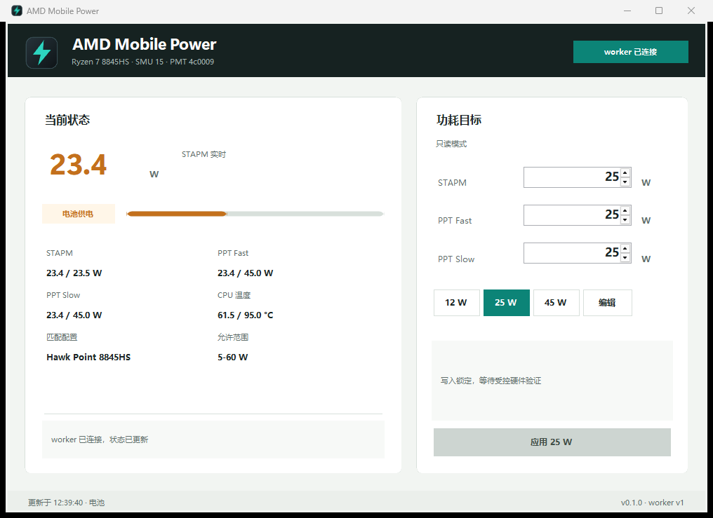

# AMD Mobile Power

AMD Mobile Power is an early-development Windows utility for monitoring and,
after supervised validation, controlling firmware power limits on supported AMD
thin-and-light laptops.

> Status: no public release yet. The normal GUI and packaged build are read-only.
> Hardware write support is present but requires two explicit development flags
> and has not completed its first supervised real-hardware write test.



## Current Features

- Native WinForms dashboard with taskbar and notification-area integration.
- Hidden named-pipe worker process isolated from the GUI.
- One-second STAPM, Fast, Slow, temperature, and power-line refresh.
- Automatic CPU family, SMU interface, PM table, and profile detection.
- Editable 12 W, 25 W, and 45 W quick presets.
- Optional battery/AC policy controls, disabled in read-only mode.
- Read-back verification, firmware-clamp reporting, and write restoration.
- Diagnostics export with platform, telemetry, process architecture, and
  runtime-file hashes.
- Self-contained Windows x64 portable ZIP and current-user install/uninstall
  scripts.
- GitHub Actions build, test, RyzenAdj build, and package-artifact workflow.

## Safety

Changing firmware power limits can cause instability, overheating, battery
wear, data loss, or hardware damage. Use conservative values. This project is
not affiliated with AMD or laptop manufacturers.

Some platforms lock sustained limits in BIOS or the embedded controller. A
successful RyzenAdj call does not guarantee that the requested value survives
read-back.

Do not run AMD Mobile Power alongside the legacy `RyzenPower`, `ryzenadj`, or
AMD Ryzen Master processes. The application intentionally refuses to become a
second hardware owner.

## Quick Start

The current development package is located at:

```text
artifacts/packages/amd-mobile-power-v0.1.0-win-x64.zip
```

Extract the ZIP and run `AmdMobilePower.exe`. This starts in read-only mode.
See `docs/INSTALLATION.md` before using `install.ps1`.

## Documentation

- `docs/README.md` is the documentation index and authority order.
- `docs/DEV_STATUS.md` records the current implementation and next task.
- `docs/SUPPORTED_HARDWARE.md` explains current compatibility evidence.
- `docs/SECURITY.md` documents hardware and driver safety boundaries.
- `docs/BUILDING.md` covers application and RyzenAdj builds.
- `docs/PACKAGING.md` covers portable and installed packaging.
- `docs/HARDWARE_TEST_PROCEDURE.md` defines the supervised write-test gate.

## Development

```powershell
git submodule update --init --recursive
dotnet build AmdMobilePower.sln -c Release
dotnet test AmdMobilePower.sln -c Release
.\build-package.ps1 -Version 0.1.0
```

## License

Original project code is licensed under the MIT License. Third-party components
retain their own licenses. Development packages include the reviewed RyzenAdj,
InpOut32, and WinRing0 license texts. See `docs/THIRD_PARTY_NOTICES.md`.

