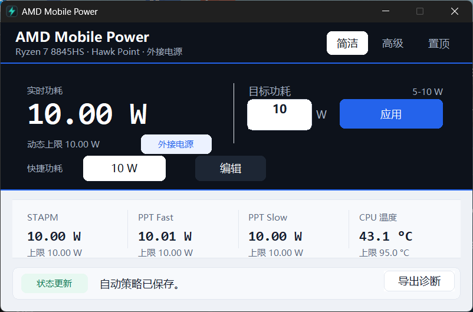
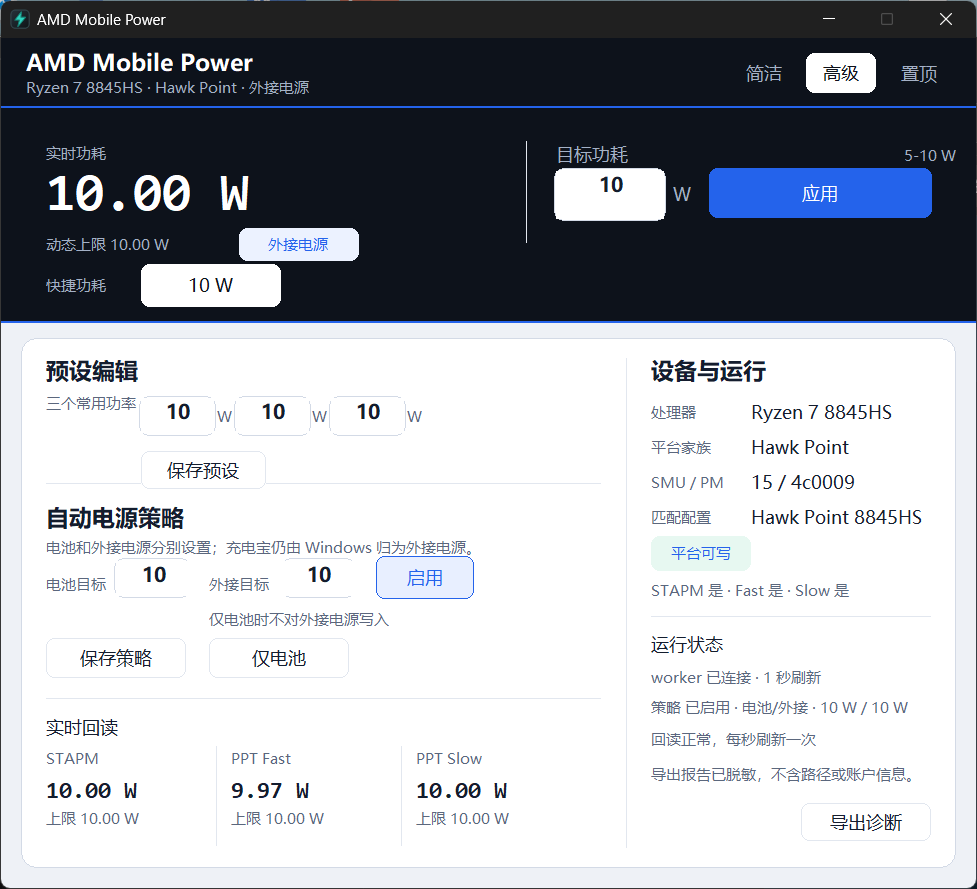

# AMD Mobile Power

AMD Mobile Power is a native Windows utility for monitoring and, after
supervised validation, controlling firmware package-power limits on supported
AMD thin-and-light laptops. It uses a Rust GUI and a separate C++ worker so the
UI and hardware access stay behind a narrow named-pipe contract.

> Status: no public release yet. The current stable-local candidate is
> `1.0.13-native`, validated on one MECHREVO WUJIE15 PRO with a Ryzen 7 8845HS.
> Its GUI, probe, worker, and portable ZIP rebuild byte-identically from the
> same commit. Local publication readiness is `PASS`; the release remains
> `READY_FOR_HUMAN_REVIEW`.
> Broader AMD generation support remains experimental until each device has
> read-only and supervised write evidence.





## Current Capabilities

- Native Rust GUI with simple and advanced modes, persistent always-on-top,
  taskbar integration, notification-area controls, and a custom double-buffered
  canvas.
- C++ worker with STAPM, PPT Fast, PPT Slow, temperature, power-line, and
  read-back telemetry.
- Automatic RyzenAdj family detection and a catalog of conservative fallbacks
  for every family `0-15`. Only `8845HS + PM table 4c0009` is currently marked
  verified.
- Read-only by default. Hardware writes require the explicit
  `--enable-write-controls` launch flag, and every write is followed by a
  read-back.
- Battery and AC policy automation, editable presets, firmware-clamp reporting,
  and restore attempts on partial Fast/Slow failure.
- Packaged WinRing0 install and uninstall helpers. The installer reuses an
  existing valid WinRing0 service instead of taking over another
  installation's driver path.
- Sanitized compatibility reports that contain no local paths, process IDs,
  account names, serial numbers, recent logs, or upload behavior.
- Headless `amd-mobile-power-probe.exe` that produces the same compatibility
  schema without the GUI or PowerShell, and never enables writes.
- Portable ZIP, isolated install/overwrite/uninstall helpers, checksums,
  diagnostics export, and byte-reproducible binaries and packages.

## Safety

Changing firmware power limits can cause instability, overheating, battery
wear, data loss, or hardware damage. Use conservative values and keep a
recovery path.

Some laptops lock sustained limits in the BIOS or embedded controller. A
successful RyzenAdj call does not guarantee that the requested value survives
read-back. The GUI treats PPT Fast/Slow as the required package caps and shows
STAPM separately because firmware may manage or clamp it dynamically.

Do not run AMD Mobile Power alongside legacy `RyzenPower`, `ryzenadj`, or AMD
Ryzen Master processes. The application intentionally refuses to become a
second hardware owner.

The local stable deployment on this development laptop is fixed to a
`10/10/10 W` battery and AC policy. That local choice does not change the
portable package's read-only default.

## Portable Quick Start

Current review candidate:

```text
artifacts/native-packages/amd-mobile-power-v1.0.13-native-win-x64-native-preview.zip
```

- Size: `745,536` bytes
- SHA256:
  `eac6fc73f47dc5912c670ca13610a4d7230ae0f15a277f4e4ddcad93fd906cd7`

1. Extract the complete ZIP to a writable directory.
2. On a fresh Windows host, open an elevated PowerShell in the extracted
   directory and initialize the bundled driver once:

```powershell
powershell -ExecutionPolicy Bypass -File .\install-driver-bootstrap.ps1
```

3. Start the GUI:

```powershell
.\amd-mobile-power-gui.exe
```

The default launch is read-only. A deliberate write-control session can be
started with:

```powershell
.\amd-mobile-power-gui.exe --enable-write-controls --simple-mode
```

For an isolated current-user install, use `install-preview.ps1`. For driver
cleanup, run `uninstall-driver-bootstrap.ps1` from an elevated PowerShell; it
removes the service only when its binary path equals this package's
`%ProgramData%\AmdMobilePower\driver\WinRing0x64.sys`.

To produce a read-only compatibility report without the GUI or PowerShell:

```powershell
.\amd-mobile-power-probe.exe --diagnose --out compatibility.json
```

Hardware access is exclusive, so exit the tray app first if you want live
limits in the report. `--self-test` checks the binary without touching
hardware. See [docs/HEADLESS_DIAGNOSTICS.md](docs/HEADLESS_DIAGNOSTICS.md).

See [docs/INSTALLATION.md](docs/INSTALLATION.md) and
[docs/DEPLOYMENT.md](docs/DEPLOYMENT.md) before enabling writes.

## Compatibility Scope

Verified device:

- MECHREVO WUJIE15 PRO
- AMD Ryzen 7 8845HS with Radeon 780M Graphics
- BIOS `T153_HPT_V05`, Windows 11 build `26300`
- SMU `15`, PM table `4c0009`

Conservative family profiles exist for Renoir/Cezanne/Lucienne,
Rembrandt/Phoenix, Mendocino, Dragon/Fire Range, Krackan/Strix Point,
Strix Halo, and older Vega-based mobile families. These profiles improve
bounds and diagnostics, but remain unverified until real device evidence is
recorded.

The operating system reports many USB-C power banks as external/AC power. A
power bank therefore triggers AC behavior and cannot currently be distinguished
from a wall adapter by the application.

See [docs/SUPPORTED_HARDWARE.md](docs/SUPPORTED_HARDWARE.md),
[docs/HARDWARE_MATRIX.md](docs/HARDWARE_MATRIX.md), and
[docs/COMPATIBILITY_REPORTS.md](docs/COMPATIBILITY_REPORTS.md).

## Development

```powershell
git submodule update --init --recursive
.\native\build.ps1 -Offline
.\native\verify-native.ps1 -NoBuild -VerifyHardware -VerifyRustGui `
  -VerifyRustWorker -VerifyWriteGuard
.\native\verify-release.ps1 `
  -Version 1.0.13-native `
  -VerifyReproducibility `
  -VerifyShellIntegration `
  -ExecuteNoChangePolicy
```

The release gate writes package, shell, DPI, hardware-policy, deployment, and
review evidence under `docs/evidence/` and `artifacts/`. Hardware tests use
conservative values and restore the previous state.

## Documentation

- [docs/README.md](docs/README.md): documentation index and authority order.
- [docs/DEV_STATUS.md](docs/DEV_STATUS.md): current implementation and next task.
- [docs/NATIVE_RC_STATUS.md](docs/NATIVE_RC_STATUS.md): native release gates.
- [docs/NATIVE_UI_REWRITE.md](docs/NATIVE_UI_REWRITE.md): native UI architecture.
- [docs/PACKAGING.md](docs/PACKAGING.md): package, driver, install, and uninstall.
- [docs/BUILDING.md](docs/BUILDING.md): build and verification commands.
- [docs/SECURITY.md](docs/SECURITY.md): hardware and driver safety boundaries.
- [docs/NATIVE_RELEASE_CANDIDATE_ZH.md](docs/NATIVE_RELEASE_CANDIDATE_ZH.md):
  Chinese review dossier.
- [docs/NATIVE_LAUNCH_COPY_ZH.md](docs/NATIVE_LAUNCH_COPY_ZH.md): review-only
  GitHub and Bilibili launch copy. It is not publication approval.

## License

Original project code is licensed under the MIT License. Third-party components
retain their own licenses. Packages include the reviewed RyzenAdj, InpOut32, and
WinRing0 license texts. See [docs/THIRD_PARTY_NOTICES.md](docs/THIRD_PARTY_NOTICES.md)
and [docs/LICENSING_REVIEW.md](docs/LICENSING_REVIEW.md).
