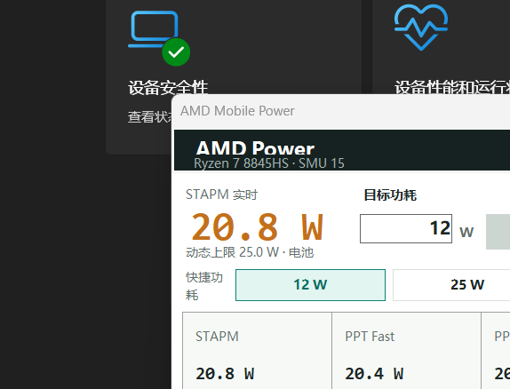
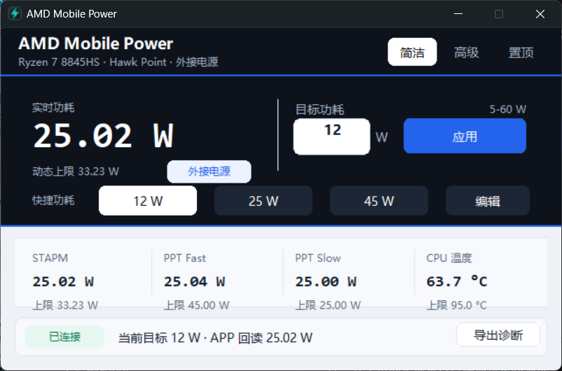
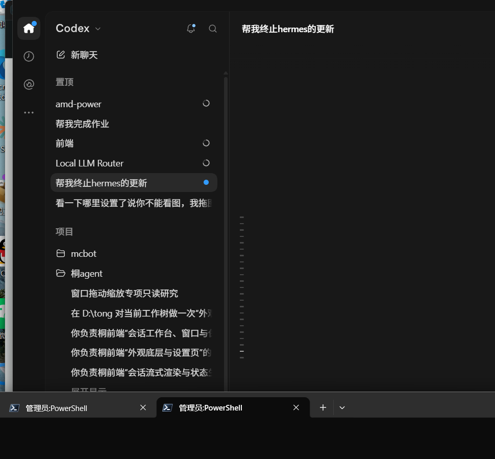

# AMD Mobile Power

AMD Mobile Power is an early-development Windows utility for monitoring and,
after supervised validation, controlling firmware power limits on supported AMD
thin-and-light laptops.

> Status: no public release yet. A local `1.0.4` stable deployment is validated on
> one AMD laptop. The normal GUI and packaged build are read-only unless launched
> with the reviewed local write-control flag. Controlled 10 W and 12 W writes,
> a packaged no-change write gate, and a supervised AC-to-battery-to-AC policy
> transition passed on 2026-11-10. The `1.0.4` build fixes the remaining
> taskbar/tray lifecycle crash, keeps orphan-worker cleanup, and preserves the
> compact-mode title/status layout.
> Public support still requires a second physical
> AMD laptop and the remaining publication gates.



## Current Features

- Native WinForms app with a compact tag-style simple view, a two-column
  advanced view, a four-column telemetry matrix, persistent always-on-top
  control, and taskbar/notification-area integration.
- Hidden named-pipe worker process isolated from the GUI.
- One-second STAPM, Fast, Slow, temperature, and power-line refresh.
- Automatic CPU family, SMU interface, PM table, and profile detection.
- Editable 12 W, 25 W, and 45 W quick presets.
- Optional battery/AC policy controls, disabled in read-only mode.
- Read-back verification, firmware-clamp reporting, and write restoration.
- Sanitized diagnostics export with platform, telemetry, process architecture,
  runtime-file hashes, and no local paths, process IDs, log directories, or
  recent log excerpts.
- Packaged read-only diagnostics collector for compatibility reports; it uses a
  sanitized field whitelist, never enables write controls, and never uploads.
- Lightweight daily GUI and worker logs with seven-day retention.
- Self-contained Windows x64 portable ZIP and current-user install/uninstall
  scripts.
- GitHub Actions build, test, RyzenAdj build, and package-artifact workflow.

## Safety

Changing firmware power limits can cause instability, overheating, battery
wear, data loss, or hardware damage. Use conservative values. This project is
not affiliated with AMD or laptop manufacturers.

Some platforms lock sustained limits in BIOS or the embedded controller. A
successful RyzenAdj call does not guarantee that the requested value survives
read-back.

Do not run AMD Mobile Power alongside the legacy `RyzenPower`, `ryzenadj`, or
AMD Ryzen Master processes. The application intentionally refuses to become a
second hardware owner.

## Quick Start

The current local stable package is located at:

```text
artifacts/packages/amd-mobile-power-v1.0.4-win-x64-lite.zip
```

Extract the ZIP and run `AmdMobilePower.exe`. This starts in read-only mode by
default. The locally validated write-control deployment is documented in
`docs/DEPLOYMENT.md`; the current laptop deployment is `C:\RyzenAdj` version
`1.0.4`.
See `docs/INSTALLATION.md` before using `install.ps1`.

The earlier self-contained development package remains available:

```text
artifacts/packages/amd-mobile-power-v0.1.0-win-x64.zip
```

The lite package is roughly 581 KB without the .NET runtime and requires the
Microsoft .NET 8 Desktop Runtime x64. See `docs/PACKAGING.md` for build and
runtime details.

## Native Preview

The `main` line now includes a clean-room Rust GUI with a
C++ worker. The current read-only-verified candidate is
`0.6.0-native-rc.13`:

```text
artifacts/native-packages/amd-mobile-power-v0.6.0-native-rc.13-win-x64-native-preview.zip
```

It is an internal candidate, not a replacement for the stable `C:\RyzenAdj`
deployment. Its clean package gate passed extracted GUI/worker read-only
verification, sanitized diagnostics, checksums, isolated install/uninstall,
and current-user shell integration. The supervised policy-write gate remains
open.





## Documentation

- `docs/README.md` is the documentation index and authority order.
- `docs/DEV_STATUS.md` records the current implementation and next task.
- `docs/NATIVE_RC_STATUS.md` tracks the native candidate and release gates.
- `docs/NATIVE_UI_REWRITE.md` records the clean-room native UI architecture.
- `docs/UI_DESIGN_DATABASE.md` records the local design-system evidence and
  compact-window UI contracts.
- `docs/SUPPORTED_HARDWARE.md` explains current compatibility evidence.
- `docs/SECURITY.md` documents hardware and driver safety boundaries.
- `docs/BUILDING.md` covers application and RyzenAdj builds.
- `docs/PACKAGING.md` covers portable and installed packaging.
- `docs/HARDWARE_TEST_PROCEDURE.md` defines the supervised write-test gate.
- `docs/LAUNCH_COPY_ZH.md` contains the review-only GitHub and Bilibili launch
  copy. It is not approval to publish.
- `docs/RELEASE_CANDIDATE_ZH.md` consolidates the current package, evidence,
  media, launch copy, and remaining publication gates.

## Development

```powershell
git submodule update --init --recursive
dotnet build AmdMobilePower.sln -c Release
dotnet test --solution AmdMobilePower.sln -c Release
.\build-package.ps1 -Version 0.1.0
```

## License

Original project code is licensed under the MIT License. Third-party components
retain their own licenses. Development packages include the reviewed RyzenAdj,
InpOut32, and WinRing0 license texts. See `docs/THIRD_PARTY_NOTICES.md` and
`docs/LICENSING_REVIEW.md`.

