# Development Status

Last updated: 2026-11-14

## Objective

Create a broadly compatible, open-source AMD laptop power manager with:

- A native Windows GUI and notification-area workflow.
- A privileged worker that owns all hardware access.
- Capability detection instead of hardcoded assumptions.
- Read-back verification and clear firmware-limit diagnostics.
- Portable and installed distribution packages.
- Documentation, compatibility evidence, and release media.

## Source of Truth

This file is the first file every maintenance session must read. Update it
after each meaningful change. Conversation history and compacted summaries are
not authoritative.

## Latest Maintenance Milestone

2026-11-14 (candidate scan/repack refreshed; CI formatting corrected):

- Current `a78c663b...` OLS-fix ZIP passed configured public sanitization
  (644 tracked files, 13 package text entries) and independent deterministic
  repack without modifying the candidate. Evidence:
  `evidence/release/public-sanitization-1.0.34-ols-2026-11-14.json` and
  `evidence/build/repack-ols-1.0.34-2026-11-14.json`.
- Found GUI rustfmt drift that would fail hosted CI. Applied rustfmt to
  main/worker source; 59 Rust tests and warnings-denied Clippy PASS afterward.
  Formatting changes require source/build identity refresh before final gates;
  no claim is made that existing binary hashes represent the formatted tree.
- Local branch had 24 commits ahead of its tracked remote before this session.
  Repository synchronization is separate from public Release approval. Hosted
  CI remains unverified until a current remote run is inspected.

2026-11-14 (clean OLS-fix candidate read-only integration PASS):

- Clean `df3c776` produced current 1.0.34 ZIP SHA256
  `a78c663b55b9ac9254fd4fb727333efd6fa425d3ea1c17d852c51d0da1085c32`,
  778,150 bytes, 19 checksum entries. Includes the OLS cleanup correction.
- Build and package read-only gates PASS: GUI 59, probe 7, policy/cleanup/
  transport regression, extracted GUI, compatibility collector/probe and
  isolated install flow. PolicyWriteVerification explicitly Skipped.
  Evidence: `evidence/packaging/v1.0.34-clean-ols-2026-11-14.json`.
- Updated current checklist hash/status. Earlier reproducibility and scan
  evidence covers previous payloads and must be refreshed for this ZIP.
- Final process check: stable C:\RyzenAdj GUI and its child worker only,
  no observed AMD build/test leftovers. Stable version remains 1.0.33.

2026-11-14 (release checklist evidence drift corrected):

- Checklist/runbook headers claimed 1.0.33 while checked items and executable
  commands referenced 1.0.31. Added current 1.0.34 override sections and
  explicitly marked the previous material historical, not current approval.
- Current summary separates source tests, existing c028cc4 ZIP evidence and
  missing final candidate/hardware/UI/media/deployment/publication gates.
  Worker source changes after candidate build remain clearly outstanding.
- Documentation verification PASS (53 Markdown files, 39 relative links),
  diff whitespace check PASS. No build, hardware or deployment changes.

2026-11-14 (driver cleanup destructor branch regression PASS):

- Added a no-driver C++ test using a narrow friend accessor and counting
  callback against the actual RyzenHardware destructor: no initialization
  attempt gives zero cleanup calls; attempted initialization gives one;
  missing cleanup callback exits normally. No DLL or hardware loaded.
- Registered the executable in CMake and standard native build. Full
  `native/build.ps1 -Offline` PASS: cleanup regression, transport resource
  checks (54 handles/4 threads unchanged), both policy suites, GUI 59 tests,
  probe 7 tests, Release binaries and icon verification.
- This proves the destructor conditional, not InitializeOls behavior or every
  partial DLL initialization failure. Real driver lifecycle coverage remains
  separate. C:\RyzenAdj unchanged; no power write requested.

2026-11-14 (unreleased: driver cleanup requires initialization attempt):

- Static inspection found RyzenHardware destructor called DeinitializeOls
  whenever the export was loaded, including ownership-conflict returns before
  InitializeOls was called. Added an attempt flag set immediately before
  InitializeOls; destructor cleans up after successful or failed attempts but
  not paths that never entered driver initialization.
- C++ Release build, both policy suites and no-hardware transport regression
  PASS (handles 54/54, threads 4/4). Evidence:
  `evidence/ui/native-worker-init-cleanup-transport-2026-11-14.json`.
- These tests do not load the real driver and do not exercise the new cleanup
  branch. A counting fake DLL/backend regression remains required; do not
  claim the branch runtime-proven yet. Stable deployment unchanged, no power
  write requested. Worker/package hashes must be refreshed before promotion.

2026-11-14 (existing responsive candidate deterministic repack PASS):

- Added `native/test-existing-package-repack.ps1` to extract the existing ZIP
  into a unique checked artifacts directory and independently serialize its
  entries with sorted paths/fixed timestamps. It never replaces the candidate
  and removes scratch files in finally.
- Exact existing candidate SHA256 `a4a731c5...` reproduced byte-for-byte;
  original package remained unchanged. Evidence:
  `evidence/build/repack-responsive-1.0.34-2026-11-14.json`.
- Scope is package-content serialization, not a source rebuild. The separate
  fresh binary rebuild/ZIP-entry comparison supplies binary evidence; this
  test alone does not establish source-to-package reproducibility for every
  text/config file. Full release/write/hang gates remain outstanding.
- No GUI interruption, hardware access or deployment change in this check.

2026-11-14 (responsive candidate binaries reproduced and matched inside ZIP):

- Fresh unique-target Rust rebuilds and clean-first C++ rebuild PASS for
  current GUI `f04afe7e`, probe `9750418f`, worker `e8ed63d3`; full hashes in
  `evidence/build/reproducibility-responsive-1.0.34-2026-11-14.json`.
- Opened the existing candidate ZIP read-only and hashed each EXE entry:
  all three exactly match the fresh rebuilds. ZIP was not regenerated.
  This ties binary reproducibility to the previously runtime-verified
  `a4a731c5...` package instead of only comparing local build outputs.
- Remaining release work is unchanged: full write/worker-hang gates,
  current ZIP reproducibility, deployment verification and updated media.
  No hardware or deployment operation performed in this milestone.

2026-11-14 (responsive GUI integrated clean package PASS):

- Clean source `c028cc4` built 1.0.34 with the viewport-aligned command area
  and latest transport fixes. ZIP SHA256
  `a4a731c53aa7ee9b0ed70d7be55d4ad8d55066aac49674e681cd2a73c5fe0cda`,
  778,167 bytes, 19 checksums. This supersedes earlier local 1.0.34 payloads.
- Complete build and read-only package checks PASS: Rust GUI 59, probe 7,
  C++ policy/transport tests, extracted GUI, collectors, headless probe,
  isolated install/overwrite/uninstall. PolicyWriteVerification=Skipped.
- Same ZIP public sanitization PASS (638 tracked files, 13 package text
  entries; configured patterns only). Evidence refreshed in
  `evidence/packaging/v1.0.34-readonly-clean-2026-11-14.json` and
  `evidence/release/public-sanitization-1.0.34-2026-11-14.json`.
- Post-test process inspection: one C:\RyzenAdj GUI and its child worker,
  no observed AMD compiler/test leftovers. Stable deployment remains 1.0.33.
- Remaining: current-payload reproducibility refresh, full write/worker-hang
  release gates, deployed verification and refreshed media. No promotion or
  public release performed.

2026-11-14 (responsive command boundary coverage):

- Geometry regression now covers every command viewport width from 520 to
  780 DIP, including scrollbar reservation, with minimum button widths,
  preset separation and right-edge alignment assertions. Rust 59 tests PASS.
- Runtime horizontal-bound checks now include all three presets as well as
  mode/topmost/target/apply/edit controls after detail scrolling. Isolated
  125% and 200% interaction checks PASS. Evidence:
  `evidence/ui/native-responsive-command-125-2026-11-14.json` and
  `evidence/ui/native-responsive-command-200-2026-11-14.json`.
- This change adds tests only; runtime checks use the Release GUI from the
  preceding responsive-layout milestone. No package rebuild, deployment or
  hardware write requested during this check.

2026-11-14 (unreleased: viewport-aligned advanced command region):

- Advanced header and command controls now use the visible viewport width,
  independently of the horizontally scrollable 760-DIP detail canvas.
  Target/apply, presets/edit and mode/write/topmost controls no longer move
  horizontally with the detail section. Header tooltip uses the same basis.
- Reviewed the right-side 200% narrow capture: Apply and header controls are
  completely visible. Detail columns still scroll horizontally; this is not
  a complete responsive reflow of the lower advanced view.
- Added runtime horizontal-bound assertions for pinned controls after scrolling
  right, and changed header-focus expectation to no horizontal movement.
  Isolated 200% interaction/focus/scroll PASS; Rust 58 tests, Clippy and
  Release build PASS. Evidence:
  `evidence/ui/native-responsive-command-200-2026-11-14.json`.
- No hardware write requested; stable 1.0.33 unchanged. New GUI source is
  ahead of packaged 1.0.34 and requires fresh package gates before promotion.

2026-11-14 (clean candidate and packaged 200% resource check):

- Clean `00db7e2` package build/read-only runtime PASS, ZIP SHA256
  `96364325117f20ff85f9948764367024c0c1f48a688e5d54dc4007f3bcf81cf4`,
  777,916 bytes and 19 checksums. Write verification explicitly Skipped.
- Packaged GUI passed 200% fixture/minimum bounds/scroll/focus and 480
  synchronous repaints/mode switches. All six resource samples: GDI 27,
  USER 61, handles 189, private bytes 2,568,192. Evidence:
  `evidence/ui/native-packaged-1.0.34-200-resource-2026-11-14.json`.
- Corrected verifier assumption that default advanced mode never scrolls:
  actual 200% client 1543x1061 is only 531 logical pixels high, so vertical
  scrolling is necessary. Assertions now compare scrollbar styles against
  actual logical viewport overflow; diagnostic dimensions retained on failure.
- SourceDirty in UI evidence refers to this verifier edit, not a rebuilt GUI;
  the GUI hash identifies the clean package payload. Stable GUI/child worker
  confirmed running after checks. No power write requested.
- Split capture review still shows target/apply clipped at the right in a
  narrow advanced viewport until horizontal scrolling. Existing geometry is
  coherent but UX remains incomplete. Responsive command/header layout is
  the next UI task; do not claim visual readiness from the PASS alone.

2026-11-14 (diagnostic package overwrite protection):

- Package entry now rejects a dirty source tree unless the version contains
  a separate `-diagnostic` suffix, before builds or staging replacement.
  Evidence-only changes retain the existing clean-source exception.
- Dirty `1.0.34` invocation was blocked and the existing ZIP hash stayed
  unchanged. `1.0.34-diagnostic.guard` generated separately with all runtime
  verification explicitly Skipped. No hardware or deployment operation ran.
- Added `native/test-package-dirty-guard.ps1` to repeat the negative check
  without modifying source to fabricate a dirty tree. Diagnostic packages
  remain unverified outputs, not release candidates.

2026-11-14 (latest payload integration and restoration confirmation):

- Clean source `e43669e` passed the complete read-only package flow with
  58 GUI tests, 7 probe tests and native transport/policy regression.
  Original clean ZIP SHA256:
  `5c8230a8aa019c02bbe2c4f34f0befef2f6067c9b45055b980f49a78a7763271`.
- Fresh isolated rebuilds reproduce current GUI `ae62f152`, probe `9750418f`
  and worker `e8ed63d3` hashes; evidence refreshed in
  `evidence/build/reproducibility-ui-root-fixes-2026-11-14.json`.
- Post-build inspection found no stable GUI/worker despite a completed
  verification command. Relaunched stable 1.0.33 and confirmed its GUI and
  child worker. The exact cause of the missing restoration is not proven.
- Package finally now waits two seconds after restoration and requires a
  live matching GUI if the launched process exits. Diagnostic read-only
  flow with this assertion PASS; local evidence
  `artifacts/ui-root-review/restore-confirmation.json`.
- That diagnostic run overwrote the local 1.0.34 ZIP with a dirty-tree build;
  the tracked clean-package evidence describes the earlier hash, not the
  current ZIP. Clean rebuild required before further package/release claims.
  C:\RyzenAdj still 1.0.33; no deployment replacement performed.

2026-11-14 (pipe-busy connection regression verified):

- Extracted the busy-open retry helper and added coverage for busy-then-open,
  persistent-busy deadline, and immediate return on non-231 errors.
- Added a real Windows named-pipe test: occupy its only instance, assert
  ERROR_PIPE_BUSY, start the retry, disconnect and re-arm the server, then
  assert successful connection after at least two attempts. File handles are
  RAII-owned and the retry thread is joined. No hardware worker is involved.
- The first fixture omitted re-arming the disconnected server and failed;
  corrected it to use PIPE_NOWAIT and ConnectNamedPipe so the fixture itself
  does not hang if the retry regresses. Added required Windows pipe/IO features.
- All 58 Rust GUI tests and Clippy warnings-denied PASS. Latest source differs
  from packaged GUI; rebuild/revalidate before promotion. C:\RyzenAdj unchanged.

2026-11-14 (GUI pipe-busy retry and latest read-only integration):

- Latest integrated package initially failed GUI worker connection with
  Windows ERROR_PIPE_BUSY (231). GUI client now retries only pipe opening
  for up to two seconds at 20 ms intervals on that exact error. It never
  retries a request after sending bytes, avoiding duplicate hardware writes.
- Rebuilt full diagnostic package with current GUI/worker: native transport,
  Rust 54+7 tests, C++ policy tests, extracted GUI, live read-only snapshot,
  diagnostics collectors, headless probe and isolated install flow PASS.
  Evidence is local `artifacts/ui-root-review/latest-integration.json`.
- Diagnostic package WorkingTree=Dirty; not valid release/promotion evidence.
  Existing tracked clean-package evidence refers to older source and does
  not cover this latest payload. Stable deployment remains 1.0.33.
- A deterministic occupied-pipe-then-release client regression is still
  required; one passing integrated run does not prove the retry path or
  eliminate every possible cause of pipe contention.

2026-11-14 (transport regression included in native build):

- `native/build.ps1` now runs the no-hardware request-bound/deadline/resource
  suite against the worker built for the selected configuration, before Rust
  checks. Standard native builds therefore exercise fragmented/oversized
  requests, slow clients, unread responses and 100-request handle/thread
  stability instead of leaving those as optional manual tests.
- Tightened disconnect expectations to IOException Win32 codes 109/232/233
  through the exception chain. A write timeout or unrelated exception is no
  longer accepted as an expected oversized-request disconnect.
- Full `native/build.ps1 -Offline` PASS: transport regression (handles 54/54,
  threads 4/4), both C++ policy suites, Rust GUI 54 tests, probe 7 tests,
  Release binaries and embedded icon checks. No hardware flags in transport
  tests. Stable deployment remains unchanged.

2026-11-14 (unreleased: response-side synchronous I/O cancellation):

- Response delivery now supervises WriteFile and FlushFileBuffers with a
  five-second watchdog. Normal completion wakes and joins it immediately;
  expiry repeatedly calls CancelSynchronousIo until sender acknowledgement,
  covering the gap between write and flush. The watchdog joins before the
  next connection; its duplicated thread handle is closed.
- No-hardware runtime regression PASS: a client kept its connection open
  without reading its response, then another client successfully queried
  health after six seconds. Read deadlines, fragmented/oversized requests
  also passed. After 100 additional health requests, process handles stayed
  54 and threads stayed 4. Both C++ policy suites PASS.
- Evidence: `evidence/ui/native-worker-response-deadline-2026-11-14.json`.
  Test worker exited; no deployment replacement or power write requested.
- This relies on Windows synchronous pipe cancellation and is not a hard
  process-level termination guarantee. Hardware/driver calls are outside
  this communication timeout. Rebuild package and refresh all affected
  reproducibility/runtime evidence before promotion.

2026-11-14 (unreleased: worker request-read deadline):

- Added a fixed five-second request-read deadline after pipe connection.
  PeekNamedPipe gates synchronous reads to available bytes, polling only
  while a client is connected without a complete request. The deadline is
  absolute, not renewed by partial data; idle unconnected server remains
  blocked in ConnectNamedPipe without a polling loop.
- No-hardware regression PASS: idle connected client and incomplete JSON
  client both disconnected within the 4-8 second acceptance window, with a
  successful health query after each. Fragmented 5 KB and oversized 70 KB
  request cases still PASS; both C++ policy suites PASS. Evidence:
  `evidence/ui/native-worker-request-deadline-2026-11-14.json`.
- Test worker exited. WriteFile/FlushFileBuffers response-side blocking is
  still outstanding; the read deadline does not bound those operations.
  No hardware settings changed and no stable deployment replaced.

2026-11-14 (unreleased: bounded worker request accumulation):

- Fixed the message-mode pipe reader: ERROR_MORE_DATA returns valid bytes
  that were previously discarded. Accumulated requests are now bounded to
  64 KiB before append; oversized requests disconnect without parsing.
- Added `native/test-worker-request-bounds.ps1`. A no-hardware worker
  answered a padded fragmented request, disconnected a 70,000-byte request,
  and answered a subsequent health request. Release C++ build and both
  existing policy test executables PASS. Evidence:
  `evidence/ui/native-worker-request-bounds-2026-11-14.json`.
- Test worker exited and process handle was disposed. C:\RyzenAdj unchanged.
  Worker source now differs from the previous candidate ZIP: regenerate
  binaries/package and reproducibility evidence before promotion.
- Remaining transport risk: synchronous reads and FlushFileBuffers can still
  be held by a slow client. The size bound does not establish a connection
  deadline or eliminate that availability risk.

2026-11-14 (concurrent worker cleanup regression PASS):

- Added `native/test-verifier-worker-scope.ps1`. It observes the isolated
  verification GUI, starts an independent worker after the verifier's initial
  worker snapshot, waits for verifier completion, and asserts that the
  independent worker survives. No hardware or write flags are supplied.
- Runtime test PASS; the test's finally path then removed its sentinel
  worker and disposed process handles. Evidence:
  `evidence/ui/native-verifier-worker-scope-2026-11-14.json`.
- This proves unrelated concurrent-worker survival, not the separate owned
  worker crash-cleanup branch or long-duration hardware memory behavior.

2026-11-14 (verification worker cleanup scope narrowed):

- GUI verifier cleanup previously killed every newly observed worker by
  process name. It now requires all three facts: absent from the initial
  worker set, parent PID belongs to this verification's GUI instances, and
  executable path matches the expected worker. Concurrent unrelated workers
  are not cleanup targets merely because they appeared during verification.
- Isolated firmware-clamp GUI interaction and 480 synchronous repaint/mode
  switches PASS with the updated cleanup path:
  `evidence/ui/native-resource-scoped-cleanup-2026-11-14.json`.
  This fixture creates no hardware worker, so concurrent-worker survival and
  owned-worker cleanup require a separate executable regression; not yet
  claimed as runtime-proven. No power write requested.
- Also replaced pre-verification force-kill of the stable GUI with its
  explicit Exit command and a bounded 15-second wait. Abort rather than
  force-kill if graceful shutdown stalls; finally avoids a duplicate relaunch
  when the original PID remains alive. Simulated GUI interaction passed:
  `evidence/ui/native-graceful-session-2026-11-14.json`. Existing workers
  inherited from older force-kill runs are not silently claimed as cleaned.

2026-11-14 (unreleased: outward-rounded keyboard focus reveal):

- Focus reveal now rounds device-to-logical displacement outward rather than
  to nearest. At fractional DPI, nearest rounding could leave a focused
  control edge clipped by a physical pixel. The helper uses i64 intermediates
  and bounds the result to i32.
- Regression coverage checks positive/negative displacements 1-400 at
  100/125/150/175/200%, zero, and i32 boundary inputs. Rust GUI 54 tests,
  Clippy warnings-denied and Release build PASS. Isolated 150% GUI lifecycle,
  keyboard reveal, minimum bounds and scrolling PASS:
  `evidence/ui/native-focus-reveal-150-2026-11-14.json`.
- No power write requested. Source GUI now differs from the previously
  verified 1.0.34 ZIP; rebuild and rerun relevant package gates before any
  promotion. C:\RyzenAdj remains 1.0.33.

2026-11-14 (1.0.34 ZIP reproducibility and read-only revalidation PASS):

- At clean source `5a92fb7`, two deterministic ZIP builds produced identical
  SHA256 `c87f5b62e3e01188fa35f0e96063f29b8f9006b1a59f881f9a629c6ac45bf8fc`
  (775,945 bytes). This supersedes the earlier `d9b3951` package hash because
  BUILD-INFO source metadata changed, not because GUI/worker binaries changed.
- Re-ran extracted-package read-only runtime, collector, headless probe and
  isolated install flow against that exact ZIP: PASS, WorkingTree=Clean,
  19 checksum entries. Write verification remains explicitly Skipped.
- Public sanitization scanned 623 tracked files and 13 package text entries:
  PASS for the configured home-path, internal-marker and credential patterns.
  This is pattern-based evidence, not a proof that every possible secret
  format or personal datum has been excluded.
- Evidence: `evidence/build/reproducibility-zip-1.0.34-2026-11-14.json`,
  `evidence/packaging/v1.0.34-readonly-clean-2026-11-14.json`, and
  `evidence/release/public-sanitization-1.0.34-2026-11-14.json`.
- C:\RyzenAdj remains 1.0.33. Complete write/worker-hang/release gates,
  refreshed UI/media evidence and promotion remain outstanding.

2026-11-14 (fresh-target binary reproducibility PASS):

- Found a verification weakness: deleting only the final Rust EXE allowed
  Cargo to reuse cached build artifacts. The reproducibility verifier now
  builds GUI/probe into unique empty target directories under artifacts,
  validates the output and removes those directories in finally.
- Fresh Rust builds and C++ clean-first rebuild reproduce all three binary
  hashes exactly: GUI `2fdff350`, probe `9750418f`, worker `67af1d41`.
  Full hashes are recorded in
  `evidence/build/reproducibility-ui-root-fixes-2026-11-14.json`.
- Verified no temporary repro target directories or C++ compiler/build
  processes remained after completion. This proves local binary
  reproducibility; ZIP reproducibility and full release gates remain pending.

2026-11-14 (1.0.34 clean read-only package PASS):

- Rebuilt from clean commit `d9b3951` with the full native build and
  `-ReadOnlyRuntimeVerification`. All 19 checksums, extracted GUI lifecycle,
  hardware snapshot, compatibility JSON/Markdown, headless probe and isolated
  install/overwrite/uninstall passed. PolicyWriteVerification=Skipped.
- ZIP: `artifacts/native-packages/amd-mobile-power-v1.0.34-win-x64-native-preview.zip`,
  775,945 bytes, SHA256
  `bf9410fa58b9401f91e269b975ede5cb5bee7d94e8991452ac64edef8a3a2003`.
- Evidence: `evidence/packaging/v1.0.34-readonly-clean-2026-11-14.json`.
  This supersedes the dirty diagnostic ZIP, not the deployed 1.0.33.
  Reproducibility, full release gates and promotion remain pending.

2026-11-14 (package verification session lifetime fixed):

- `build-package.ps1` now preserves active GUI launch contexts, requests
  graceful exit, scopes any leftover-worker cleanup to the saved GUI's exact
  sibling executable, and restores sessions in one outer finally after GUI,
  collectors, probe and isolated install/uninstall complete.
- Re-ran the 1.0.34 diagnostic package flow with `-NoBuild
  -ReadOnlyRuntimeVerification`: extracted GUI, hardware read-only,
  compatibility JSON/Markdown, headless probe and isolated install/overwrite/
  uninstall all PASS. Policy write verification explicitly Skipped.
- This diagnostic ZIP records WorkingTree=Dirty and is NOT a release
  candidate suitable for promotion. Local evidence:
  `artifacts/ui-root-review/package-flow.json`. A clean-source rebuild and
  full release gates remain required.
- After finally restoration there is one stable GUI and its own worker under
  C:\RyzenAdj. Probe read-back: AC, Fast/Slow 45 W, STAPM 25 W. No deployment
  replacement was performed. Stable automatic policy may resume on restart.

2026-11-14 (1.0.34 candidate build; collector conflict correctly blocked):

- Ran `build-package.ps1 -Version 1.0.34 -ReadOnlyRuntimeVerification`
  from clean source `ffe344b`. C++ build/policy tests, Rust GUI 53 tests,
  probe 7 tests, Release binaries and embedded icons passed. Extracted GUI
  lifecycle, hardware read-only snapshot, diagnostics, sizing and scroll
  checks passed. No policy-save/write test was requested.
- The overall package gate FAILED at standalone compatibility collection:
  the GUI verifier had already restored the stable session, whose worker
  held the hardware-owner mutex. Exit code 3 also covers initialization
  failures, so it must not alone be labeled an owner conflict.
- Collector now checks the existing hardware-owner mutex after exit code 3
  and reports the active-session conflict explicitly. Reproduced against an
  isolated extracted runtime: FAILED with the intended explanation, own
  worker cleaned up, stable session left running. Local reproduction output
  is under `artifacts/ui-root-review/collector-conflict.*`.
- The candidate ZIP is NOT release-gated and must not be promoted. The
  extracted verification directory contains a diagnostic-only collector copy
  newer than that ZIP; do not treat it as byte-identical package evidence.
- Next packaging task: keep the stable session restoration outside the full
  sequence of GUI, standalone collector and headless-probe checks, with a
  single finally restoration path. Do not bypass hardware ownership.

2026-11-14 (unreleased: native layout/paint root-cause pass):

- Unified the paint canvas and child-control content width. Previously narrow
  advanced windows positioned children on a 760-DIP canvas but painted header,
  sections and device details against the smaller viewport, causing drift.
- Replaced recursive pending-layout replay with a shared four-pass budget.
  Removed the independent 20-DIP horizontal-scrollbar visibility tolerance so
  SetScrollInfo and ShowScrollBar agree at boundary widths.
- Corrected negative device-to-logical coordinate rounding. DPI font/rectangle
  updates now participate in redraw suspension; final redraw includes the
  non-client frame. Failed double-buffer allocations now fall back to the
  paint DC and release any partial GDI allocations.
- Added canvas/rounding regression tests and runtime boundary sweeps at
  739/740/741/759/760/761/780 DIP. Optional verifier captures are split into
  left/right images for review.
- Verification: Rust 53/53, Clippy with warnings denied, native GUI Release
  build, .NET Release build (0 warnings/errors), .NET 72/72. Isolated simulated
  GUI checks passed at live DPI and the 200% fixture, including tray lifecycle,
  focus reveal, minimum sizing, scrolling and target draft retention.
- Evidence: `evidence/ui/native-layout-root-fixes-2026-11-14.json` and
  `evidence/ui/native-layout-root-fixes-200-2026-11-14.json`; local visual
  captures under `artifacts/ui-root-review*`. Capture data is simulated, not
  hardware evidence. No power write was requested during this milestone.
- C:\RyzenAdj remains the verified 1.0.33 deployment. These changes are not yet
  packaged/promoted. Full package/hardware gates and real cross-monitor DPI
  transitions remain pending; fixed DPI fixtures do not prove those paths.
- Next: responsive advanced-mode reflow that keeps target/apply visible at
  narrow widths instead of requiring horizontal scrolling, then package gates.
- Resource regression: `verify-rust-gui.ps1 -VerifyResourceStability` now runs
  480 mode switches and samples GDI/USER objects, handles and private bytes.
  Each switch also forces synchronous parent/child repaint. Six warm-state
  samples kept GDI=27, USER=61, handles=189-190 and private
  bytes=2,523,136-2,703,360. Every post-warmup sample is checked, not just
  the final sample. Evidence records SourceDirty explicitly. Evidence:
  `evidence/ui/native-resource-stability-2026-11-14.json`. This bounded fixture
  checks UI churn, not an all-night live-worker memory soak. Verification GUI
  exited normally and the stable tray session was restored. No AMD build/test
  process remained; unrelated engine build processes were left untouched.

2026-11-14 (1.0.33：界面细节打磨，并修掉一处滚动重绘遗漏):

- 标题行合并：应用名与设备/worker 状态放在同一行（原来标题与副标题上下两行，
  视觉上重复窗口标题栏且浪费高度），并给右侧按钮预留 12 px 间距，长文案改为
  省略号而不是压到按钮下面。
- 目标功耗范围提示（`5-45 W`）从动作行最右侧移到「目标功耗」标签右侧，读作
  「目标功耗 5-45 W」，不再像是输入框的右对齐内容。
- 置顶按钮改用真正的图钉图标：未置顶用空心钉（E840），置顶后用实心钉（E842）；
  原来的 E718 在 16 px 下看起来像一个横向箭头。
- 滚动条改为按真实溢出显隐（`ShowScrollBar` + 20 px 容差），默认高级窗口宽度下
  不再出现「只差 1 px」的横向滚动条。
- 修掉一处重绘遗漏：禁用状态的输入框走 `WM_CTLCOLORSTATIC`，之前返回透明画刷；
  因为父窗口带 `WS_CLIPCHILDREN`，滚动后这些区域会残留上一帧的深色像素（表现为
  输入框变黑、旧文字浮在字段上）。现在这些字段返回不透明表面画刷，滚动后的
  高级视图不再出现深色方块与残影。
- 验证：Rust 51/51、Clippy `-D warnings`；`build-package.ps1 -Version 1.0.33`
  全绿（提取包运行验证 `MinimumResizeBounds/AdvancedScroll/PolicySave` = PASS）；
  `verify-release.ps1 -Version 1.0.33 -VerifyReproducibility
  -VerifyShellIntegration -ExecuteNoChangePolicy -VerifyWorkerHang
  -AllowBatteryWriteGuard` 全绿。
- 包：`artifacts/native-packages/amd-mobile-power-v1.0.33-win-x64-native-preview.zip`，
  `775,202` 字节，SHA256
  `17fef8f89445a0c13436ffaca04334d4ed58d17aeff34515ecf5c50c2620aaa9`，
  源提交 `6ca4d19b9221fc18918d977219af879a0e296b28`；已部署到 `C:\RyzenAdj`
  （回滚目录 `C:\RyzenAdj.before-20261114-143351`）。

2026-11-14 (1.0.32: 消除模式切换白闪与错位帧，门禁脚本按 Per-Monitor V2 取几何):

- 用户截图显示高级模式出现白块、控件与文字错位的混合帧。根因有两条：窗口类
  使用白色系统背景刷（`COLOR_WINDOW`），且布局过程中窗口仍在重绘（窗口
  `SetWindowPos` 先触发一次 WM_PAINT，随后逐个移动子控件并 `UpdateWindow`），
  模式切换或尺寸变化时会露出“半成品帧”。
- 修复：窗口类背景刷置空、`WM_ERASEBKGND` 直接返回（`WM_PAINT` 已整帧双缓冲
  覆盖）；模式切换与布局期间用 `WM_SETREDRAW` 冻结重绘，子控件统一以
  `SWP_NOREDRAW` 移动，收尾一次性 `RedrawWindow(RDW_ALLCHILDREN)`；布局进行
  中到达的尺寸变化记入 `layout_pending` 并在收尾补做（最多 3 层），不再丢失。
- `native/verify-rust-gui.ps1` 现在把自身进程设为 Per-Monitor V2：此前在 175%
  缩放下脚本读到的是虚拟化矩形，最小窗口与滚动条断言会随显示缩放漂移（同一个
  检查在旧二进制上也失败）。滚动范围检查改为 Wait-Until，超时时打印
  `Max/Page/Position` 与 worker 连接状态，便于定位。
- 门禁：`build-package.ps1 -Version 1.0.32` 全绿（含提取包运行验证
  `MinimumResizeBounds/AdvancedScroll/PolicySave` = PASS）；
  `verify-release.ps1 -Version 1.0.32 -VerifyReproducibility
  -VerifyShellIntegration -ExecuteNoChangePolicy -VerifyWorkerHang
  -AllowBatteryWriteGuard` 全绿（shell 集成、no-change 策略写回、worker 挂起
  替换、DPI 100/125/150 夹具、1366x768/200% 工作区、最大化滚动、可复现构建）。
- 包：`artifacts/native-packages/amd-mobile-power-v1.0.32-win-x64-native-preview.zip`，
  `775,002` 字节，SHA256
  `97f9a09d3d3943645a3fbc58b527f90a4af51a14e07c264918cd4e14565a8102`，
  源提交 `43c2fb1e2bb43dd0d0eb5a6e0854c76898f73bcb`。
- 已部署到 `C:\RyzenAdj`（回滚目录 `C:\RyzenAdj.before-20261114-125104`）。
  托盘以 `--tray --simple-mode --max-target-watts 45` 运行；电池回读 Fast/Slow
  45 W，STAPM 由固件动态决定（27.0 W 上限、约 24 W 实测）。
- 过程记录：为定位滚动条断言，本地探测脚本一度在未隔离 `LOCALAPPDATA` 的情况下
  启动 GUI，真实状态里的电池目标被写成 25 W；已复原为 45/45 并与硬件回读核对。
  后续本地探测一律使用隔离状态目录。

2026-11-14 (1.0.31 promoted to the stable-local deployment):

- Committed and pushed the hardware-gate documentation refresh
  (`e2f4ade`); `verify-docs.ps1` scans 53 Markdown files and 39 relative links
  as `PASS`, and `verify-public-sanitization.ps1` scans 594 tracked files plus
  the 13-entry package as `PASS`.
- Promoted the gated package to `C:\RyzenAdj` through the reversible helper:
  rollback `C:\RyzenAdj.before-20261114-110034`, evidence
  `docs/evidence/packaging/v1.0.31-native-deployment-2026-11-14.json`.
  `BUILD-INFO.txt` reports `1.0.31`, commit `28092ea`.
- Relaunched the deployed tray GUI with `--simple-mode --max-target-watts 45`
  and re-verified by probe read-back: `STAPM/Fast/Slow = 45/45/45 W`, power
  line `ac`, policy enabled, presets `10/25/45`, write controls unlocked.
- `verify-publication-readiness.ps1 -Version 1.0.31` now reports
  `LocalReadiness=PASS` with `PublicReleaseReadiness=READY_FOR_HUMAN_REVIEW`.
  Remaining open gates are external: second AMD device, real OS DPI sessions,
  clean-Windows WinRing0 baseline, human media review, and explicit public
  release approval.
- Corrected the stale pre-gate ZIP hash in `docs/RELEASE_RUNBOOK.md` and
  marked the older `ccb0ed9a…` record in this file as historical.

2026-11-14 (1.0.31 full hardware gate PASS):

- Ran the complete `verify-release.ps1 -Version 1.0.31` gate with the deployed
  GUI/worker stopped: hardware read-only, write-guard, same-value
  `41/45/45 W` policy write, worker-hang replacement, shell integration,
  DPI/work-area/maximize fixtures, isolated install/uninstall, public
  sanitization, and reproducibility all passed.
- Rebuilt package:
  `artifacts/native-packages/amd-mobile-power-v1.0.31-win-x64-native-preview.zip`,
  `775,090` bytes, SHA256
  `33486b2dfcbb1e61471fc9d58b14d31c02802eb532c674a0c4ea28d7a9366a68`,
  source commit `28092ea483fa614d5668a4f720b6869ddd6d6401`.
  This supersedes the earlier pre-sanitization candidate hash `ccb0ed9a`.
- Evidence:
  `docs/evidence/packaging/v1.0.31-release-gate-2026-11-14.json`,
  `docs/evidence/hardware/v1.0.31-power-policy-no-change-2026-11-14.json`,
  `docs/evidence/hardware/v1.0.31-worker-hang-2026-11-14.json`.
- The deployed tray app was restored after the gate and re-applied the 45 W
  policy. Promotion to `C:\RyzenAdj` and the human media/release approvals
  remain pending.

2026-11-14 (public history sanitation and 45 W switch):

- Rewrote the public commit history to remove the internal author/committer
  identity. Remote `main` and `release/1.0.31` now point at sanitized heads
  `664bc59c` and `2b6dcd2`; the old automation-named remote branch was deleted.
  Content trees are unchanged, `git fsck` and the public-sanitization gate
  pass, and only the public repository identity remains in history.
- The new sanitized HEAD passed hosted Windows CI run `43546592447`; all
  native, documentation, reproducibility, public-sanitization, and probe steps
  are green.
- At 10:39 the user ended the temporary 8 W window and requested 45 W. The
  persisted policy and live AC read-back are now `45/45/45 W`; the temporary
  19:00 restore task was removed. The tray GUI was restarted after stopping the
  old process so its in-memory 8 W policy could not overwrite the new state.
- The final hardware gate remains pending; it should not be run while the
  user's 45 W session is active.

2026-11-14 (1.0.31 packaged UI, DPI, and CI evidence refreshed):

- At the pre-sanitation branch head, the public hosted-windows workflow was
  green:
  run `43537439992` (`fe8dcd7`) completed every native step successfully.
  `docs/evidence/build/hosted-ci-2026-11-14.json` now records that exact
  commit, so the publication-readiness hosted-CI gate can resolve against
  HEAD.
- Re-ran the extracted 1.0.31 GUI with the live worker and write-control UI
  checks instead of the earlier reduced lifecycle-only pass. The refreshed
  evidence now records `TaskbarIconAvailable=true`, `TrayIconId=1`,
  `InitialUiMode=simple`, `FinalUiMode=advanced`, diagnostics export, tray
  restore, single-instance wake, preset editing, and policy controls as
  `PASS`. The live worker stayed at `8/8/8 W` and was not asked to write.
- Re-ran the packaged 1.0.31 logical DPI fixtures at 100/125/150%, the
  1366x768/200% work-area fixture, and the maximize/scroll regression.
  All three evidence sets are `PASS`; the deployed tray GUI was restored
  with its original `--tray --simple-mode --max-target-watts 45` arguments.
- At that point the temporary 8 W window was active on AC and battery. It was
  later ended by the 45 W switch recorded above.
- Hardened the local 19:00 maintenance helper before the window ended:
  `revert-night-8w-to-10w.ps1` now rebuilds the complete `powerPolicy` object
  instead of assigning into an older partial object. A 07:05 run had failed
  with a missing `batteryTarget` property and needed a manual retry; the
  rewritten path keeps that from recurring during the scheduled restore.
- Reviewed the promotion flow without touching the stable deployment:
  `promote-stable-deployment.ps1` dry-run recognizes the 1.0.31 ZIP, target
  `C:\RyzenAdj`, a timestamped `C:\RyzenAdj.before-*` backup path, and the
  desktop shortcut `功耗设置 5-60W.lnk` with
  `--simple-mode --max-target-watts 45`. The final dry run must be repeated
  for the rebuilt post-hardware-gate package because its ZIP hash changes.
- Ran the real shell-integration gate against the 1.0.31 package:
  install directory and marker, Start menu shortcut, startup shortcut, and
  uninstall registry entry were created and then removed completely.
  Evidence: `docs/evidence/packaging/v1.0.31-shell-integration-2026-11-14.json`;
  the deployed `C:\RyzenAdj` tree was not touched.
- Added `native/verify-public-sanitization.ps1` and wired it into hosted CI
  and the release gate. It scans tracked text files and the portable ZIP for
  personal Windows home paths, internal agent markers, common API keys or
  tokens, and private-key headers. The 1.0.31 run scanned 593 tracked files
  and 13 package text entries with zero hits:
  `docs/evidence/release/public-sanitization-1.0.31-2026-11-14.json`.
- Sanitized the public branch and documentation before the final package:
  local branch renamed to `release/1.0.31`, personal home paths removed,
  internal agent markers removed from tracked files, and the hosted-CI
  evidence now records the sanitized branch alias.
- The previous remote branch name is still visible on GitHub. It must be
  deleted after `release/1.0.31` is merged, and deletion requires explicit
  owner approval because it is a remote-data operation.

2026-11-14 (unreleased branch hardening: atomic UI state writes):

- `save_*` persistence now writes a same-directory temporary file, calls
  `sync_all`, then replaces the destination with `MoveFileExW` using
  `MOVEFILE_REPLACE_EXISTING | MOVEFILE_WRITE_THROUGH`. A crash or power loss
  during a normal settings save can no longer leave a truncated
  `rust-ui-state.json`.
- If the existing state file fails to parse, the loader preserves it as
  `rust-ui-state.json.corrupt.bak` before the next save replaces it. BOM
  tolerance remains in place.
- Verification on the branch: Rust GUI `28` library + `23` main = `51/51`,
  probe `7/7`, C++ policy tests `PASS`, Clippy `-D warnings`, Release build,
  and embedded icon check all pass. No hardware write or deployment was
  performed.
- Candidate package:
  `artifacts/native-packages/amd-mobile-power-v1.0.31-win-x64-native-preview.zip`,
  `775,091` bytes, 19 checksum entries, SHA256
  `ccb0ed9a91cc27ab068f117d8174c605c84fb4ab8f6202faecfdce2058326de5`.
  The packaged GUI lifecycle/install checks pass; runtime compatibility and
  policy verification are intentionally skipped until the hardware gate.
  Historical only: this pre-hardware-gate, pre-sanitization candidate was
  rebuilt during the full gate; the current package is the `33486b2d…`
  artifact recorded in the latest milestone above.
- Reproducibility PASS for GUI `18f82690`, probe `9750418f`, worker `67af1d41`,
  and the ZIP. Evidence:
  `docs/evidence/build/reproducibility-1.0.31-2026-11-14.json` and
  `docs/evidence/packaging/v1.0.31-clean-2026-11-14.json`.
- Found and fixed a package-verification side effect: `install-preview.ps1`
  and `uninstall-preview.ps1` stopped every process named
  `amd-mobile-power-gui.exe` / `amdmobilepower_native_worker.exe`, so an
  isolated install/uninstall could kill the deployed stable worker. Both now
  stop only processes whose executable path is inside the requested install
  directory.
- Added `native/test-install-process-scope.ps1` as the regression guard. It
  installs and uninstalls an isolated copy while the deployed GUI/worker are
  running and requires the stable process set to remain unchanged; the test
  passed with the deployed worker PID `39516` still alive.
- The regression guard now writes
  `docs/evidence/packaging/v1.0.31-install-process-scope-2026-11-14.json`;
  the final run recorded stable PIDs `32288,39516` and
  `IsolatedTargetLeftBehind=false`.
- Added `docs/NATIVE_RELEASE_CANDIDATE_1.0.31_ZH.md` with the candidate hash,
  software-gate evidence, deferred hardware gate, and reproduction commands.
- Prepared the 1.0.31 release materials: `release-notes-1.0.31-zh.md`,
  `NATIVE_LAUNCH_COPY_1.0.31_ZH.md`, `release-assets-1.0.31.json`, and a
  1.0.31 media evidence record. They remain draft/pending until the hardware
  gate passes; the v9 video and 1.0.28 capture set remain valid because the
  UI is unchanged. Rechecked the video with `ffprobe` and a full `ffmpeg`
  decode: 42.5 s, 1920x1080, 30 fps, H.264/AAC, hash and size match.
- Updated `docs/RELEASE_RUNBOOK.md` to the 1.0.31 pending-gate flow: hardware
  gate, dry-run promotion, readiness refresh, fast-forward merge, tag,
  GitHub Release draft, Bilibili upload, post-download verification, and
  reversible rollback.
- Rewrote `docs/RELEASE_CHECKLIST.md` for 1.0.31 so completed software gates
  are checked while hardware, real-DPI, human-review, public-approval, and
  promotion items remain explicitly pending.
- Ran the packaged 1.0.31 GUI interaction suite without starting a hardware
  worker: modes, topmost, write controls, preset editing, target draft
  retention, focus notifications, minimum bounds, advanced scroll,
  close-to-tray, tray restore, and single-instance wake all passed. Evidence:
  `docs/evidence/ui/native-packaged-1.0.31-ui-2026-11-14.json`.
- Recovery after the earlier unintended stop: the persisted policy was restored
  to `8/8/8 W`, the deployed GUI/worker were restarted, and live AC read-back
  is `8.00 W` again. No high-risk power value was written.
- Branch: `release/1.0.31`. The reviewed hardware release gate
  is deferred until after the temporary 8 W window ends at 19:00; `main`
  remains the 1.0.30 release-ready line.

2026-11-14 (release documentation and publication gate reconciled):

- Re-ran `native/verify-publication-readiness.ps1 -Version 1.0.30`:
  `LocalReadiness=PASS`, `PublicReleaseReadiness=READY_FOR_HUMAN_REVIEW`,
  `HostedCi=Verification PASS`, and no local blockers.
- Corrected stale release documentation that still described 1.0.23 or 1.0.28
  as the current deployment, said the deployed policy was disabled, or listed
  the old shortcut without `--max-target-watts 45`.
- `docs/DEPLOYMENT.md` now documents the 1.0.30 promotion gates, rollback
  directory, current package evidence, and the dry-run/apply promotion flow.
  `docs/NATIVE_RC_STATUS.md` now points at the 1.0.30 candidate, review bundle,
  evidence set, and current open gates.
- `native/verify-docs.ps1` passed (50 Markdown files, 39 relative links). No
  native payload or package hash changed; public publication and Bilibili
  upload remain unapproved human gates.
- Regenerated `artifacts/native-release-review/v1.0.30` with
  `-IncludeMedia`: 33 files, 32 SHA256 entries verified, and the bundled
  README, `NATIVE_RC_STATUS.md`, and `RELEASE_CHECKLIST.md` match the current
  source documents. The refreshed readiness check remains `LocalReadiness=PASS`
  with no local blockers.

2026-11-14 (1.0.30-native tolerates a UTF-8 BOM in the state file):

- Root cause of the 07:00 state reset: Windows PowerShell 5.1 writes UTF-8 with
  a BOM, and `serde_json` rejected the file. `state::load_state` then returned
  `None`, so presets, policy, and the unlock flag silently fell back to
  defaults (`12/25/45`, locked) while the worker kept the real limits.
- `decode_state` now trims a leading U+FEFF before parsing, with a unit test
  for a BOM-prefixed file. Rust GUI tests are 25 library + 23 main = `48/48`.
- Clean 1.0.30 package: 771,049 bytes, SHA256
  `618c01442aac0715dade459f2f1a2e58a0471dcd1688096b0ca8765e7df44c3f`,
  source commit `2f04605`. Full release gate PASS: clean package, shell
  integration, `10/10/10 W` no-change policy, worker hang, DPI, 1366x768/200%
  work area, maximize scroll, byte-identical reproducibility. Evidence:
  `docs/evidence/packaging/v1.0.30-release-gate-2026-11-14.json`.
- Promoted to `C:\RyzenAdj`; 1.0.29 is recoverable at
  `C:\RyzenAdj.before-20261114-072507`. Deployed GUI SHA256
  `213a96fd...`, worker/probe unchanged. Live state after restart: AC,
  `10/10/10 W`, presets `10/25/45`, write unlocked.
- Packaged GUI evidence:
  `docs/evidence/ui/native-packaged-1.0.30-ui-2026-11-14.json`.
- Hosted Windows CI run `43527570945` (commit `b2e051c`) is green for 1.0.30;
  the readiness gate reports `HostedCi=Verification PASS`.

2026-11-14 (verifier guard for Windows PowerShell 5.1):

- Reproduced at 06:41: Windows PowerShell 5.1 removes the quotes from JSON
  passed to native commands, so `probe.exe --payload-json` receives
  `{settings:{...}}` and fails with `key must be a string`. The packaged
  night-revert helper already avoids this by speaking the named-pipe protocol
  directly.
- Both verifiers now use `native/worker-client.ps1`: payloads go over the named
  pipe, and probe output is collected without letting 5.1 turn a native
  command's stderr into a terminating error. Verified under `powershell.exe`
  5.1 at 07:10: `verify-write-controls.ps1 -NoBuild` reports `DRY RUN PASS`
  with the invalid-target guard at `10/10/10`, and
  `verify-power-policy.ps1 -NoBuild` passes the policy read plus write-gate
  checks. `docs/HARDWARE_TEST_PROCEDURE.md` and `native/README.md` describe the
  pipe-based behaviour.

2026-11-14 (1.0.29-native ships corrected package documentation):

- The packaged `README.txt` still told users to start the GUI with
  `--enable-write-controls`, which contradicted the 1.0.27+ in-app lock and
  tray `写入解锁…` flow. `native/portable-README.txt` now documents the
  in-app unlock, `10 / 25 / 45 W` editable presets, the battery/AC policy, and
  `%LOCALAPPDATA%\AmdMobilePower`. `native/build-package.ps1` fails the build
  if those required strings disappear from the staged README.
- `verify-rust-gui.ps1` exported diagnostics by picking the newest file in the
  folder; during policy-toggle checks that could still be the previous export,
  producing `Policy toggles were not reflected together in diagnostics`. It now
  records existing files and waits for a genuinely new export. The failing
  1.0.29 build then passed `PolicySave` and every other packaged-GUI check.
- `verify-release.ps1` writes reproducibility evidence to
  `reproducibility-<version>-<date>.json`, so a new candidate no longer
  overwrites the previous version's record.
- Clean 1.0.29 package: 770,245 bytes, SHA256
  `c6b54d84f3f1bdba67407fe72a1f4465913e554defa1577e5c02c7373b5db640`,
  source commit `ee40565`, working tree clean. GUI / worker / probe hashes are
  unchanged from 1.0.28 because only packaging text changed.
- Full release gate PASS: clean package, shell integration, battery no-change
  policy (`8/8/8 W` request and read-back), worker hang, 100/125/150% DPI,
  1366x768/200% work area, maximize scroll, byte-identical reproducibility.
  Evidence: `docs/evidence/packaging/v1.0.29-release-gate-2026-11-14.json`.
- Promoted to `C:\RyzenAdj`; previous stable is recoverable at
  `C:\RyzenAdj.before-20261114-054523`. The desktop shortcut keeps
  `--simple-mode --max-target-watts 45`. The app was restarted and the battery
  policy still reads `8/8/8 W`.
- Packaged GUI evidence `PASS`
  (`docs/evidence/ui/native-packaged-1.0.29-ui-2026-11-14.json`), review bundle
  `artifacts/native-release-review/v1.0.29` (29 files), and publication
  readiness `LocalReadiness=PASS` with no local blockers.
- Hosted Windows CI is green for this candidate: run `43525105775`
  (commit `dd537f7`) passed all native-workflow steps; the readiness gate now
  reports `HostedCi=Verification PASS` for 1.0.29.

2026-11-14 (publication readiness gate is green for human review):

- `native/verify-publication-readiness.ps1` now resolves the real desktop
  shortcut through `[Environment]::GetFolderPath('Desktop')`, accepts the
  `v<version>-native-deployment-<date>.json` evidence name that the promote
  script actually writes, and accepts a fresh packaged-GUI verification whose
  GUI hash matches the deployment record instead of trusting only a stored
  `UiVerification` flag. The published evidence still redacts the user-home
  prefix as `<USER_HOME>`.
- `native/prepare-release-review.ps1` no longer pins the 2026-11-11 media or
  the 2026-11-12 DPI evidence. It resolves the newest promo video, the
  per-version media evidence and launch copy, and the newest DPI fixture set;
  it also adds `packaged-ui.json` and `deployment.json` to the review bundle
  when those records exist.
- New evidence: `docs/evidence/ui/native-packaged-1.0.28-ui-2026-11-14.json`
  (packaged GUI, tray, mode, write-control checks; `BackgroundGuiRelaunched 1`),
  `docs/evidence/media/native-promo-1.0.28-draft-2026-11-14.json` (v9 video,
  42.5 s, full decode PASS, CC BY 4.0 music attribution), and refreshed
  `docs/evidence/packaging/v1.0.28-native-deployment-2026-11-14.json`.
- `native/verify-rust-gui.ps1` used to `Stop-Process` every
  `amd-mobile-power-gui` before testing because the GUI owns a machine-wide
  single-instance mutex; that closed the user's deployed tray app. It now
  records the running GUI command lines, runs the check, and relaunches them
  in `finally`. Verified live: deployed GUI PID `12572` was replaced by
  `49444`, `C:\RyzenAdj` still reports `8/8/8 W` on battery, and the packaged
  UI evidence recorded `BackgroundGuiRelaunched 1`.
- Review bundle:
  `artifacts/native-release-review/v1.0.28` (29 files, SHA256SUMS verified).
  `native/verify-publication-readiness.ps1 -Version 1.0.28` reports
  `LocalReadiness=PASS`, `PublicReleaseReadiness=READY_FOR_HUMAN_REVIEW`,
  empty `BlockersFromLocalChecks`. Evidence:
  `docs/evidence/release/native-publication-readiness-2026-11-14.json`.
- Hosted Windows CI is green on the native-only workflow: run `43509158502`
  (commit `4f91e4e`) passed PowerShell syntax, documentation links, Rust
  fmt/clippy, RyzenAdj build, native build/tests, byte-reproducible package,
  headless probe self-test, and artifact upload. Evidence:
  `docs/evidence/build/hosted-ci-2026-11-14.json`. The readiness gate now
  reports `HostedCi=Verification PASS` when that evidence's commit is an
  ancestor of HEAD and no `native/`, `.github/`, Cargo, or build-script change
  landed since it.
- Open human/external gates: second AMD device, real system DPI sessions at
  100/150%, clean Windows WinRing0 baseline, human video/claim review,
  explicit public-release approval, and the authenticated Bilibili upload.

2026-11-14 (1.0.28-native shipped to the stable-local deployment):

- Added the tray-menu write gate: `写入解锁…` opens the same consent dialog as
  the header lock, `写入已解锁` is checked while writes are enabled, and
  selecting it again relocks and restarts the worker read-only.
- Runtime inspect of the deployed tray menu passed: `简洁模式` checked,
  `写入已解锁` checked, presets `10 / 25 / 45 W` present, and the GUI stayed
  alive and responsive after the popup closed. Evidence:
  `docs/evidence/ui/v1.0.28-tray-menu-2026-11-14.json`.
- Replaced the awkward advanced-panel capability sentence
  `STAPM 是 · Fast 是 · Slow 是` with `可写：STAPM / Fast / Slow` (or the
  subset actually supported), and added a unit test covering full, partial,
  and unsupported field sets.
- Verified 24 library tests, 23 main tests, and Clippy with `-D warnings`.
  The full release gate passed: clean package, shell integration, worker-hang
  recovery, no-change battery policy, 100/125/150% DPI, 1366x768 at 200%
  work area, maximize-scroll regression, and byte-identical reproducibility.
- Package: `1.0.28`, 769,919 bytes, SHA256
  `3a60bd0373120889d6a7bedd11e42f87df7a398288eea95354b20cab4998f593`,
  source commit `f64812e6fb873ef72df81e8b324f2172d51aa506`; gate evidence
  `docs/evidence/packaging/v1.0.28-release-gate-2026-11-14.json`.
- Promoted to `C:\RyzenAdj`. Previous stable
  `1.0.27-native` is recoverable at
  `C:\RyzenAdj.before-20261114-025845`; deployed GUI SHA256
  `d46f885e44aa53355739005a875d107bff58b83a23da4639991be6fd7f538245`.
  The desktop shortcut remains
  `--simple-mode --max-target-watts 45`.
- Fresh 1.0.28 launch on battery reports `8.00 / 8.00 / 8.00 W`, policy
  enabled, write unlock persisted, presets `10 / 25 / 45 W`, and no firmware
  clamp. The temporary night setting remains 8 W until 07:00.

2026-11-14 (tray unlock, real-UI promo v9, and 8 W night setting):

- Tray menu now exposes the same write gate as the header lock: `写入解锁…`
  opens the consent dialog and `写入已解锁` is checked while writes are
  enabled; selecting it again relocks and restarts the worker read-only.
  This is the only new GUI behavior in the working tree; Rust unit tests
  (24 lib + 22 main), release build, and Clippy `-D warnings` are clean.
- `native/capture-rust-gui-redesign.ps1` now supports separate
  `-PolicyBatteryWatts` / `-PolicyAcWatts` values, respects `-PresetWatts`
  for policy-seeded captures, and uses a PowerShell 5.1-safe `UIntPtr` for
  the cleanup exit message. This lets the promo capture the real
  `10 W / 45 W` auto-policy state instead of a hand-built mock.
- Promo v9 replaces the safety, auto-policy, and compatibility mock cards
  with crops from the shipped 1.0.28 UI: the real consent dialog (checked
  state), the real advanced preset + policy panel (`10 / 25 / 45 W`,
  battery `10 W`, AC `45 W`, `已启用`), and the real device panel
  (`Ryzen 7 8845HS`, `Hawk Point`, `可写：STAPM / Fast / Slow`). The main
  preset scene still uses the real recorded click demo. Final: 42.5 s,
  1920x1080, 30 fps, `4,426,857` bytes, SHA256
  `ca887aa5ec3b55157e91206781d15f502e3fdede7c3c7e3907621ac331863023`,
  full decode PASS:
  `artifacts/media/promo-html-v1/amd-mobile-power-promo-2026-11-14-v9.mp4`.
- User requested an immediate night limit of `8 W` until 07:00. Hardware
  read-back at 2026-11-14 02:12 confirms `STAPM 8.00 W`, `PPT Fast 8.00 W`,
  `PPT Slow 8.00 W` on battery; the persisted policy has both battery and AC
  targets at 8 W and is enabled, so unplug/replug does not raise the limit.
  This is a temporary local setting, not a shipped schedule feature; no
  public release or upload was performed.
- The revert is owned by the local one-off scheduled task
  `AmdMobilePower NightRevert 20261114` (06:59) running
  `%LOCALAPPDATA%\AmdMobilePower\maintenance\revert-night-8w-to-10w.ps1`.
  The helper writes 10 W through the running worker pipe, verifies the
  read-back, mirrors the value into `rust-ui-state.json`, restarts the GUI so
  its panel agrees with the worker, and verifies the target again. It was
  rehearsed twice at 04:15 with `-Watts 8` (no `-NoRestart` on the second run)
  and returned `OK` with `stapm=8 fast=8 slow=8 line=battery` before and after
  the restart, so the 05:00-07:00 window stays at 8 W. A local maintenance
  job verifies the 06:59 run and removes itself afterwards.
- The helper now speaks the worker named-pipe protocol directly instead of
  passing JSON through `probe.exe --payload-json`: the scheduled task runs
  under Windows PowerShell 5.1, which strips the embedded quotes from native
  command arguments and made the first version fail at 06:25. Re-verified under
  `powershell.exe` 5.1 on 1.0.29 at 06:33: policy apply, read-back, state
  mirror, GUI restart, and post-restart read-back all returned `OK` at
  `8/8/8 W`, so the 06:59 task exercises the same path with `10 W`.
- The first 5.1 state write used `Set-Content -Encoding UTF8`, which emits a
  BOM; the Rust state loader rejected that file and fell back to defaults
  (`12/25/45`, locked). The helper now writes UTF-8 without a BOM and creates a
  missing `powerPolicy` object. The state was repaired and re-verified at
  07:06 with `10/10/10 W` and presets `10/25/45`. Follow-up: make the Rust
  state loader tolerate a BOM.
- The 06:59 one-shot task hung before its first log line; the worker pipe still
  existed and answered probes. The helper no longer enumerates `\\.\pipe\`
  (which can block on a wedged pipe) and connects to the fixed
  `AmdMobilePower.RustGui.Worker.v1` name instead. The revert was completed
  manually at 07:05 after stopping the stuck process.

2026-11-14 (auto-policy fix, shipped as 1.0.27-native): user reported that
after enabling the auto power policy, unplugging/replugging never wrote the
10 W battery target. Root cause: `start_worker` only added
`--enable-write-controls` for the CLI flag, not for the persisted
`writeUnlocked` state. Launching normally (shortcut without the flag) with a
previously unlocked UI therefore spawned a read-only worker: the UI showed
"写入已解锁" while every write was rejected and the worker never started its
policy ticker (`if (enable_write_controls && hardware)`), so auto switching
silently did nothing. Fixes:

- `start_worker` now passes the write flag when either the CLI flag or
  `state::load_write_unlocked()` is set.
- New `policy_synced` flag: the saved policy is re-sent to the worker on the
  first healthy snapshot after any worker (re)start (toggle-unlock, crash
  restart, force restart), instead of relying on the old
  `policy_profile_applied` path alone.
- Verified end to end on hardware: a fresh launch with persisted unlock and
  no flags applied the policy target automatically (limits changed to
  12/12/12 for the probe run, then back to 10/10/10 after restoring the
  saved targets). Deployed instance now reports 10.00/10.00/10.00 W with
  the auto policy armed.

- Package: `1.0.27`, 767,549 bytes, SHA256
  `8721c6ddfc25f430d19337ad122149eb7f78da51d288fd6ea83a3e642070fbcb`,
  source commit `7813335`; release gate PASS (shell integration, hardware
  no-change 10/10/10, DPI 100/125/150 fixtures, small viewport, maximize
  scroll); reproducibility PASS. Deployed to `C:\RyzenAdj`; rollback
  `C:\RyzenAdj.before-20261113-224640` remains the 1.0.26 backup.
- Note: one gate run timed out in the DPI capture's mode-switch wait; a
  direct rerun of the same step passed at 100/125/150%, so it was a
  transient timing hiccup, not a layout regression.

2026-11-13 (in-app write unlock, shipped as 1.0.26-native): the read-only
default was previously only liftable via the `--enable-write-controls`
launch flag, which normal shortcuts never pass. The header now has a lock
button (`WRITE_UNLOCK = 111`) that shows a consent dialog before enabling
writes: liability notice plus operating notes, a checkbox that must be
ticked before the confirm button enables, and confirmation. On confirm the
GUI flips `write_enabled`, persists `writeUnlocked` in the UI state, and
replaces its owned worker with one launched with `--enable-write-controls`
(an externally-started worker reports that the app must be relaunched).
Clicking the lock again relocks immediately and restarts the worker
read-only. Implementation: `native/rust-gui/src/unlock_dialog.rs` (own popup
class, GDI painted, owner-draw buttons; deliberately not TaskDialogIndirect
because the manifest does not activate comctl32 v6), state persistence in
`state.rs`, header wiring in `main.rs`.

- Tests: 24 lib + 22 main pass; Clippy clean; packaged GUI
  `verify-rust-gui -VerifyWorker -VerifyWriteControls` PASS (ViewModes /
  TopMost / WriteControls / preset editing / bounds / scroll).
- Packaging: `1.0.26`, 766,832 bytes, SHA256
  `15dda8a4067518e333131c77cbd8d8d76686c5887b800b190a6847e124ff82c8`,
  release gate PASS (shell integration, hardware no-change policy 10/10/10
  read-back, 100/125/150% DPI fixtures, 1366x768/200% work area, maximize
  scroll), reproducibility PASS (byte-identical rebuilds).
- Test fix: `verify-maximize-scroll.ps1` hard-coded device-pixel geometry
  (796x460) and a 440 px threshold, which fails on a non-100% scaled desktop;
  it now scales both by `GetDpiForWindow`.
- Deployed to `C:\RyzenAdj` (rollback `C:\RyzenAdj.before-20261113-224640`).
  The desktop shortcut now passes only `--simple-mode --max-target-watts 45`;
  launches start read-only and the lock button unlocks after consent, with
  the choice persisted for later launches.

2026-11-13 (media promo v5): copy rewritten in plain language (scenario
mapping 45 W performance / 25 W quiet / 10 W endurance), added an
auto-power-policy scene (plug -> 45 W, battery -> 10 W, one toggle), renamed
the safety mock card to the app's real wording "写入解锁 / 只读模式 · 默认",
and replaced the synthesized bed with a licensed track: "Deliberate Thought"
by Kevin MacLeod (incompetech.com), CC BY 4.0, credited in the closing
frame. The ui-demo clip now carries a synthetic pointer with click ripples
aligned to the recorded preset presses (25 W @2.0 s, 45 W @5.0 s, 10 W
@8.0 s scene-local), since PrintWindow captures never include the cursor.
Final: 42.5 s, 1920x1080, `4,222,416` bytes, SHA256
`0b84d7eba48ccf8f82f3c37127cf91125105eabdd8487e24748bc14d75b3cd45`,
decode PASS, at
`artifacts/media/promo-html-v1/amd-mobile-power-promo-2026-11-13-v5.mp4`
(local only). Publish-time obligation: keep the CC BY 4.0 music credit in the
video description.

2026-11-13 (gui flicker fix + promo v2 subtitle cut): two user-reported
defects fixed and the video rebuilt without narration.

- Button-press white flash: the five full-window `InvalidateRect(..., TRUE)`
  calls erased the client with the light `COLOR_WINDOW` brush before the
  double-buffered repaint, so every preset click / status update flashed
  white for 2-3 frames (visible in captures as YAVG ~219 frames). All five
  now invalidate without erase; `paint_window` already repaints every pixel
  from its memory DC. A `WM_ERASEBKGND => 1` arm was tried first and
  reverted: on this window it silently broke owner-draw button text (white
  boxes), verified with a live window capture.
- Promo v2 (subtitles, no voice): the SAPI narration is gone; each scene's
  sentence is burned in as a bottom caption band (`drawCaption` in
  `media/promo-html/src/engine.js`) over the seeded music bed at
  loudnorm I=-20 (mean -23.0 dB). The ui-demo clip was re-recorded from the
  flicker-fixed build, so no white frames remain anywhere (signalstats YAVG
  never exceeds 150). Final: 41.5 s, 1920x1080, `4,063,618` bytes, SHA256
  `cf8f03c839f02f1c2ea10381a80c1c050c51a980598138c5d0d2a2c7b8812450`,
  full decode PASS, at
  `artifacts/media/promo-html-v1/amd-mobile-power-promo-2026-11-13-v2.mp4`
  (local only). The 24+22 Rust tests pass. The C-drive deployment still runs
  `1.0.25-native`; promoting the flicker fix requires the full release gate
  (package build, verify-release, DPI fixtures, hardware smoke) first.

2026-11-13 (media promo-html v1): rebuilt the promo video pipeline from
GDI+ slides to HTML/CSS/JS scenes recorded frame-exact by Playwright
(`media/promo-html/`): `index.html` + `src/engine.js` render seven scenes
(hook / problem / ui-demo / safety / compat / a11y / closing) driven by
`window.__seek(t)`; `build/record.js` screenshots 1,245 frames at 30 fps and
injects the recorded GUI demo clip frame-by-frame into the ui-demo scene
(every seek rebuilds the DOM, so the clip frame must be re-assigned every
output frame -- an early "skip unchanged index" cache produced alternating
blank frames). Audio: SAPI Huihui narration per scene + the seeded original
music bed mixed by `build/make-audio.ps1`. Final render: 41.5 s, 1920x1080,
3,419,008 bytes, SHA256
`268558aa21bbb33cfc0c3286fcec3ad08abf132ef70aa95834f7a9058903922e`, full
ffmpeg decode PASS, at
`artifacts/media/promo-html-v1/amd-mobile-power-promo-2026-11-13.mp4`
(local only; videos never enter git -- final assets go to a GitHub Release
when approved). The demo clip was re-recorded at 200% DPI
(`artifacts/media/live-demo/simple-demo-200.mp4`, 1200x720) after fixing the
firmware-clamp fixture to fold simulated applies back into the telemetry
read-back row (applying 10 W now shows 10.00 W everywhere instead of stale
12.00 W values; commit `dbb7c5f`). Status: DRAFT_FOR_HUMAN_REVIEW.

2026-11-13 (public sanitization + rename): the repository went public as
`syttys123/amd-mobile-power`. Before publication every tracked blob and commit
was scrubbed with `git filter-repo` (two passes):

- Author/committer identities on all 343 commits were normalized to the
  repository owner before publication.
- Personal user-profile paths and local design-library paths were replaced
  with `<USER_HOME>` and `<local-design-library>`; one research-note sentence
  in `docs/UI_DESIGN_DATABASE.md` was generalized.
- Repo URLs rewritten `amd---` -> `amd-mobile-power` (full URL, host path, and
  bare-name forms).
- Legacy branch references and local URI allowlist entries were removed.
- Post-rewrite verification confirmed no personal paths, old repository
  URLs, or internal tool markers remained; commit messages are clean and no
  tokens, keys, serials, or real names were published.
- Branch layout: old .NET `main` preserved as `legacy-dotnet`; the native line
  is now `main` and the GitHub default branch. Description and topics set via
  API. Pre-sanitization backup kept locally at
  `D:\amd-mobile-power-backup-presanitize-20261113` (never pushed).
- Push note: the flaky proxy rejects large packs with HTTP 408; full-history
  pushes must go in ~20-commit increments (`git push origin <sha>:refs/heads/main`).
- Evidence JSONs inside history may reference pre-rewrite commit hashes; those
  references are historical and no longer resolve.

2026-11-13 (media 1.0.23 v2 live-demo): the presets scene no longer overlays
an animated counter on a static capture; it now plays a real recorded GUI
clip filling the screenshot card edge to edge (`25 -> 12 -> 45 W` preset
clicks, then preset 1 edited to `10 W` and saved so the row reads
`10 / 25 / 45 W`), captured under the read-only `firmware-clamp` fixture at
125% DPI. UI fixtures now simulate the apply answer instead of failing
(`firmware-clamp` reports "已应用 … 固件报告了钳制或 STAPM 警告"), so captures
show the real apply/read-back flow without hardware. New tooling:
`media/promo-native/capture-live-demo.ps1` (PrintWindow recorder; the capture
process must be per-monitor DPI aware and must use PW_CLIENTONLY, or the
window measures wrong and renders with a left border strip and a cropped
bottom row), and `render-promo.ps1` learned storyboard `"video"` scenes (slide
base + clip cover-composited into the card area, freeze last frame if
narration runs long). Video SHA256
`42aef6cb3d9ea11ac512e26049a269c4f2ccca87e4da71986ac42050ac26d1ce`,
`23,804,272` bytes, `109.2 s`; `verify-media.ps1` PASS.

2026-11-13 (gui): quick-preset clicks now apply immediately in advanced mode
too, matching simple mode, instead of only staging the target field
(`PRESET_12/25/45` all route to `start_preset_apply`). User-reported UX gap;
covered by the existing 22-test suite plus fixture capture. Ships as
`1.0.24-native`.

2026-11-13 (media 1.0.23): re-rendered the promo draft so the closing
narration matches the shipped build: `1.0.23`, 46 GUI tests, and the maximize
scroll regression. The video is `109.2 s` at 1920x1080 with seven non-repeating
scenes, SAPI Chinese narration, the original seeded music bed at `-26 dB`, and
refreshed SRT captions. Contact sheet and Bilibili cover were regenerated;
`verify-media.ps1` PASS covers full decode, scene count, volume, evidence
hashes, review assets, and cover. Evidence:
`docs/evidence/media/native-promo-1.0.23-draft-2026-11-13.json`. Status stays
`DRAFT_FOR_HUMAN_REVIEW`; no upload or publication was performed.

2026-11-13 (media 1.0.23 v2): re-rendered the draft again after visual review.
Each scene now uses its own camera motion (zoom or pan) instead of a static
card, and the presets scene overlays an animated `10 / 12 / 25 / 45 W` counter
on the UI capture, and a thin accent progress bar runs along the bottom of the
whole video. Video SHA256
`990087053389a1f3f3cccc7db729357c5bb72a06878f984035f125bf75787036`,
`24,145,236` bytes, `109.2 s`. `verify-media.ps1` PASS.

2026-11-13 (media 1.0.23 v4 candidate): re-rendered the alternate voice draft
with `Microsoft Yaoyao` at rate 2 on the same live-demo storyboard, so both
narration takes can be compared frame for frame: `111 s`, `24,078,681` bytes,
SHA256 `d7bd7b71254fec708f536751c3e405a2365d4676093dce9c652d0892e8b99638`.
Path: `artifacts/media/amd-mobile-power-promo-1.0.23-v4-yaoyao-2026-11-13/`.
The earlier animated-counter Yaoyao draft (v3) is superseded.
Path: `artifacts/media/amd-mobile-power-promo-1.0.23-v3-yaoyao-2026-11-13/`.
Isolated voice samples (same sentence, rate 3 vs 1/2) live under
`artifacts/media/voice-samples/`. The `v2` Huihui draft stays the default
candidate until the owner picks.

2026-11-13 (visual QA): deployed `1.0.23-native` was captured in simple and
advanced modes at 100% and 125% logical scaling with the worker-offline
fixture. No truncated labels, overlapping controls, or clipped footers were
found; preset rows and telemetry columns align. Screenshots:
`assets/native-qa-1.0.23-{simple,advanced}-{100,125}.png`. Evidence:
`docs/evidence/ui/native-visual-qa-100-125-2026-11-13.json`.

2026-11-13 (`1.0.23-native`): deployed to `C:\RyzenAdj`, superseding
`1.0.22-native`. It fixes the advanced-mode maximize/snap regression inherited
from `1.0.22-native`: after shrinking the window, scrolling, and maximizing,
the page kept its old `scroll_offset`, shifted up by that amount, and left a
blank band at the bottom while the header row left the client area. `WM_SIZE`
now re-lays out on `SIZE_MAXIMIZED`, page up/down moves exactly one viewport
(`layout::page_scroll`) to match `SIF_PAGE`, and header controls subtract the
scaled scroll offset instead of scaling the already-subtracted value.

- Package: `760,850` bytes, SHA256
  `42f6cf9172f3db6d0a2ac81bfffbab4b38b1f5a1423ff64b7b020855fce29f79`,
  built from clean commit `2033052`.
- Deployed GUI SHA256 `e18c4213faf1da088aa71d75134616e898fe6a3943e7dd03ec769bcd9a6b9b6a`;
  worker and probe unchanged (`67af1d41`, `9750418f`).
- Verified: 24 library + 22 main Rust tests, 7 probe tests, Clippy
  `-D warnings`, C++ policy tests, offline Release build, shell integration,
  100/125/150% DPI fixtures, 1366x768/200% work-area fixture, worker-hang
  replacement PASS, no-change hardware policy PASS (`10/10/10 W` read back),
  and byte-identical rebuild.
- Regression proof: `native/verify-maximize-scroll.ps1` drove the deployed
  `1.0.22` binary first (`-ExpectRegression`): scrolled `243`, maximized
  position stayed `243`, header top `-231`. The `1.0.23` release build reports
  position `0` and header top `12`.
- Rollback: `C:\RyzenAdj.before-20261113-024133`. The daily GUI was relaunched
  with `--enable-write-controls --simple-mode --max-target-watts 45`;
  editable presets remain `10/25/45 W`.
- Evidence:
  `docs/evidence/packaging/v1.0.23-native-release-gate-2026-11-13.json`,
  `v1.0.23-native-clean-2026-11-13.json`,
  `v1.0.23-native-shell-integration-2026-11-13.json`,
  `docs/evidence/hardware/v1.0.23-native-power-policy-no-change-2026-11-13.json`,
  `v1.0.23-native-worker-hang-2026-11-13.json`,
  `docs/evidence/ui/native-maximize-scroll-1.0.22-baseline-2026-11-13.json`,
  `native-maximize-scroll-2026-11-13.json`, and
  `docs/evidence/build/reproducibility-2026-11-13.json`.
- Next: keep the video/claim review and public-release approval gates open;
  no second AMD device is available yet.
- Verification tooling: `verify-rust-gui.ps1 -ExecutePolicySave` now treats the
  persisted `powerPolicy` block as the durable success signal instead of the
  telemetry-refreshed status label (which can overwrite the save message within
  one tick). Re-run against the deployed `1.0.23` GUI reports `PolicySave
  PASS`.
- Packaging: `native/verify-upgrade.ps1` installed `1.0.22-native`, upgraded in
  place to `1.0.23-native`, verified every new payload hash, passed the
  read-only GUI/worker check, and uninstalled with no residual directory.
  Evidence:
  `docs/evidence/packaging/native-upgrade-1.0.22-to-1.0.23-2026-11-13.json`.
- CI: the hosted Windows workflow now uploads the native portable ZIP,
  `.sha256`, and `BUILD-INFO.txt` as a separate
  `amd-mobile-power-native-win-x64` artifact; previously only the legacy .NET
  package was published. A new `native/verify-docs.ps1` step checks relative
  Markdown links (currently 41 files / 37 links) before the Rust lint step.
- Release preparation: `docs/RELEASE_RUNBOOK.md` now records the exact push,
  tag, GitHub draft-release, Bilibili upload, post-publish verification, and
  rollback steps. `docs/release-assets-1.0.23.json` lists the release assets
  with sizes and SHA256 values that were re-hashed from disk.
- Release gate: `native/verify-release.ps1` now also runs
  `verify-maximize-scroll.ps1` and records `MaximizeScroll=PASS` plus the
  evidence path, so the 1.0.23 regression is checked by every future gate.

2026-11-13: `1.0.22-native` is deployed to `C:\RyzenAdj`. It supersedes
`1.0.21-native` with stabilised scrollbar layout, simple-mode scrolling on a
short work area, correct header focus reveal, and real `WM_DPICHANGED`
suggested-rect handling.

- Package: `760,654` bytes, SHA256
  `500224c715e834e14a0134af681cf17171d24fb747d57515175688317fab3e76`,
  built from clean commit `b688e50`.
- Deployed GUI SHA256
  `288f86ded5ca06d52813b010572c8e4e25dfb9545daee48aead4a319205683e7`;
  worker remains `67af1d41c9a054d9522e4f81521c4d9db1803bd8156199fe119e38470fd0efb1`.
- Verified: 44 Rust GUI tests (22 library + 22 main), 7 probe tests, Clippy
  `-D warnings`, C++ policy tests, offline Release build, 100/125/150% DPI
  fixtures, an isolated 1366x768/200% work-area fixture, shell integration,
  packaged/deployed GUI interaction, and byte-identical rebuild.
- Default advanced mode no longer leaves a phantom scrollbar; precision wheel
  `30/60` produce `12/24` logical pixels; header focus is checked as a client
  rectangle; simple and advanced content both scroll in a short work area.
- Hardware gate wrote/read back the same AC `10/10/10 W`. Worker-hang
  replacement PASS in `34.6 s` with 22 responsive samples and zero failures.
- Rollback: `C:\RyzenAdj.before-20261113-012141`. The daily GUI was relaunched
  with `--enable-write-controls --simple-mode --max-target-watts 45`;
  editable presets remain `10/25/45 W`.
- Evidence:
  `docs/evidence/packaging/v1.0.22-native-release-gate-2026-11-13.json`,
  `v1.0.22-native-clean-2026-11-13.json`,
  `v1.0.22-native-shell-integration-2026-11-13.json`,
  `v1.0.22-native-deployment-2026-11-13.json`,
  `docs/evidence/hardware/v1.0.22-native-power-policy-no-change-2026-11-13.json`,
  `v1.0.22-native-worker-hang-2026-11-13.json`,
  `docs/evidence/ui/native-packaged-1.0.22-native-ui-2026-11-13.json`,
  `native-deployed-1.0.22-native-ui-2026-11-13.json`,
  `native-dpi-100-125-150-2026-11-13.json`, and
  `native-workarea-200-1366x768-2026-11-13.json`.

2026-11-13 (media): the `1.0.22-native` promotional draft is rendered and
verified. `media/promo-native/storyboard-1.0.22.json` uses the final GUI,
high-contrast, worker-offline, and device-panel captures across seven
non-repeating scenes over `107.7 s` at 1920x1080. It uses
`Microsoft Huihui` SAPI voice, the original seeded music bed at `-26 dB`, SRT
captions, a new contact sheet, and a regenerated Bilibili cover.
`verify-media.ps1` PASS covers full decode, scene count, volume, evidence
hashes, review assets, and cover. Evidence:
`docs/evidence/media/native-promo-1.0.22-draft-2026-11-13.json`. Status stays
`DRAFT_FOR_HUMAN_REVIEW`; no upload or publication was performed.

2026-11-13 (1.0.21): `1.0.21-native` was deployed to `C:\RyzenAdj`. It supersedes
`1.0.20-native` with native horizontal/vertical scrollbars, a `560` logical
pixel advanced-window minimum for narrow work areas, precision-wheel handling
for `30/60` deltas, scroll preservation across `WM_DPICHANGED`, and header
focus restoration in the scrollable advanced view.

- Package: `759,212` bytes, SHA256
  `d84051b6df5ec4dc1d6d004cea635a0fd262033dfaec867d61560559c01c0c66`,
  built from clean commit `3b51494`.
- Deployed GUI SHA256 `e7f602de314207734c752cf684c22150acc21d2cb5e9a2a4e6488d5b029d67b1`;
  worker remains `67af1d41c9a054d9522e4f81521c4d9db1803bd8156199fe119e38470fd0efb1`.
- Verified: 43 Rust GUI tests, 7 probe tests, Clippy `-D warnings`, C++ policy
  tests, offline native Release build, DPI fixtures at 100/125/150%, shell
  integration, packaged/deployed GUI interaction, and byte-identical rebuild.
- Hardware gate wrote and read back the same AC `10/10/10 W`, so the daily
  state did not change. Worker-hang replacement PASS in `33.9 s` with 21
  responsive samples and zero failures.
- Rollback: `C:\RyzenAdj.before-20261113-004532`. The daily GUI was relaunched
  on `C:\RyzenAdj` with `--enable-write-controls --simple-mode
  --max-target-watts 45`; editable presets remain `10/25/45 W`.
- Evidence:
  `docs/evidence/packaging/v1.0.21-native-release-gate-2026-11-13.json`,
  `v1.0.21-native-clean-2026-11-13.json`,
  `v1.0.21-native-shell-integration-2026-11-13.json`,
  `v1.0.21-native-deployment-2026-11-13.json`,
  `docs/evidence/hardware/v1.0.21-native-power-policy-no-change-2026-11-13.json`,
  `v1.0.21-native-worker-hang-2026-11-13.json`,
  `docs/evidence/ui/native-packaged-1.0.21-native-ui-2026-11-13.json`,
  `native-deployed-1.0.21-native-ui-2026-11-13.json`, and
  `native-dpi-100-125-150-2026-11-13.json`.

2026-11-12: compact native UI polish is deployed as `1.0.20-native`
(`d9129b0`, package SHA256
`4285011dee71e3fbdc9c36869079e54430bccaee168d8d5f0f99b9524d88adf0`,
758,548 bytes). It supersedes `1.0.19-native` (`18dbec1`), which was deployed
briefly before the advanced-window work-area fix. Older version statements
below are chronological records, not the current deployment pointer.

- Simple mode now defaults to a `600x360` client and resizes down to `560x360`;
  advanced mode stays `780x680`. One layout model aligns the target field,
  apply action, three presets, and preset editor at every supported width.
- Neutral charcoal/white surfaces, a restrained teal primary action, a smaller
  measured-power display, aligned units, compact telemetry, full-width device
  rows, and icon-only topmost/edit/export actions replace the previous deck.
- Hover, hand cursors, keyboard focus rings, and native tooltips are wired.
  Focus notifications no longer execute button actions. Target and preset
  drafts survive the one-second telemetry refresh and mode changes.
- Verified: 42 Rust GUI tests, 7 probe tests, Clippy, offline native Release
  build, both C++ policy tests, .NET Release build with zero warnings/errors,
  and 72 .NET tests. Live read-only interaction and lifecycle checks pass,
  including three minimize/restore cycles, tray restoration, single-instance
  wake, target draft retention, and minimum resize bounds.
- Logical 100/125/150% fixtures and separate region crops pass visual review;
  real Windows-session 100/150% monitor transitions remain pending.
- Local state remains editable `10/25/45 W`, ceiling `45 W`, automatic
  battery/AC policy disabled. Start-of-session hardware read-back was
  `25/25/25 W` on external power. Visual/interaction checks were read-only;
  a separate explicit GUI current-value preset test wrote and verified the
  same `25/25/25 W`, with no change to the daily configuration.
- Detail and development evidence: `docs/NATIVE_UI_REWRITE.md` and ignored
  `artifacts/verify/native-ui-polish-*.json`. Next: clean `1.0.19-native`
  package, controlled current-value write/read-back, reversible C-drive
  promotion, shortcut verification, and relaunch of the daily GUI.

2026-11-12 (follow-up): independent source review caught a 1080p/150%
regression where the advanced minimum height exceeded the work area. Fixed:
the advanced window fits the monitor work area on open, its full content
scrolls (wheel, scrollbar, keyboard reveal), the layout minimum advanced
client is `760x420` (window minimum `780x420` so the scrollbar never eats
into content), and the harness now checks scroll range, bottom-button bounds,
and focus reveal at native scale and the 150% fixture. A +1 px minimum-width
clamping artifact was also fixed. Verified read-only while the machine was on
battery (`25/25/20 W` live firmware limits); the release gate's policy probe
wrote and read back the same `25/25/20 W` on battery.

Release evidence for `1.0.20-native`:
`docs/evidence/packaging/v1.0.20-native-release-gate-2026-11-12.json`,
`...-clean-...`, `...-shell-integration-...`, `...-deployment-...`,
`docs/evidence/hardware/v1.0.20-native-power-policy-no-change-2026-11-12.json`,
`docs/evidence/ui/native-packaged-1.0.20-native-ui-2026-11-12.json`, and
`docs/evidence/ui/native-deployed-1.0.20-native-ui-2026-11-12.json`.
Rollback: `C:\RyzenAdj.before-v1.0.20-native-20261112-ui` plus
`artifacts/deployment-backups/C-RyzenAdj-before-1.0.20-native-d9129b0-20261112-ui`.

2026-11-12 (media): the 1.0.20 promo draft is rendered and verified.
`render-promo.ps1` now accepts an optional seeded music bed
(`media/promo-native/generate-music.py`, original composition, no external
samples) mixed at `-26 dB` under the loudnormed voice. The new storyboard
`media/promo-native/storyboard-1.0.20.json` tells the current product story in
seven non-repeating scenes (hook, live telemetry, 10/25/45 presets, fail-closed
safety, accessibility, evidence-first compatibility, closing) over 99.5 s at
1920x1080 with SAPI `Microsoft Huihui` voice, SRT captions, and a regenerated
Bilibili cover. Verification: `verify-media.ps1` PASS (full decode, volume,
hashes, review assets, cover luma); fresh 1.0.20 screenshots were captured
from the running build and archived under `assets/`. Evidence:
`docs/evidence/media/native-promo-1.0.20-draft-2026-11-12.json`. Status stays
`DRAFT_FOR_HUMAN_REVIEW`; no upload or publication was performed.

2026-11-13 (gate supplement): the 1.0.20 release gate had skipped the
worker-hang check. It now ran separately against the packaged GUI/worker while
the hardware was already at `10/10/10 W`, so the verifier's isolated 10 W
policy caused no net change. Result: `PASS` after `33.5 s`, 20 responsive
samples with 0 failures, replacement worker healthy, policy and telemetry
restored to `10/10/10 W`. Evidence:
`docs/evidence/hardware/v1.0.20-native-worker-hang-2026-11-13.json`.
A follow-up static re-read of the scroll paths (offset units, focus reveal,
scrollbar range, DPI change, mode switch) found no confirmed regression
beyond what the harness already covers. The daily GUI was relaunched and
reports `10/10/10 W` on AC.

## Current Repo State

- GitHub remote: `https://github.com/syttys123/amd-mobile-power.git`
- Local directory: `D:\amd-mobile-power`
- Stable deployment directory: `C:\RyzenAdj`
- Documentation audit starting point: commit `53e1935` (`ci: build portable
  package on Windows`). Always verify the live value with `git rev-parse HEAD`;
  this line is historical evidence, not a permanent current-head marker.
- The remote was empty when cloned.
- The repository now contains the documentation and maintenance baseline.
- The initial .NET 8 solution skeleton builds with zero warnings and errors.
- Baseline commit `f9d1be5` was pushed to `origin/main`.
- The intended project name is `amd-mobile-power`. The GitHub repository still
  uses the original `amd-mobile-power` URL because GitHub CLI is not installed locally.
- The current Release build has 71 passing tests across Core, Worker, and GUI.
- A real hardware read-only probe against the development laptop succeeded.
- The repository GUI now reads through the named pipe and updates every second.
- The GUI defaults to read-only; hardware writes require the explicit
  `--enable-write-controls` development flag.
- A self-contained Windows x64 portable ZIP now builds reproducibly.
- The current development package was rebuilt from clean commit `71be9c8`:
  593,944 bytes, SHA256
  `020d2b8d5f28955b894612020292285f821d556b22ebacd905154c933601e87b`.
- The current local stable package is `1.0.4`: 594,763 bytes, SHA256
  `f54558295515f875b655a2bdf420c719b907639999700988f0a5910deb033433`,
  built from clean commit `b2ac5f4` with .NET SDK `10.0.400`.
- `C:\RyzenAdj` now contains the promoted `1.0.8-native` package. The previous
  native `1.0.7-native` deployment is preserved as
  `C:\RyzenAdj.before-20261112-025316` and under
  `artifacts\deployment-backups\C-RyzenAdj-before-1.0.8-native-36287f7-20261112-025316`;
  `1.0.6-native` remains at
  `C:\RyzenAdj.before-20261112-023730` and under
  `artifacts\deployment-backups\C-RyzenAdj-before-1.0.7-native-01cdb50-20261112-023730`;
  `1.0.5-native` remains at
  `C:\RyzenAdj.before-20261112-022356` and under
  `artifacts\deployment-backups\C-RyzenAdj-before-1.0.6-native-a9c02aa-20261112-022356`;
  `1.0.4-native` remains at
  `C:\RyzenAdj.before-20261112-015439` and under
  `artifacts\deployment-backups\C-RyzenAdj-before-1.0.5-native-22a0624-20261112-015439`;
  the earlier `1.0.3-native` builds remain at
  `C:\RyzenAdj.before-20261112-011649` and
  `C:\RyzenAdj.before-20261112-005635`, and `1.0.2-native` at
  `C:\RyzenAdj.before-20261112-003929`. `1.0.1-native` remains at
  `C:\RyzenAdj.before-20261111-233609`;
  `1.0.0-native` remains at `C:\RyzenAdj.before-20261111-232010`.
  The verified .NET `1.0.4` deployment remains recoverable as
  `C:\RyzenAdj.before-20261111-223017` and under
  `artifacts\deployment-backups\C-RyzenAdj-before-1.0.0-native-20261111-223017`.
- `C:\RyzenAdj` now contains the promoted `1.0.10-native` package. The
  previous `1.0.9-native` deployment is recoverable at
  `C:\RyzenAdj.before-20261112-041014`; `1.0.9-native` remains a historical
  gate-passing candidate and was superseded because its target editor still
  retained the old default at runtime. Package SHA256 is
  `d28f499195db2a9c51f9fc07816ee70ed8ebcb9110637489ba3fc43b94a64437`
  (571,464 bytes), source commit
  `b93dd5d53d596dba75f9ca004e0b31947b65c1d6`, and the full release gate,
  shell integration, DPI fixtures, and controlled 10 W policy probe all pass.
  After the packaged/deployed UI lifecycle evidence and the 10 W media review
  bundle were added, publication readiness reports `LocalReadiness=PASS`,
  `PublicReleaseReadiness=READY_FOR_HUMAN_REVIEW`, and no local blockers.
- Active native-development branch: `main`.
- The Rust GUI now uses one continuous dark command deck shared by simple and
  advanced modes, with a double-buffered custom canvas, flat telemetry/status
  bands, a split advanced workspace, native text fields, owner-drawn controls,
  dialog keyboard navigation, focus rings, and the embedded AMD Mobile Power
  taskbar/tray icon. The default for a fresh UI state is simple mode.
- The native Rust GUI test suite now passes 38/38 tests. The runtime verifier
  passes worker connection, diagnostics export, mode switching, topmost,
  minimize/restore, close-to-tray, tray restore, single-instance wake, and
  preset editing. The fixture path also verifies the battery-only policy toggle
  without starting a hardware worker.
- Current redesign evidence is recorded in `docs/NATIVE_UI_REWRITE.md` with
  simple/advanced and read-only screenshots at 125% scaling. The capture gate
  now verifies foreground ownership before copying the DWM frame, preventing
  unrelated desktop content from entering UI evidence. The native rewrite is
  now the stable-local C-drive deployment for the verified 8845HS platform.
- The native shell now follows Windows high contrast through
  `SPI_GETHIGHCONTRAST` and refreshes on `WM_SETTINGCHANGE` /
  `WM_SYSCOLORCHANGE`. The test-only `--ui-fixture high-contrast` path renders
  the full simple and advanced shells in black, white, and yellow without
  modifying system accessibility settings; diagnostics expose the active state
  as `ui.highContrast`.
- The clean native candidate is now `1.0.2-native`: 556,027 bytes,
  SHA256
  `614743257e66c002b5873e3bc5f36f57a874bf763e6a3cb728a28225eec16d9c`,
  built from clean commit `545f6bcc2e116e667cad0f87331d97b5b9284c2a`.
  It embeds the application icon as a PE resource (9 `RT_ICON` images plus
  `RT_GROUP_ICON` 1) so Explorer, the taskbar, Alt+Tab, and shortcuts show the
  real icon. `1.0.1-native` (534,763 bytes,
  `992290ffb2337038c937932e2a4888db19946df46c2678b7a32b33285f997cad`) remains
  the historical shortcut-argument fix.
- The clean native candidate is now `1.0.8-native`: 570,836 bytes, SHA256
  `8ce1fc66ca5fb9c087f4777cc79a9e93bfc9a3ddbf01ced4e24578b361f1e768`,
  built from clean commit `36287f78b286c68dd44d6f45dd59ce2b9dfa0e00`.
  It was promoted to `C:\RyzenAdj` after the full release gate, packaged GUI
  verification, shell integration, isolated install/uninstall, and a
  no-change hardware policy probe passed. The package adds the bundled
  install and uninstall helpers; all 18 deployed payload files match the
  staged package. The previous `1.0.7-native` deployment is recoverable at
  `C:\RyzenAdj.before-20261112-025316` and under
  `artifacts\deployment-backups\C-RyzenAdj-before-1.0.8-native-36287f7-20261112-025316`.
- The `1.0.8-native` shortcut and live worker state enforce a 10 W uniform
  policy. The shortcut arguments are
  `--enable-write-controls --simple-mode --max-target-watts 10 --uniform-target-watts 10`;
  local state reports both battery and AC at `10/10/10 W`, presets
  `[10,10,10]`, and `maxTargetWatts=10`; live AC read-back is `10/10/10 W`.
  `--uniform-target-watts 10` persists and enables the same 10/10/10 target for
  both battery and AC, while `--max-target-watts 10` prevents every later UI
  target, preset, or saved policy from exceeding 10 W. The promotion helper now
  accepts and validates replacement `-GuiArguments`, so the desktop shortcut
  can carry both flags without drifting from `native\gui-cli-contract.json`.
  Rust GUI tests pass 38/38 and Clippy is clean. A fixture launch with isolated
  `%LocalAppData%` produced `enabled=true`, both power lines at 10 W, presets
  `[10,10,10]`, and `maxTargetWatts=10`.
- The native target editor now synchronizes with the selected preset and the
  effective cap on startup and after profile clamping. Regenerated 10 W
  captures show target input `10`, effective range `5-10 W`, one visible
  preset, and live `10/10/10 W` read-back; evidence is recorded in
  `docs\evidence\ui\native-10w-capture-2026-11-12.json`.
- The `1.0.10-native` runtime also verifies the deployed target editor from the
  packaged screenshot rather than cross-process window text: target input
  `10`, one visible `10 W` preset, and live `10/10/10 W` are recorded in
  `docs\evidence\ui\native-deployed-1.0.10-capture-2026-11-12.json`.
- The GUI now supervises its worker. Previously a worker crash left the panel on
  "worker 不可用" until the app was restarted by hand. The monitor thread now
  posts `WM_APP_RESTART_WORKER` on the first failed sample and then backs off
  `5 s → 10 s → 20 s → 40 s → 60 s`; the UI thread respawns only when its own
  child exited or, with no child handle, when the pipe is genuinely gone, so an
  externally started worker is never duplicated. A live test killed the worker
  under an isolated `%LocalAppData%` instance: a new worker appeared after
  `0.8 s`, reported `hardware=true`, and the pipe served `10/10/10 W` again.
  A fresh worker starts with an empty policy, so the restart handler also
  clears `policy_profile_applied` and `policy_in_flight`; the next profile
  refresh re-pushes the saved battery/AC policy. Verified in the isolated
  harness: after killing the worker, the replacement came up in `1.2 s` and
  `getPowerPolicy` reported `enabled=true`, both targets `10/10/10`, and
  `lastAttemptSucceeded=true`.
  Rust tests are now `20/20` in the main suite with a new backoff-bounds test;
  Clippy and fmt stay clean.
- Worker supervision now covers a hung worker as well as an exited one. The
  monitor thread publishes a heartbeat after every completed sample; a 5 s
  watchdog asks the UI thread to replace the worker after six stalled checks
  (30 s). Termination and the bounded 15 s wait run on a background thread, so
  a driver-bound worker cannot freeze the window, and the replacement is only
  spawned after the old process is confirmed gone. Dead children are reaped
  before any PID is passed to `OpenProcess`, avoiding PID-reuse kills. A real
  `NtSuspendProcess` test on 2026-11-12 suspended the isolated worker: the GUI
  stayed `Responding=true` for the whole stall, a replacement worker appeared
  after `34.5 s`, `getPowerPolicy` returned `enabled=true`, both targets
  `10/10/10`, `lastAttemptSucceeded=true`, and the live snapshot returned to
  `10/10/10 W`. The deployed app was restored afterward with the same policy.
  Rust tests are now `22/22` in the main suite plus `19/19` library tests.
- The hang check is now a maintained verifier instead of a one-off harness:
  `native/verify-worker-hang.ps1` starts an isolated GUI/worker pair, suspends
  the worker with `NtSuspendProcess`, samples GUI responsiveness every second,
  waits for a replacement, and requires the 10/10/10 W policy plus live
  telemetry to return. It refuses to run while another hardware worker exists
  and only stops the processes it created. `verify-release.ps1
  -VerifyWorkerHang` runs it against the expanded package. A direct unit test
  for `terminate_process_bounded` was added as well. The maintained verifier
  was exercised from clean commit `f56ebe7` against the deployed 1.0.17
  binaries: replacement in `34.7 s`, `22/22` responsive samples, zero
  failures, and the 10/10/10 W policy restored; evidence:
  `docs/evidence/hardware/v1.0.17-native-worker-hang-verifier-2026-11-12.json`.
  A negative guard run with the deployed app active refused to start, named
  the owning worker PID, left both processes alive, and kept the 10/10/10 W
  policy unchanged.
  Negative control: the same check against the `1.0.16` GUI (no hang watchdog)
  failed with "The worker was not replaced within 12 s" after nine responsive
  samples, proving the verifier distinguishes the unfixed build. Evidence:
  `docs/evidence/hardware/v1.0.16-negative-control-worker-hang-2026-11-12.json`.
- The publication-readiness gate now also requires the deployed headless probe:
- The probe now retries `ERROR_PIPE_BUSY` when it talks to a running GUI. The
  worker exposes a single pipe instance, so a `--command` call could collide
  with the GUI's one-second poll and fail with "所有的管道范例都在使用中".
  `open_pipe` retries only that error (40 × 50 ms) and returns every other error
  immediately, including a missing pipe. Stress test against the running GUI:
  `50/50` `getHealth` calls succeeded (previously the first call could fail);
  probe tests are now `7/7`.
- The publication-readiness gate now also requires the deployed headless probe:
  `C:\RyzenAdj\amd-mobile-power-probe.exe` must match
  `DeployedProbeSHA256` in the deployment evidence and pass `--self-test`.
  Re-running readiness for `1.0.13-native` keeps `LocalReadiness=PASS`,
  `PublicReleaseReadiness=READY_FOR_HUMAN_REVIEW`, zero blockers, and all 13
  checks true.
- The GitHub Actions workflow was rewritten against the current scripts. It now
  lints and formats both Rust crates, syntax-checks every root and native
  PowerShell script, runs the native build and tests, verifies reproducible
  binaries plus a reproducible portable package, runs the staged probe's
  `--self-test`, audits dependencies, and keeps the legacy release gate. The
  hosted run is still unobservable because the repository API returns 404
  without credentials; every step that can run locally was executed and passed,
  including a CI-versioned reproducibility run (`1.1.0-ci.local`).
- Publication readiness is regenerated for `1.0.13-native`:
  `LocalReadiness=PASS`, `PublicReleaseReadiness=READY_FOR_HUMAN_REVIEW`, and
  no local blockers. The packaged GUI/tray evidence for this version
  (`docs/evidence/ui/native-packaged-1.0.13-native-ui-2026-11-12.json`)
  verifies the taskbar icon, tray icon id, close-to-tray, tray restore,
  single-instance wake, and simple → advanced mode switch. The 27-file review
  bundle is `artifacts/native-release-review/v1.0.13-native`. Open gates remain
  the second AMD device, real 100%/150% Windows sessions, and hosted CI.
  Evidence: `docs/evidence/release/native-publication-readiness-1.0.13-2026-11-12.json`.
- `C:\RyzenAdj` now contains the promoted `1.0.18-native` package, the first
  package gated with `-VerifyWorkerHang`. Package SHA256 is
  `fd7bf191ac557fb9bc1038cb725907ba67e5f819b8eeee6136f5cbe2721d6ef1`
  (751,600 bytes, 19 checksum entries) from clean commit `12934df`; GUI
  `63193c17`, probe `9750418f`, worker `67af1d41`. The previous deployment is
  recoverable at `C:\RyzenAdj.before-20261112-074413`. The gate suspended the
  isolated worker, replaced it in `34.9 s` with `28/28` responsive samples,
  and restored `enabled=true` with both targets `10/10/10 W`. Packaged UI,
  shell integration, DPI fixtures, the no-change 10 W policy write, and
  reproducibility all passed. Evidence:
  `docs/evidence/packaging/v1.0.18-native-release-gate-2026-11-12.json`,
  `docs/evidence/packaging/v1.0.18-native-deployment-2026-11-12.json`,
  `docs/evidence/hardware/v1.0.18-native-worker-hang-clean-2026-11-12.json`.
  A separate clean-tree run after deployment replaced the worker in `35.6 s`
  with `27/27` responsive samples and zero failures. Publication readiness is
  `LocalReadiness=PASS` with all 13 checks true,
  `PublicReleaseReadiness=READY_FOR_HUMAN_REVIEW`, and no local blockers.
  Evidence:
  `docs/evidence/release/native-publication-readiness-1.0.18-2026-11-12.json`.
  The compatibility importer now preserves UTC/local `DateTime` kind while
  normalizing `collectedAt`, sorts by the parsed instant instead of the raw
  string, and exposes `-Reindex` to repair an existing index without adding a
  report. The current index is UTC-normalized and lists the 1.0.18 report
  first; duplicate rejection still passes.
- Local deployment profile (2026-11-12): the machine-specific 10 W uniform
  lock was removed. The shortcut is now
  `--enable-write-controls --simple-mode --max-target-watts 45`; saved presets
  are `[10, 25, 45]`, `maxTargetWatts=45`, and the automatic battery/AC policy
  is disabled. Direct 25 W and 45 W preset writes were verified on the live
  package, then the app was returned to 25 W. `10 W` remains the manual night
  preset. The previous state file is backed up as
  `rust-ui-state.json.before-10-25-45.bak`.
- `C:\RyzenAdj` previously contained the promoted `1.0.17-native` package, which adds
  hung-worker replacement on top of the 1.0.16 supervision path. Package
  SHA256 is
  `95abf61a87ff4aaf9c549f0f8df1d0632dd8ceb7daace8e9e3650f8ff66cde62`
  (751,599 bytes, 19 checksum entries) from clean commit `672933c`; GUI
  `63193c17`, probe `9750418f`, worker `67af1d41`. The previous deployment is
  recoverable at `C:\RyzenAdj.before-20261112-070824`. Gate PASS includes
  reproducibility, shell integration, DPI fixtures, packaged GUI/probe, and a
  controlled no-change 10 W policy write. Deployment acceptance suspended the
  live worker with `NtSuspendProcess`: the window stayed responsive, a
  replacement appeared after `34.5 s`, and `enabled=true` with both targets
  `10/10/10` was re-applied. Evidence:
  `docs/evidence/packaging/v1.0.17-native-watchdog-hang-2026-11-12.json`,
  `docs/evidence/packaging/v1.0.17-native-release-gate-2026-11-12.json`,
  `docs/evidence/packaging/v1.0.17-native-deployment-2026-11-12.json`.
  Publication readiness is `LocalReadiness=PASS` with all 13 checks true,
  `PublicReleaseReadiness=READY_FOR_HUMAN_REVIEW`, and no local blockers.
  Open gates remain the second AMD device, real 100%/150% Windows sessions,
  hosted CI, the clean WinRing0 baseline, and human media/release approval.
  Evidence:
  `docs/evidence/release/native-publication-readiness-1.0.17-2026-11-12.json`.
- `C:\RyzenAdj` previously contained the promoted `1.0.16-native` package, which adds
  worker supervision with automatic policy restore and a probe that retries
  `ERROR_PIPE_BUSY`. Package SHA256 is
  `e11d3ab0c5e954bec0cf8e1bb66b813d28170f406d628f968bd2dc982ef0b3e4`
  (747,390 bytes, 19 checksum entries) from clean commit `5bcad77`; GUI
  `89fedf42`, probe `9750418f`, worker `67af1d41`. The previous deployment is
  recoverable at `C:\RyzenAdj.before-20261112-064143`. Gate PASS includes
  reproducibility, and deployment acceptance killed the live worker: it came
  back in `1.3 s`, re-applied `enabled=true` with both targets `10/10/10`, and
  served `10/10/10 W` again. The probe answered `30/30` concurrent-poll stress
  calls. Evidence:
  `docs/evidence/packaging/v1.0.16-native-release-gate-2026-11-12.json`,
  `docs/evidence/packaging/v1.0.16-native-deployment-2026-11-12.json`.
- `C:\RyzenAdj` previously contained the promoted `1.0.13-native` package. Package
  SHA256 is
  `eac6fc73f47dc5912c670ca13610a4d7230ae0f15a277f4e4ddcad93fd906cd7`
  (745,536 bytes, 19 checksum entries) from clean commit `6a98692`, and a
  rebuild from the same tree reproduced the identical ZIP hash. The binaries
  are unchanged from `1.0.12` (GUI `ff2dcd48`, worker `67af1d41`, probe
  `6a050588`); the previous deployment is recoverable at
  `C:\RyzenAdj.before-20261112-055844`. The gate reported
  `Reproducibility=PASS` alongside the usual hardware, UI, install, shell, DPI,
  and no-change policy checks. After restart the app reports `enabled=true`,
  battery and AC `10/10/10 W`, and live AC `10/10/10 W`. Evidence:
  `docs/evidence/packaging/v1.0.13-native-release-gate-2026-11-12.json`,
  `docs/evidence/packaging/v1.0.13-native-deployment-2026-11-12.json`.
- `C:\RyzenAdj` previously contained the promoted `1.0.12-native` package, the first
  deployment whose binaries are byte-identical to a verified rebuild: GUI
  `ff2dcd48`, worker `67af1d41`, probe `6a050588`. Package SHA256 is
  `04209688c737c7973dbcc85ab7bdd358c5a61711b07fb189f41c829aa16bc1ed`
  (745,516 bytes, 19 checksum entries) from clean commit `6f96f52`; the previous
  `1.0.11-native` deployment is recoverable at
  `C:\RyzenAdj.before-20261112-055115`. The gate passed C++ tests, native
  read-only hardware at `10/10/10 W`, GUI lifecycle, packaged headless probe,
  compatibility collector, install flow, shell integration, DPI fixtures, and a
  controlled no-change 10 W policy write. After restart the app reports
  `enabled=true`, battery and AC `10/10/10 W`, and live AC `10/10/10 W`.
  Evidence: `docs/evidence/packaging/v1.0.12-native-release-gate-2026-11-12.json`,
  `docs/evidence/packaging/v1.0.12-native-deployment-2026-11-12.json`.
- `C:\RyzenAdj` previously contained the promoted `1.0.11-native` package, which adds
  the headless `amd-mobile-power-probe.exe` to the stable folder. The previous
  `1.0.10-native` deployment is recoverable at
  `C:\RyzenAdj.before-20261112-052733`. Package SHA256 is
  `5e544f46daf22619b9fa9f0fe162b847ffde61ee42a900c2742fc5a990734295`
  (745,376 bytes, 19 checksum entries), built from clean commit `aa290ae`. The
  release gate passed C++ policy tests, native read-only hardware, GUI
  lifecycle, packaged headless probe, compatibility collector, isolated
  install/uninstall, shell integration, DPI fixtures, and a controlled
  no-change 10 W policy write. All 19 deployed files match the package; the GUI
  was restarted with the original arguments and reports `enabled=true`, battery
  and AC `10/10/10 W`, and live AC `10/10/10 W`. Evidence:
  `docs/evidence/packaging/v1.0.11-native-release-gate-2026-11-12.json`,
  `docs/evidence/packaging/v1.0.11-native-clean-2026-11-12.json`,
  `docs/evidence/packaging/v1.0.11-native-deployment-2026-11-12.json`.
- Native builds are now byte-reproducible. Rebuilding identical sources used to
  change only the PE `TimeDateStamp` and debug directory (24 bytes), because
  `link.exe` stamped the image with the wall clock. `native/rust-gui/build.rs`,
  `native/rust-probe/build.rs`, and `native/cpp-worker/CMakeLists.txt` now pass
  `/Brepro`. `native/verify-reproducibility.ps1` rebuilds the GUI and probe
  (after deleting the exe) and the worker (`--clean-first`) and compares
  hashes; the first run reported `PASS` with GUI `ff2dcd48`, probe `6a050588`,
  and worker `67af1d41` identical across both builds. The `1.0.11-native`
  deployment predates this change; `1.0.12-native` is the first package whose
  artifacts can be reproduced from the commit.
- Portable packages are now byte-reproducible as well. `build-package.ps1`
  writes the archive directly with sorted entries and a fixed entry timestamp
  instead of `Compress-Archive` (which stamps each entry with the file mtime),
  and `BUILD-INFO.txt` takes `BuiltAt` from the source commit's committer date
  (`BuildTimestampSource=git-commit`). Two consecutive `-NoBuild -NoVerify`
  builds of the same tree produced identical hashes; the clean `1.0.13-native`
  tree rebuilt to `eac6fc73` (745,536 bytes) both inside and outside the gate.
  `verify-reproducibility.ps1 -PackageVersion` now covers the package, and
  `verify-release.ps1 -VerifyReproducibility` runs it as part of the release
  gate.
- Every native package now also ships `amd-mobile-power-probe.exe`, a
  dependency-free diagnostic entry point. `--diagnose` starts a private
  read-only worker, collects health/capabilities/telemetry/profiles/policy,
  reads SMBIOS and Windows version strings from the registry, and emits the
  same compatibility schema the PowerShell collector produces, so
  `import-compatibility-report.ps1` accepts either source. It never passes
  `--enable-write-controls`, includes no local paths, pipe names, or process
  ids, and degrades to a host-plus-health report with a clear reason when the
  driver cannot be opened. `--self-test` validates the binary without touching
  hardware. `build.ps1` now runs 6 probe unit tests, the staged package runs
  `--self-test`, and package verification runs `--diagnose` from the expanded
  ZIP with schema/privacy/redaction assertions. A non-elevated run on the
  8845HS emitted `collectionStatus=FAILED`, `hardwareInitialized=false`, full
  host data (`MECHREVO WUJIE15 PRO`), worker health, and all ten profile-catalog
  entries; `import-compatibility-report.ps1` accepted the report as
  `Verification=PASS`. Docs: `docs/HEADLESS_DIAGNOSTICS.md`.
- The probe now names the real reason hardware access is unavailable. The
  worker takes the exclusive `Local\AmdMobilePower.HardwareOwner.v1` mutex, so
  a running GUI previously surfaced only an opaque worker-exit error; the probe
  checks the mutex first, reports `worker.exclusive=WARN` with "exit it from
  the tray", and still collects host, worker, and profile data. Worker stderr
  is captured for every other startup failure. A full live run from the
  expanded `1.0.11-native` ZIP with the GUI closed reported
  `collectionStatus=PASS`, `hardwareInitialized=true`,
  `writeControlsEnabled=false`, matched `hawk-point-8845hs`, all seven checks
  `PASS`, and live AC `10/10/10 W`. The clean `1.0.11-native` package
  (`b8b422a0…`, 745,376 bytes, 19 checksum entries) was built from commit
  `ebe3f98` with `WorkingTree=Clean`; the packaged `BUILD-INFO.txt` inside the
  expanded ZIP reported the same commit and tree state. The GUI was then restarted with the
  original arguments and verified back at `enabled=true`, battery and AC
  `10/10/10 W`, `lastAttemptSucceeded=true`, live `10/10/10 W`. Evidence:
  `docs/evidence/diagnostics/headless-probe-8845hs-live-2026-11-12.json`.
- The 10 W review media now uses those corrected real screenshots. The updated
  78.2-second draft is verified at 1920x1080 with full decode, hashes, audio
  level, safe-width, cover, contact-sheet, and Bilibili-cover checks in
  `docs\evidence\media\native-promo-10w-draft-2026-11-12.json`.
- The `1.0.8-native` release gate reports `Verification=PASS`, including 18
  checksum entries, isolated install/uninstall, packaged GUI lifecycle,
  shell integration, DPI fixtures, read-only hardware, and a controlled
  current-value policy write-back. Publication readiness reports
  `LocalReadiness=PASS`, `PublicReleaseReadiness=READY_FOR_HUMAN_REVIEW`, no
  local blockers, and a successful deployed-shortcut launch with both
  value-bearing ceiling/uniform arguments parsed correctly. The DPI layout
  fixture gate is also `PASS`; real 100%/150% Windows sessions remain pending.
  Evidence:
  `docs\evidence\release\native-publication-readiness-2026-11-12.json`.
- The native worker profile catalog is now a single family-indexed table rather
  than a separate switch statement. Every RyzenAdj family `0-15` is mapped
  exactly once to a conservative fallback, the verified `8845HS + 4c0009`
  device profile remains separate, and the read-only `getProfiles` command
  exposes all ten entries. The compatibility collector now includes the full
  catalog, and the report importer rejects duplicate ids, missing family
  coverage, or a verified-profile count other than one. The worker version is
  `0.6.0-native`. A real read-only collector run on the 8845HS returned
  `PASS`, ten catalog entries, one verified profile, matched
  `hawk-point-8845hs`, and live `10/10/10 W` limits; the importer accepted the
  report and rejected a deliberately missing family mapping.
- The portable native package now carries `install-driver-bootstrap.ps1`, so a
  fresh Windows host can initialize the bundled WinRing0 driver from the
  extracted ZIP instead of relying on a development-machine path. The helper
  validates the driver source, configures the demand-start service, verifies
  the service binary path, and creates only the narrow `StartWinRing0` logon
  task. Package verification now requires the helper to be present.
- The native package now also carries `uninstall-driver-bootstrap.ps1` and the
  installer reuses a valid WinRing0 service at another path instead of
  replacing it. The elevated cleanup removes only the service whose binary
  path equals this app's ProgramData driver, plus its narrow logon task and
  ProgramData driver file.
- The driver bootstrap now stops an app-owned running service and waits for
  `Stopped` before replacing the `.sys` file. A failed copy or configuration
  attempts to restart the service, avoiding a silent hardware-channel outage
  during in-place updates.
- The Rust GUI verifier now waits for the battery-only and policy-enable
  controls to become visible, enabled, and correctly labeled after switching
  to advanced mode. This removes the observed intermittent
  `battery-only policy toggle is not usable` false failure without relaxing the
  final assertions.
- The Rust GUI now has a test-only `--dpi-fixture` override for deterministic
  100/125/150/200 render scales. The new `verify-dpi-fixtures.ps1` gate passed
  100%, 125%, and 150% with exact physical client sizes for both simple and
  advanced modes: `640x392` / `780x680`, `800x490` / `975x850`, and
  `960x588` / `1170x1020`. Header, target, preset, metric, and status regions
  were inspected separately at 100% and 150% with no clipped or overlapping
  text. Evidence:
  `docs\evidence\ui\native-dpi-100-125-150-2026-11-12.json`. Real OS sessions
  configured at 100% and 150% remain a separate open gate.
- The 1.0.0-native package passed 16-entry checksum verification, extracted GUI/worker
  read-only verification, dialog/lifecycle checks, sanitized compatibility
  JSON/Markdown generation, isolated install/uninstall, and real current-user
  Start menu/Startup/uninstall-entry create-cleanup. It also carries the
  Windows high-contrast palette and fixture gates. The separate controlled
  policy probe wrote the current AC limits `25/45/25 W` back unchanged,
  verified the worker read-back, disabled the policy, and shut down cleanly.
- The native preview installer now stages the complete payload before switching
  directories, preserves a marked prior installation for rollback, refuses
  unmarked non-empty targets, and is verified through fresh install,
  same-version overwrite, and uninstall.
- A real `rc.9` to `rc.10` cross-version upgrade passed: every installed file
  matched the new package, the upgraded GUI/worker connected read-only, and
  uninstall removed the entire installation.
- A real `rc.10` to `rc.11` cross-version upgrade also passed with the same
  payload-hash, upgraded read-only runtime, and uninstall checks.
- A real `rc.11` to `rc.12` upgrade passed the same payload, read-only runtime,
  and uninstall gates after the UI failure-state work.
- A real `rc.12` to `rc.13` upgrade passed with the same payload-hash,
  read-only runtime, and uninstall checks after the battery-only policy work.
- A real `rc.13` to `rc.14` upgrade passed with the same payload-hash,
  read-only runtime, and uninstall checks after the focus/icon verification
  tooling update.
- A real `rc.14` to `rc.15` upgrade passed with the same payload-hash,
  read-only runtime, and uninstall checks after the high-contrast work.
- A real `rc.15` to `rc.16` upgrade passed with the same payload-hash,
  read-only runtime, and uninstall checks after the packaged UI evidence work.
- A real `rc.16` to `rc.17` upgrade passed with the same payload-hash,
  read-only runtime, and uninstall checks after the policy-gate separation.
- A real `rc.17` to `1.0.0-native` upgrade passed with the same payload-hash,
  read-only runtime, and uninstall checks after the release-candidate naming
  and deployment-helper work.
- Native simple/advanced screenshots are now reproducible through
  `native\capture-rust-gui-redesign.ps1`, which uses an isolated
  `%LocalAppData%` and unique worker pipe and does not request a power write.
- The same capture gate now also produces explicit read-only simple/advanced
  states, uses foreground-verified screen capture with DWM extended-frame
  bounds, and fails closed instead of recording an unrelated foreground window.
- The Windows CI definition now checks PowerShell syntax, Rust formatting,
  Clippy with `-D warnings`, native builds/tests, native package generation,
  dependency audit, and the existing .NET release gate. The external GitHub
  Actions billing/spending-limit blocker still prevents observing a hosted run.

## Development Workflow

- Develop only under `D:\amd-mobile-power`.
- Build and test from source on D:.
- Promote a build to `C:\RyzenAdj` only after automated and hardware checks.
- Keep the current C: deployment recoverable until the promoted build passes
  startup, tray, worker, and power-limit verification.
- Never edit production files in `C:\RyzenAdj` as part of normal development.

## Working Prototype

A working prototype exists outside this repository at `C:\RyzenAdj` on the
current development laptop.

Verified prototype behavior:

- CPU: AMD Ryzen 7 8845HS.
- Worker runs under PowerShell 7.6.9.
- Native `RyzenPower.exe` shell already provides GUI, taskbar icon, tray icon,
  close-to-tray, single-instance wake-up, and editable presets.
- Background supervisor launches the PowerShell 7 worker through a hidden
  scheduled task.
- Current development mode during the last verification: AC power, 25 W.
- STAPM, Fast, and Slow limits read back as 25.00 W in that state.
- At a requested 45 W, Fast and Slow read back as 45 W, but firmware clamps
  STAPM back to 25 W. Even `--max-performance` did not lift that clamp.

Prototype assets and files include:

- `RyzenPower.exe`
- `src/RyzenPowerGui.cs`
- `src/make-icon.ps1`
- `assets/ryzen-power.ico`
- `power-gui.ps1`
- `powerctl.ps1`
- `ryzen-worker.ps1`
- `readjust-service.vbs`
- RyzenAdj binaries and WinRing0 dependencies

The prototype is not yet copied into this repository. Dependency and license
review must happen before vendoring binary files.

## Target Architecture

```text
src/
  AmdMobilePower.Gui/
  AmdMobilePower.Worker/
  AmdMobilePower.Core/
  AmdMobilePower.Diagnostics/
tests/
  AmdMobilePower.Core.Tests/
  AmdMobilePower.IntegrationTests/
docs/
assets/
build/
third_party/
```

- GUI: user-level WinForms process, tray lifecycle, presets, diagnostics view.
- Worker: privileged process, RyzenAdj access, telemetry loop, command handling.
- Core: named pipe contracts, validation, profile models, telemetry parsing.
- Diagnostics: capability reports and support bundles.

## Completed

- Defined project objective and safety boundaries.
- Defined repository maintenance rules.
- Chose local project name: AMD Mobile Power.
- Defined native GUI plus privileged worker architecture.
- Recorded the existing prototype state and key hardware observations.
- Created GUI, worker, core, and xUnit projects in the .NET 8 solution.
- Verified the initial Release build with zero warnings and zero errors.
- Added immutable power target, power-line, telemetry, validation, and clamp
  detection contracts.
- Added backward-compatible parsing for prototype key/value telemetry.
- Added seven passing unit tests.
- Added GitHub Actions Windows build workflow.
- Added the initial hardware evidence matrix.
- Added the first maintenance commit and pushed it to the remote.
- Added a versioned JSON-lines named pipe protocol with request IDs and
  structured errors.
- Added a reusable named pipe client in Core.
- Added a worker server with a no-hardware `getHealth` endpoint.
- Added integration tests for health responses and unsupported commands.
- Full Release build remains at zero warnings and errors.
- Added CPU platform, power-capability, read-back, and hardware-adapter
  contracts.
- Added wildcard-based platform profiles with conservative default and 8845HS
  development profiles.
- Test suite now includes twelve passing tests across Core and Worker.
- Added RyzenAdj upstream as a Git submodule at commit
  `5775fc3e6dbb25c7030ee2d100a1bdd6e8bf2d0a`.
- Added `build-ryzenadj.ps1` and successfully built `libryzenadj.dll` from the
  pinned submodule with Visual Studio 2026 and CMake.
- Recorded RyzenAdj LGPL-3.0 and unresolved Windows-driver redistribution
  concerns in the third-party notices.
- Added an opt-in native RyzenAdj adapter that loads runtime dependencies beside
  the worker executable and exposes capability and telemetry reads.
- Added `getSnapshot` as a read-only named pipe command with profile matching.
- Added mandatory target-range and capability validation inside the adapter
  before any future power-limit write.
- Verified a clean Release build with zero warnings and 22 passing tests.
- Verified `getCapabilities` and `getSnapshot` on the Ryzen 7 8845HS:
  - SMU BIOS interface `15`.
  - PM table `4c0009`.
  - STAPM, Fast, and Slow all reported as supported.
  - Matched profile `hawk-point-8845hs`.
  - Probe ran while on AC and performed no hardware writes.
- Added the `applyTarget` named pipe contract.
- Added profile-aware and capability-aware target validation.
- Added mandatory read-back checks and automatic STAPM/Fast/Slow restore when a
  write or read-back fails.
- Added adapter tests for successful writes, firmware clamps, partial writes,
  missing read-backs, unexpected read-back increases, native exceptions, and
  restore failures.
- Added `docs/HARDWARE_TEST_PROCEDURE.md`.
- Added the native WinForms read-only GUI shell with:
  - Named pipe snapshots instead of shared text files.
  - Hidden worker startup with no console window.
  - CPU, SMU, PM table, power line, live power, limits, and temperature display.
  - One-second telemetry refresh without overlapping requests.
  - Editable 12/25/45 W presets stored under `%LocalAppData%\AmdMobilePower`.
  - Tray icon, close-to-tray behavior, single-instance wake-up, and app icon.
- Verified the GUI at 175% Windows display scaling with the two-column layout
  fully visible and no clipped labels.
- Verified that a second GUI launch exits and wakes the existing instance.
- Verified that the worker runs without a visible window.
- Added `build-package.ps1` and `docs/PACKAGING.md`.
- Verified the packaged GUI starts only one visible GUI process and launches
  `worker\AmdMobilePower.Worker.exe` with no visible console window.
- Verified the packaged worker responds to `getSnapshot` with the expected
  8845HS platform and telemetry data.
- Current local package:
  - Path: `artifacts/packages/amd-mobile-power-v0.1.0-win-x64.zip`
  - Size: 106,647,225 bytes
  - SHA256:
    `c61dcbea652c98ec0b1a80550910bc7f01c62c182b32b431f7e03aa2528dc441`
  - Source commit: `cba9c91`
  - Working tree at build time: clean
- Verified first install, overwrite upgrade, and uninstall against an isolated
  `artifacts/test-install` directory without changing shell integration.
- Re-verified isolated install and uninstall with the license-bearing package;
  all three third-party license files were present after installation.
- Re-hashed every file in the current migration package's staged
  `SHA256SUMS.txt`; all entries match, and the ZIP hash matches its adjacent
  `.sha256` file.
- Added CI-side portable package generation with uploaded ZIP and SHA256
  artifacts on pushes.
- Made `build-ryzenadj.ps1` detect Visual Studio 2019/2022/2026 automatically;
  the VS 2026 local rebuild path was reverified.
- Added `exportDiagnostics` over the named pipe.
- Diagnostics include platform capability, profile match, telemetry, worker/OS
  architecture, executable directory, and SHA256 values for four RyzenAdj
  runtime files.
- Verified a real diagnostics export on the 8845HS with all four runtime files
  present and hashed.
- Added an explicit worker-level `--enable-write-controls` gate in addition to
  the GUI flag.
- Added battery/AC power policy settings with a one-second monitor and automatic
  switching on power-line changes.
- Added a named hardware-owner mutex and legacy `RyzenPower`/`ryzenadj` process
  detection.
- Reproduced an access violation caused by running the legacy and new hardware
  owners together; the new GUI now blocks startup and reports the conflicting
  process instead of launching a second RyzenAdj owner.
- Added GUI controls for optional automatic battery/AC targets; they remain
  disabled in read-only mode.
- Persisted automatic policy settings in the existing local UI state file so
  presets and policy updates do not overwrite each other.
- Added a documentation index, installation/recovery guide, security guide,
  supported-hardware guide, and refreshed README.
- Clarified that read-only mode is a runtime write gate, not a filesystem mode
  or lack of write-capable code.
- Reconciled architecture documentation with the current child-worker process,
  named-pipe commands, package profiles, and LocalAppData storage.
- Renamed live STAPM, PPT Fast, PPT Slow, and temperature captions to
  "实际 / 上限" so requested targets cannot be mistaken for current firmware
  limits.
- Expanded hardware-owner detection to cover the legacy
  `Local\RyzenAdjPowerWorker` mutex and running `\AMD\RyzenAdj*` scheduled tasks.
- Confirmed on the development laptop that closing `RyzenPower.exe` left
  `\AMD\RyzenAdjWatch` running with an elevated hidden PowerShell worker; the
  old process-name-only check missed it and a read-only probe crashed natively.
- Added a Core regression test for legacy-worker mutex detection. The suite now
  has 37 passing tests: 14 Core and 23 Worker.
- Made portable publishing independent of the NuGet vulnerability endpoint by
  disabling NuGet Audit inside the package build.
- Rebuilt the portable package from clean commit `b48c011`.
- Completed redistribution review for the bundled InpOut32 and WinRing0 files:
  the official InpOut binary hash matches and includes MIT terms; WinRing0 uses
  the OpenLibSys two-clause BSD terms.
- Added complete license texts under `third_party/licenses/`.
- Rebuilt the portable package from clean commit `783e0e0` and verified that the
  staged ZIP license directory contains RyzenAdj, InpOut32, and WinRing0 texts.
- Runtime-verified close-to-tray on the current Release GUI: WM_CLOSE hid the
  window while PID `91956` remained responsive; a second launch woke the same
  process, left one GUI instance, and made the window visible again.
- Stopped `\AMD\RyzenAdjWatch` on 2026-11-09 and confirmed
  `Stop-ScheduledTask` left the elevated hidden `pwsh.exe` child alive. Ending
  that child removed the legacy mutex, but subsequent old and new RyzenAdj
  probes both reported `Unable to get MP1 SMU Obj`; the new worker then crashed
  natively in `init_ryzenadj`.
- Added a recovery gate: after force-terminating a RyzenAdj owner, reboot before
  attempting another probe or any hardware write.
- Added fail-closed worker handling: a hardware-read timeout now kills the
  unresponsive worker, blocks automatic restart attempts, and asks for a Windows
  reboot instead of relaunching the worker every refresh tick.
- Negative-tested the fail-closed path against the known bad driver state:
  the worker timed out once, exited, and remained at zero worker processes
  while the GUI stayed responsive with the recovery message.
- Added a Core regression test confirming that named-pipe request cancellation
  becomes an explicit `TimeoutException` for the GUI recovery path.
- Extended fail-closed handling to worker startup: if the process does not begin
  listening within the startup deadline, the GUI stops it and does not retry
  automatically.
- Rebuilt the portable package from clean commit `cba9c91` with the complete
  fail-closed worker behavior.
- Isolated-installed the current package without startup or shell integration,
  confirmed the migration script, migration guide, release checklist, and all
  three license files were present, then uninstalled it successfully.
- Re-verified every staged `SHA256SUMS.txt` entry and the outer ZIP SHA256 after
  the final package contents were staged.
- Added a framework-dependent lite package mode to `build-package.ps1`.
- Built the lite package from a detached clean worktree at commit `624d959`:
  - ZIP size: 449,612 bytes.
  - SHA256:
    `e4c58b20e2efd45f4119920c3b0d7c083b0b30cfcd6061748bd3b63e3c760318`.
  - Requires the Microsoft .NET 8 Desktop Runtime x64.
  - Working-tree state at build time: clean.
- Smoke-tested the lite GUI while the legacy hardware owner prevented worker
  startup. The GUI working set was about 56 MB, private memory about 14.6 MB,
  and startup CPU time about 0.45 seconds. This measurement covers the GUI only,
  not a connected worker or live hardware polling.
- Rebooted the development laptop for driver-state recovery. The enabled
  `\AMD\RyzenAdjWatch` logon trigger immediately restarted the legacy
  `RyzenPower` GUI and hidden worker, and `Local\RyzenAdjPowerWorker` was present
  again before the new GUI started. This confirms the task must be disabled
  before reboot for migration.
- Ran `packaging/migrate-legacy-owner.ps1 -Apply` after that reboot. The task
  state changed to `Disabled`; the old GUI and hidden worker still existed in
  the current session and require one final reboot to clear.
- Found that the legacy GUI also had `Ryzen Power.lnk` in the current user's
  Startup folder. Renamed it to `Ryzen Power.lnk.disabled` before reboot and
  updated the migration helper/documentation so future migrations disable both
  the logon task and the GUI startup shortcut.
- Confirmed after reboot that legacy processes and the legacy mutex were gone,
  but the new worker initially failed with `WinRing0 status=2 (driver not
  loaded)` because the demand-start kernel driver is not started automatically.
- Added `packaging/install-driver-bootstrap.ps1`, which installs a stable
  ProgramData driver copy and a highest-privilege logon task that starts only
  the WinRing0 service. The GUI and worker remain non-elevated.
- Installed `\AmdMobilePower\StartWinRing0`; manually running the task returned
  exit code `0`, and the driver path is now
  `C:\ProgramData\AmdMobilePower\driver\WinRing0x64.sys`.
- Verified the new GUI connects after driver startup: SMU `15`, PM table
  `4c0009`, AC telemetry present, and live STAPM/Fast/Slow/temperature values.
- Verified the balanced BIOS profile exposes a dynamic STAPM limit that moved
  between roughly 25 W and 40 W. The first implementation incorrectly treated
  a higher dynamic STAPM readback as a total write failure and restored
  Fast/Slow.
- Changed the first-write policy so only non-STAPM readback increases are
  treated as unsafe. A real 12 W test then succeeded: actual STAPM was 12.0 W,
  Fast/Slow limits were 12.0 W, and the BIOS dynamic STAPM ceiling remained
  about 25 W. Added a regression test; the suite now has 38 passing tests.
- Confirmed on the development laptop that PPT Fast and Slow are the effective
  required caps: at a 12 W target both read back as 12 W while the firmware
  reports a dynamic STAPM ceiling between roughly 16 W and 25 W.
- Changed write semantics so Fast and Slow must pass transport and read-back
  validation, while STAPM is written best-effort and excluded from success and
  rollback decisions. This keeps low-power targets effective when firmware
  rejects or dynamically rewrites STAPM.
- Found the recurring worker startup crash was caused by a client disconnect
  before a complete pipe frame, followed by `Mutex.ReleaseMutex()` running on a
  different thread during async shutdown. The mutex exception masked the pipe
  error and made the GUI enter its hardware-timeout lockout.
- Replaced the hardware-owner mutex with a named process-scoped event and made
  incomplete client connections non-fatal to the server loop. Added a
  regression test where a client connects and disconnects before sending a
  frame, then verifies a later health request still succeeds.
- Attempted an elevated restart of both `WinRing0_1_2_0` and `inpoutx64` with
  no RyzenAdj process running. Both services returned to `Running`, but the
  legacy `ryzenadj.exe --info` still hung in the SMU polling loop. Service
  restart is therefore insufficient; a Windows reboot remains required.
- Rebuilt the portable package from clean commit `0276c5b`; it contains the
  fail-closed worker recovery behavior, migration helper, migration guide, and
  release checklist.
- Added persistent simple and advanced GUI modes in the same executable.
  Simple mode is a fixed compact window with one uniform target input, editable
  presets, a live STAPM value, and one-line STAPM/Fast/Slow/temperature
  metrics. Advanced mode retains the two-column dashboard and independent
  three-limit controls. Both modes share the same worker, telemetry, presets,
  and pending target values.
- Added title-bar and tray-menu mode switching. The selected mode is stored in
  `%LocalAppData%\AmdMobilePower\ui-state.json` and restored at launch.
- Added a persistent always-on-top toggle in both the compact header and tray
  menu.
- Removed numeric spin buttons from GUI watt inputs while retaining numeric
  range validation.
- Verified both mode pages at the current 125% Windows scaling without startup
  crashes or control overlap. Long diagnostic messages remain intentionally
  ellipsized in the compact status strip. Verified that changing the simple
  target to 25 W updates STAPM, Fast, and Slow to 25 W when switching to
  advanced mode. Verified the always-on-top toggle sets the Win32 topmost style
  and survives through the UI-state file.
- Reworked simple mode against the legacy compact hierarchy and expanded it to
  `560x400`: quick-power presets are stacked vertically in a dedicated left
  rail; the main column contains a full-width target row, a large live STAPM
  value with power bar, a separate four-row telemetry panel, and the status
  strip. Removed the horizontal preset row that compressed the labels.
- Cleared default WinForms margins from fixed-height labels, disabled automatic
  ellipsis on simple-mode value labels to remove the native floating tooltip,
  and verified that the target, telemetry, and status text no longer overlap.
- Removed the simple-mode power progress graphic below the live wattage. The
  numeric value, AC/battery badge, firmware limit summary, and detailed
  telemetry remain visible.
- Verified the revised simple mode with a real window screenshot while the
  worker was online at a 10 W limit; all four telemetry values and the target
  controls were visible. The full suite remains at 41 passing tests.
- Added lightweight rolling diagnostic logs for the GUI and worker under
  `%LocalAppData%\AmdMobilePower\logs`. Logs are daily, retain seven days, and
  avoid per-second telemetry spam by recording lifecycle, connection changes,
  write outcomes, and exceptions only.
- Extended diagnostics export with the log directory and recent GUI/worker log
  excerpts so a single report is useful for field support. Added deterministic
  logger tests and an injected worker logging test. The suite now has 44
  passing tests.
- Built a new framework-dependent `0.1.1-dev` package from the current dirty
  source tree. The ZIP is 464,709 bytes with SHA256
  `44b0602ef43c45738b974ed0ee52b2e62023f2d0dda85e28c9ec40e25c4332f0`.
- Verified the candidate package in an isolated artifact directory: install,
  file layout, and uninstall passed. Read-only launch also passed; the packaged
  worker connected and reported AC telemetry with 10W STAPM/Fast/Slow limits.
  This package remains a development candidate because the source tree was
  dirty at build time.
- Audited the local UI research corpus and catalogued 24 official design-system
  repositories, Apple HIG, Atlassian guidance, and the existing SQLite UI index
  in `docs/UI_DESIGN_DATABASE.md`. The document separates local evidence,
  source-code findings, implementation recommendations, and runtime-only
  checks, then defines the `560x400` compact-layout target.
- Reworked compact mode into a four-band layout: live power and target controls,
  one horizontal preset strip, a four-column telemetry matrix, and a persistent
  status bar with a visible read-only/write-state badge.
- Fixed compact mode so the initial target comes from the first editable preset
  instead of the profile default. On the development profile it now starts at
  12 W rather than 25 W.
- Fixed the compact apply button so read-only and applying states actually
  disable it; the previous `enabled || !_applying` condition could leave the
  button active while hardware writes were locked.
- Moved DPI sizing to run after WinForms auto-scaling. At 125% scaling the
  compact window now reports a `700x500` client area, and UI Automation plus
  Windows OCR confirm that the right-side target controls and four telemetry
  columns fit inside the window.
- Applied and read back 10 W, then 12 W, through the compact GUI while the
  laptop was powered by a power bank. Both writes completed; STAPM, Fast, and
  Slow read back at the requested limit, and the GUI remained responsive.
- Renamed the two unused historical compact-layout builders and marked them
  obsolete so future maintenance edits the active `BuildSimpleWorkspace()`
  path.
- Centralized product metadata in `Directory.Build.props`: GUI and worker now
  share the product name, version, company, copyright, repository URL, embedded
  application icon, deterministic builds, and source-revision settings.
- Replaced the hardcoded GUI footer with `Application.ProductVersion` and the
  worker protocol version. Verified that one `-p:Version=0.1.2-dev` publish sets
  both executables to product version `0.1.2-dev` and file version `0.1.2.0`.
- Built `artifacts/packages/amd-mobile-power-v0.1.2-dev-win-x64-lite.zip`.
  The package is 554,191 bytes with SHA256
  `38a258e9ca47a10b98593c629715e4f4912366d3fd5ced614a0c8a2b44c592cf`.
  All 30 staged checksums match, isolated install/uninstall passed, and the
  packaged read-only GUI started its packaged worker successfully. The source
  tree was dirty at build time, so this is a development candidate rather than
  release evidence.
- Added RyzenAdj's own CPU-family identifier to platform capability data and
  profile matching. This fills a real gap because Windows CPU information did
  not provide reliable CPUID family/model values.
- Added seven conservative family profiles covering legacy Vega, Renoir/
  Cezanne/Lucienne, Rembrandt/Phoenix, Mendocino, Dragon/Fire Range,
  Krackan/Strix Point, and Strix Halo. Every profile is explicitly marked
  unverified and retains capability/read-back validation.
- Added profile-priority and worker capability tests. The suite increased from
  44 to 47 passing tests.
- Replaced the native `NumericUpDown` implementation with a pure numeric text
  entry, removing the residual gray spinner artifact. The live power value now
  renders as one `12.0 W` label. Both compact and advanced mode now label
  external power as `电源`, because Windows cannot distinguish a power bank
  from a wall adapter.
- Removed the compact-mode power-line badge beside `目标功耗`; its `--` startup
  placeholder looked like a gray dot. The current source now appends `电源` or
  `电池` to the `动态上限` line below the live STAPM value.
- Rebuilt `artifacts/packages/amd-mobile-power-v0.1.3-dev-win-x64-lite.zip`
  with the final UI and multi-generation profile changes. The package is
  564,349 bytes with SHA256
  `d6c1046a30505d76f2777018d8f572ef73fe8e85658035a7ae053c4e11f800eb`.
  All 37 staged checksums match, nine profiles are present, isolated
  install/uninstall passed, and packed read-only startup launched the packed
  worker with a connected GUI.
- Expanded diagnostics schema 1 with protocol version, pipe name, hardware-
  adapter and write-control state, worker executable SHA256, RyzenAdj family
  number/name, and every available profile with its match patterns and ranges.
- Verified a live `exportDiagnostics` response on the 8845HS: family `10`
  (`Hawk Point`), SMU `15`, PM table `4c0009`, profile
  `hawk-point-8845hs`, nine profiles, five runtime-file entries, and a worker
  executable hash were all present in one JSON response.
- Repeated the diagnostics export from the packed read-only build: version
  `0.1.3-dev`, family `Hawk Point`, matched device profile, nine profiles, five
  runtime-file entries, hardware adapter present, and write controls disabled.
- Passed the controlled no-change write gate with the packaged `0.1.3-dev`
  GUI/worker. Initial, requested, read-back, and final STAPM/Fast/Slow values
  were all 12 W; no restore, firmware clamp, or STAPM warning was reported.
  The evidence summary is
  `docs/evidence/hardware/mechrevo-wujie15-8845hs-no-change-2026-11-10.json`.
- Stopped the packaged GUI/worker after the no-change test and confirmed no
  `AmdMobilePower` or `RyzenAdj` process remained.
- Completed the engineering third-party redistribution review. Packages now
  include the pinned RyzenAdj LGPL-3.0 text, canonical GPL-3.0 text, InpOut32
  MIT notice, WinRing0 BSD notice, and instructions for replacing the separate
  `worker\libryzenadj.dll` with a compatible build.
- Verified the clean-tree Lite package with 39 staged files, 38 SHA256 entries,
  nine profiles, four license files, no logs or machine state, isolated first
  install/overwrite/uninstall, and a default read-only GUI/worker launch.
- Corrected the Lite package README so it now states that
  `-FrameworkDependent` builds require the Microsoft .NET 8 Desktop Runtime x64
  instead of claiming every package is self-contained.
- Split hardware-conflict evaluation into deterministic inputs and added tests
  for the legacy worker mutex, all three known process owners, all four running
  scheduled tasks, precedence, and the no-conflict case. The suite increased
  from 47 to 57 passing tests.
- Added an injectable worker-process boundary and GUI tests for hardware-read
  timeouts and worker-start timeouts. Both paths stop the worker once, enter
  locked fail-closed state, and refuse later refreshes without restarting it.
  The suite increased from 57 to 59 passing tests.
- Recorded the current Windows build `26300.9711`, Windows Defender real-time
  protection, WinRing0 signature/service state, binary hashes, and packaged
  read-only telemetry evidence in `WINDOWS_DRIVER_SECURITY.md`. Clean-VM and
  third-party endpoint-protection validation remain open.
- Added a visible `导出诊断` action to advanced mode while retaining the tray
  entry, and fixed compact mode to hide the advanced footer instead of leaving
  its controls in a zero-height layout row.
- Captured healthy external-power, preset-editor, legacy-conflict,
  diagnostics-save, clean-package, tray-menu, and real-battery dashboard states
  with zero visible boundary violations.
- Reconciled the hardware matrix with current 10 W, 12 W, 25 W, and 45 W
  request/read-back evidence. Firmware-clamped STAPM values are documented
  separately from Fast/Slow transport failures and restore behavior.
- Removed the compact-mode gray `--` placeholder beside `目标功耗`; the live
  summary now reads `动态上限 ... · 电源/电池`.
- Upgraded the shared test toolchain to Test SDK 18.11.0, xUnit v3 4.0.3,
  Visual Studio Runner 4.0.1, and Coverlet 10.1.0. The previous test
  dependencies pulled vulnerable `System.Net.Http` 4.3.0 and
  `System.Text.RegularExpressions` 4.3.0 transitively. xUnit v3's analyzer also
  required every asynchronous test call to use the current test cancellation
  token, which is now enforced. A test-only
  `System.Diagnostics.DiagnosticSource` 8.0.1 override removes the remaining
  deprecated transitive package.
- Added `verify-dependencies.ps1` as a machine-readable release and CI gate. It
  verifies complete project coverage, rejects every reported advisory or
  deprecated package, and runs automatically inside `verify-release.ps1` and
  the Windows build workflow. Windows PowerShell 5.1 and PowerShell 7 both
  complete the six-project audit.
- Verified the solution with an isolated .NET SDK `8.0.427`: restore, Release
  build, 71 tests, formatting, and dependency audit pass with zero warnings.
  The CI workflow now pins this tested SDK patch instead of tracking `8.0.x`.
- Fixed three installer defects found by current-user integration testing:
  scheduled-task permission failures now reset the native exit code before the
  Startup-folder fallback, task-not-found checks no longer make uninstall fail,
  and registry uninstall commands now preserve a custom install directory.
- Added `verify-shell-integration.ps1` and the optional
  `verify-release.ps1 -VerifyShellIntegration` gate. It verifies the Start menu
  shortcut, uninstall entry, custom-directory uninstall command, and either the
  logon task or the Startup-folder fallback, then cleans every created artifact.
- Hardened profile loading against duplicate IDs and added regression coverage
  that loads every shipped profile, confirms the default profile matches an
  unknown AMD CPU, and rejects case-insensitive duplicate IDs. The suite
  increased from 59 to 61 passing tests.
- Added `verify-tray-menu.ps1`, which locates the real hidden-tray icon,
  validates its live power tooltip and 11-item upward context menu, captures
  the release screenshot, and closes without invoking an action.
- Added `verify-release.ps1 -VerifyTrayMenu`; runtime screenshots are written
  under ignored `artifacts/verify` so an interactive media check does not dirty
  the release worktree.
- Extended the tray verifier with opt-in `-VerifyGracefulExit`, which invokes
  the real Exit menu item and requires both packaged processes to disappear.
- Hardened the tray verifier against transient process-exit property failures
  and false menu captures by requiring the context menu to open upward and
  remain horizontally anchored to the notification icon.
- Added `render-promo.ps1` and the JSON storyboard for a reproducible Chinese
  development-preview video. The current draft is 77.1 seconds at 1920x1080,
  includes the read-only diagnostics collector, enforces text safe-width
  bounds, passes full FFmpeg decode and audio-level checks, and remains
  `DRAFT_FOR_HUMAN_REVIEW`.
- Implemented the versioned `shutdown` worker command with a
  response-before-exit test; GUI teardown now tries graceful shutdown before
  falling back to process termination.
- Added `verify-power-policy.ps1` with a read-only preflight mode and an
  explicitly confirmed AC/battery baseline, transition, and restore workflow.
- Added `collect-diagnostics.ps1` for compatibility reports from a portable
  package without opening the GUI. It starts only the hidden read-only worker,
  uses an isolated pipe, writes a whitelisted and path-sanitized JSON report,
  and requires graceful protocol shutdown. Release verification can exercise
  this path with `-VerifyDiagnostics`.
- Rebuilt the clean Lite package after adding product analyzer hardening and
  the dependency vulnerability and deprecation gate. The package is 593,944
  bytes with SHA256
  `020d2b8d5f28955b894612020292285f821d556b22ebacd905154c933601e87b`,
  built from commit `71be9c8` with .NET SDK `8.0.427`, and contains 40 files
  with 39 checksum entries.
  The full local gate passed with 0 build warnings, 71/71 tests, shell
  integration, tray-menu placement, graceful tray exit, and read-only
  diagnostics collection. Direct and transitive dependency audit covered all
  six projects with zero advisories. PowerShell 5.1 and PowerShell 7 both
  produced a `PASS` diagnostic report with no local drive paths or forbidden
  process/log fields.
- Added `verify-dashboard.ps1` and the `-VerifyDashboard` release gate. It
  starts the packaged read-only GUI in explicit simple mode, waits for live
  worker telemetry, verifies `动态上限 ... · 电源/电池`, and requires zero
  non-background pixels immediately left of `目标功耗`. The packaged dashboard
  pass used `动态上限 25.0 W · 电源`.
- Added `prepare-release-review.ps1`, a no-upload review bundle generator. It
  validates the package sidecar and embedded commit, rejects runtime-sensitive
  drift after the package source commit, reruns the full media gate, copies
  release and Bilibili assets, and emits a JSON manifest plus complete SHA256
  list under ignored `artifacts/release-review`. Both Windows PowerShell 5.1
  and PowerShell 7 pass. The media verifier now reads UTF-8 JSON explicitly and
  captures FFmpeg stderr without treating successful diagnostics as a failure
  on PowerShell 5.1.
- Enabled selected product analyzers as errors under `src/.editorconfig`:
  null validation, culture-stable formatting, explicit string comparison, and
  safe P/Invoke search paths. Added regression tests for the new public API
  null guards.
- Replaced the GUI's raw diagnostics serialization with the shared
  `PublicDiagnosticsReport` whitelist. The GUI and portable collector now
  exclude process IDs, worker/log directories, and recent logs while redacting
  absolute Windows and UNC paths. Regression coverage parses the exported JSON
  and verifies private fields and path values are absent.
- Added compatibility-matrix tests that require every RyzenAdj family `0-15` to
  map to exactly one shipped profile and verify every known family display name.
- Captured the real battery state through the packaged read-only GUI and worker:
  `动态上限 25.0 W · 电池`, zero visible boundary violations, and screenshot
  `assets/main-dashboard-battery-2026-11-10.png`.
- Relaxed read-only `verify-power-policy.ps1 -PlanOnly` so it can run from either
  AC or battery while the full write test still requires starting on AC. The
  battery preflight recorded a `25/25/20 W` baseline, a planned `12/12/12 W`
  target, zero hardware writes, and `shutdownProtocol=PASS`.
- Fixed the supervised power-policy test to enforce Fast/Slow read-back while
  treating STAPM as firmware-managed, and to wait for live battery power to
  settle before passing. Failure cleanup now restores the active baseline before
  surfacing the exception.
- The full AC -> battery -> AC policy transition passed on the development
  8845HS with the packaged worker. AC baseline was `39/45/25 W`, battery
  baseline was `25/25/20 W`, and the `12/12/12 W` battery target settled at
  STAPM actual `12.52 W` with Fast/Slow limits at `12.00 W`. Reconnecting AC
  restored Fast/Slow to `45/25 W`; STAPM remained firmware-dynamic as designed.
  Both baselines were restored and worker shutdown used the graceful protocol.
  Evidence:
  `docs/evidence/hardware/mechrevo-wujie15-8845hs-policy-2026-11-10.json`.
- Migrated the local test entry point to the .NET 10 Microsoft.Testing.Platform
  runner through `global.json`; `dotnet test --solution AmdMobilePower.sln`
  passes all 71 tests. CI and the release gate are now pinned to SDK `10.0.400`
  while product projects continue to target .NET 8 APIs.
- Built the clean `1.0.0` Lite package and passed the full local release gate:
  zero build warnings, 71/71 tests, dependency audit, format verification,
  isolated install/overwrite/uninstall, shell integration, tray menu/exit,
  read-only diagnostics, and the packaged dashboard gate. Evidence:
  `docs/evidence/packaging/v1.0.0-clean-2026-11-10.json`.
- Passed a packaged `1.0.0` no-change hardware write on battery: the worker
  wrote `25/25/20 W` back to the same baseline, read back all three limits at
  their requested values, kept live power near 20 W, and shut down through the
  protocol. Evidence:
  `docs/evidence/hardware/mechrevo-wujie15-8845hs-no-change-1.0.0-2026-11-10.json`.
- Promoted the verified `1.0.0` package to `C:\RyzenAdj` after a full
  recoverable legacy backup. The deployed package passed file-hash comparison,
  the packaged dashboard gate, read-only diagnostics, and a write-mode launch
  where both GUI and worker logs reported writes enabled. Evidence:
  `docs/evidence/packaging/v1.0.0-deployment-2026-11-10.json`.
- Removed the redundant bottom `详情` button from simple mode after it collided
  with the write-state badge or warped the status strip. The footer now has
  only the fixed write-state badge and a single ellipsized status line; advanced
  mode remains reachable from the header.
- Hardened `verify-dashboard.ps1` against transient WinForms UI Automation
  rectangles. It waits for a stable target label anchor, rejects any bottom
  `详情` button, checks write-state/status non-overlap, and still requires zero
  non-background pixels in the target-power left region.
- Built and verified the clean `1.0.1` Lite package from commit `01fd3ae`:
  zero build warnings, 71/71 tests, dependency audit, isolated
  install/overwrite/uninstall, shell integration, tray menu and exit,
  read-only diagnostics, and the packaged dashboard gate all passed. Evidence:
  `docs/evidence/packaging/v1.0.1-clean-2026-11-10.json`.
- Passed the packaged `1.0.1` battery no-change hardware write at
  `25/25/20 W`; STAPM/Fast/Slow read back at the requested limits, settled live
  power stayed near `20 W`, and worker shutdown used the graceful protocol.
  Evidence:
  `docs/evidence/hardware/mechrevo-wujie15-8845hs-no-change-1.0.1-2026-11-10.json`.
- Promoted `1.0.1` to `C:\RyzenAdj` after a hash-verified `1.0.0` backup. The
  deployed path passed all 40 file hashes, the new dashboard overlap gate,
  read-only diagnostics reporting worker `1.0.1`, and a write-mode shortcut
  launch using both `C:\RyzenAdj` executables. Evidence:
  `docs/evidence/packaging/v1.0.1-deployment-2026-11-10.json`.
- Diagnosed the `1.0.1` tray-restore failure from Windows Error Reporting:
  repeated WinForms message re-entry caused `System.StackOverflowException`
  (`0xc00000fd`). All tray restore paths now merge requests through
  `RequestShowFromTray()` and `BeginInvoke` instead of showing the window
  synchronously from the notification-icon callback.
- Worker startup now receives `--parent-pid`; the worker watches the GUI parent
  and performs a protocol shutdown within about two seconds if the GUI exits,
  preventing orphaned hidden workers after a crash or forced termination.
- Built and verified the clean `1.0.2` Lite package from commit `9fb180a`: zero
  build warnings, 71/71 tests, dependency audit, isolated
  install/overwrite/uninstall, shell integration, tray menu and graceful exit,
  single-click/double-click/menu restore, worker parent-exit cleanup, read-only
  diagnostics, and the packaged dashboard gate all passed. Evidence:
  `docs/evidence/packaging/v1.0.2-clean-2026-11-10.json`.
- Passed the packaged `1.0.2` battery no-change hardware write at `12/12/12 W`;
  STAPM/Fast/Slow read back at the requested limits, actual power remained
  below the ceiling, and worker shutdown used the graceful protocol. Evidence:
  `docs/evidence/hardware/mechrevo-wujie15-8845hs-no-change-1.0.2-2026-11-10.json`.
- Promoted `1.0.2` to `C:\RyzenAdj` after a hash-verified 42-file backup of the
  complete `1.0.1` deployment. The deployed path passed all 40 package hashes,
  the dashboard boundary gate, read-only diagnostics reporting worker `1.0.2`,
  and a write-mode shortcut launch where both GUI and worker came from
  `C:\RyzenAdj` and logged `writes=True`. Evidence:
  `docs/evidence/packaging/v1.0.2-deployment-2026-11-10.json`.
- Fixed the compact-mode header and status layout: the top title now uses the
  complete `AMD Mobile Power` text and runtime DPI auto-sizing, while the
  write-state status cell shrank from 92 px to 78 px. The dashboard verifier now
  checks the full title text, title-to-mode-control gap, status width ratio, and
  ghost-icon retry behavior for tray recovery.
- Built and verified the clean `1.0.3` Lite package from commits `57d719c` and
  `335b420`: zero build warnings, 71/71 tests, dependency audit, format,
  isolated install/overwrite/uninstall, shell integration, tray menu, tray
  recovery, parent-exit cleanup, read-only diagnostics, and the packaged
  dashboard gate all passed. Evidence:
  `docs/evidence/packaging/v1.0.3-clean-2026-11-10.json`.
- Passed the packaged `1.0.3` battery no-change hardware write at `12/12/12 W`;
  STAPM/Fast/Slow read back at the requested limits and worker shutdown used the
  graceful protocol. Evidence:
  `docs/evidence/hardware/mechrevo-wujie15-8845hs-no-change-1.0.3-2026-11-10.json`.
- Promoted `1.0.3` to `C:\RyzenAdj` after a hash-verified 42-file backup. The
  deployed dashboard showed the complete title, a 245 px right gap, a 78 px
  write-state cell, read-only diagnostics reporting worker `1.0.3`, and a
  write-mode launch from both GUI and worker under `C:\RyzenAdj`. Evidence:
  `docs/evidence/packaging/v1.0.3-deployment-2026-11-10.json`.
- Verified the deployed tray lifecycle: single-click restore passed, the tray
  menu opened with 11 items and exited gracefully, and terminating the GUI left
  no orphaned worker process.
- Diagnosed the remaining `1.0.3` WER crash as a WinForms message-chain
  `System.StackOverflowException` caused by the `Resize` handler hiding the
  form whenever `WindowState` briefly became `Minimized`. Minimizing now keeps
  the window in the taskbar; only close/X, `--tray`, or the explicit hide action
  hides it to the notification area.
- Unified show and hide requests behind `RequestShowFromTray()` and
  `RequestHideToTray()`, made each action idempotent, and routed the
  single-instance listener through the same queued restore path.
- Added `verify-ui-lifecycle.ps1` and the `-VerifyUiLifecycle` release gate. It
  checks three Win32 minimize/restore cycles, close-to-tray, second-instance
  wake-up, and new Windows Application crash events. The development Release
  build passed in PowerShell 7 with `ApplicationCrashEvents = 0`.
- Built and passed the clean `1.0.4` Lite release gate from commit `b2ac5f4`:
  zero warnings/errors, 71/71 tests, dependency audit, format, package checks,
  isolated install/overwrite/uninstall, shell integration, tray menu and
  graceful exit, tray recovery, parent-exit cleanup, UI lifecycle, dashboard,
  and read-only diagnostics all passed. Evidence:
  `docs/evidence/packaging/v1.0.4-clean-2026-11-10.json`.
- Passed the final `1.0.4` no-change hardware gate on AC: `45/45/45 W` was
  written back and read back exactly, with graceful worker shutdown.
- Promoted `1.0.4` to `C:\RyzenAdj` after hash-verifying both 42-file backups.
  The deployed path passed file-hash verification, UI lifecycle, tray menu and
  exit, dashboard, read-only diagnostics, a write-mode GUI/worker launch, and a
  deployed no-change hardware test. Evidence:
  `docs/evidence/packaging/v1.0.4-deployment-2026-11-10.json`.
- Started branch `main` with a first native vertical slice:
  Rust named-pipe probe/client and a C++ worker skeleton. The Rust probe
  successfully reads health from both the C++ skeleton and the deployed C#
  worker `1.0.4`, and both shutdown paths pass. Evidence:
  `docs/RUST_CPP_MIGRATION.md` and `native/verify-native.ps1`.
- Added the Rust GUI migration shell on `main`: a
  dependency-free lifecycle state machine, a Win32 window and notification-area
  icon, close-to-tray behavior, a tray Show/Exit menu, and queued
  second-instance wake-up. The state machine has 10 passing unit tests and the
  live `native/verify-rust-gui.ps1` gate passes three Win32
  minimize/restore cycles, close-to-tray, tray restore, second-instance wake,
  and explicit exit with code 0. The combined native gate also passed read-only
  C++ hardware capability/snapshot reads on the 8845HS. C:\RyzenAdj remains
  unchanged at `1.0.4`.
- Connected the Rust GUI to the C++ worker's version 1 named-pipe protocol for
  read-only `getSnapshot` polling. The GUI now normalizes short pipe names,
  starts a same-directory native worker when present, and displays CPU, family,
  PM table, AC/battery state, target power, STAPM/Fast/Slow limits,
  temperature, capability flags, and firmware-clamp state once per second. The
  worker remains without a write function. `native/build.ps1` now stages
  `artifacts\native-build\gui-runtime` with the GUI, native worker, and required
  RyzenAdj/WinRing0/InpOut runtime files. The staged pair passed the full
  lifecycle gate plus `WorkerReadOnly = PASS` on the 8845HS.
- Ported the validated power-limit policy into the C++ worker without enabling
  writes by default. The new policy layer validates 5-60 W targets, requires
  Fast/Slow capability, performs mandatory read-back verification, tolerates
  independently rejected or clamped STAPM, and restores previous limits after
  required Fast/Slow write or read-back failures. Eight fake-backend policy
  tests pass. The worker accepts `applyTarget` only with both
  `--enable-hardware --enable-write-controls`; the default gate returns
  `hardware_writes_disabled`, and a 4 W target on the write-enabled worker
  returned `invalid_target` before any DLL write. The supervised no-change
  hardware gate then wrote the current AC state back as `45/45/45 W`, read back
  `45/45/45 W`, did not trigger restore, and shut the worker down cleanly.
  Evidence:
  `docs/evidence/hardware/mechrevo-wujie15-8845hs-native-no-change-2026-11-10T12-16-14Z.json`.
- Added opt-in write controls to the Rust GUI: 12 W, 25 W, and 45 W presets plus
  Apply, all hidden unless `--enable-write-controls` is passed. The GUI sends
  `applyTarget` from a background thread, keeps tray/window interaction
  responsive, and reports readback/clamp/restore status. A supervised
  `45/45/45 W` no-change preset through the full Rust GUI -> C++ worker ->
  RyzenAdj path passed with no restore attempt. Evidence:
  `docs/evidence/hardware/mechrevo-wujie15-8845hs-native-gui-no-change-2026-11-10T12-24-30Z.json`.
- Added `native/build-package.ps1` and a portable native preview README. The
  package stages the Rust GUI, C++ worker, runtime DLL/SYS files, licenses,
  notices, build metadata, SHA256 checksums, and isolated install/uninstall
  helpers, then extracts and reruns the GUI lifecycle, read-only worker,
  write-control UI, compatibility collector, and shell-integration
  fingerprints in isolation. The current internal native RC is
  `0.6.0-native-rc.4`: 453,796 bytes with SHA256
  `98858df304ad4507a842176e8237bb75ac4059926bca43ac05d9e8b4c0f05933`,
  built from clean commit `d6af6a9`. Evidence:
  `docs/evidence/packaging/v0.6.0-native-rc.4-release-gate-2026-11-10.json`.
  The prior `0.5.0-native-preview.1` package remains historical evidence.
- Added `native/verify-preview-shell-integration.ps1` and exercised the real
  current-user Start menu, Startup shortcut, and uninstall entry for the clean
  `0.6.0-native-rc.4` package without launching the GUI. The verifier
  created the expected shortcuts and version metadata, then removed the
  install directory, both shortcuts, and the uninstall key with zero residual
  artifacts. Evidence:
  `docs/evidence/packaging/v0.6.0-native-rc.4-shell-integration-2026-11-10.json`.
- Added `native/collect-native-diagnostics.ps1` to the native preview package.
  It starts the bundled worker with read-only hardware access, queries health,
  capabilities, and telemetry over the v1 named pipe, writes a sanitized local
  JSON compatibility report, and never enables write controls or network
  access. The package build gate now runs the collector against the extracted
  package and rejects reports containing local package paths or pipe names.
  The collector can also emit an issue-ready Markdown summary through
  `-MarkdownPath`, with the same read-only and sanitization boundary.
- Added a native conservative family/profile catalog for RyzenAdj families
  `2/3/5`, `7`, `8`, `9`, `10`, `11/15`, `12/13`, `14`, and legacy
  `0/1/4/6`. The `8845HS + 4c0009` development match is the only verified
  profile; every other profile is capped conservatively between 30 W and 65 W.
  Capability payloads now expose profile id, display name, range, default, and
  verification state. The Rust GUI clamps its 12/25/45 presets to the active
  profile and still passed the full 45/45/45 W no-change path.
- Added the native worker's battery/AC power-policy controller and v1
  `getPowerPolicy` / `setPowerPolicy` commands. The policy validates both
  targets against the active profile, applies the active power-line target
  once per change, retries failed targets after a five-second backoff, and
  reports last-observed power line, last applied target, timestamp, and error
  state. Fake-backend tests cover battery-to-AC switching, duplicate-write
  suppression, failure backoff, disabled policy, and unknown power-line
  handling. `verify-native.ps1` now checks the read-only policy gate; the
  supervised AC no-change path passed from clean commit `c81a4f8` by writing
  the current `45/45/45 W` state back, observing the worker's `ac` policy
  apply, disabling the policy, and shutting down cleanly. Evidence:
  `docs/evidence/hardware/mechrevo-wujie15-8845hs-native-power-policy-no-change-2026-11-10.json`.
- Exposed the native policy in the Rust preview GUI with editable battery/AC
  target fields, an enable checkbox, a save button, live policy status, and
  `%LocalAppData%\AmdMobilePower\rust-ui-state.json` persistence. The GUI
  verifier now isolates `%LocalAppData%` and covers the save path without
  touching user state.
- Extended the Windows CI workflow to build the pinned RyzenAdj runtime and a
  checksum-verified native preview ZIP, upload both the package and SHA256
  sidecar, and keep hardware runtime verification explicitly skipped on
  headless runners. `native/build-package.ps1` now validates every staged
  checksum entry before zipping and exposes `RuntimeVerification` /
  `CompatibilityCollector` evidence fields.
- Added `native/verify-release.ps1` as the aggregate native release gate:
  clean-worktree enforcement, build, hardware read-only/write-guard checks,
  policy checks, package verification, optional no-change policy write,
  optional real shell integration, and a consolidated JSON result.
- Added `docs/NATIVE_RC_STATUS.md` to track the current
  `0.6.0-native-rc.4` candidate, its passed gates, and the remaining
  second-device and publication blockers.
- Added `native/prepare-release-review.ps1` to create a local review-only
  bundle containing the current RC package, evidence, notices, documentation,
  manifest, and SHA256 list without uploading or changing the stable
  deployment.
- Made `native/verify-release.ps1` drift-aware: a verified package stays valid
  while HEAD only advances over `docs/` or root-level Markdown, and any change
  to runtime, build, CI, or packaging paths still invalidates it. Previously a
  single documentation commit invalidated an otherwise identical package and
  forced a rebuild.
- Rebuilt the native candidate as `0.6.0-native-rc.5` from clean commit
  `75c0728`. The local gate passed the offline build, C++ policy tests, 14 Rust
  GUI tests, read-only 8845HS hardware capability/telemetry
  (`43.33/45/45 W` on AC), the write-control guard, the read-only policy plan
  and write gate, package checksum verification, isolated install/uninstall,
  real Start menu/Startup/uninstall-entry integration, and a controlled AC
  no-change power-policy write. Evidence:
  `docs/evidence/packaging/v0.6.0-native-rc.5-release-gate-2026-11-10.json`.
- Ran the `rc.5` no-change policy write on AC: the worker requested the live
  `44/45/45 W` state, applied it, reported `lastAttemptSucceeded`, disabled the
  policy, and shut down through the protocol. Evidence:
  `docs/evidence/hardware/v0.6.0-native-rc.5-power-policy-no-change-2026-11-10.json`.
  The firmware reports STAPM dynamically below the Fast ceiling, so the request
  is the rounded live value rather than a fixed constant.
- Taught `native/prepare-release-review.ps1` to include the hardware
  no-change evidence only when the aggregate gate recorded
  `NoChangePolicy = PASS`, and to surface that field in its manifest. A
  candidate that intentionally skipped the hardware write no longer fails
  bundle generation with a missing-file error.
- Product decision after the native preview work: the `.NET` GUI remains the
  deployed product and daily driver at `C:\RyzenAdj` (`1.0.4`). The native
  Rust/C++ line stays an experimental preview until it reaches feature and UI
  parity; it will not replace the GUI on the strength of packaging alone.
- Fixed two GUI-line defects found while re-verifying the deployed package.
  `verify-dashboard.ps1` was not DPI aware, so at 125% scaling `GetWindowRect`
  and `CopyFromScreen` returned virtualized logical pixels and captured a
  `574x438` crop of the real `718x547` window, silently excluding the
  `简洁/高级/置顶` header controls from the automated checks. It now calls
  `SetProcessDpiAwarenessContext(PER_MONITOR_AWARE_V2)` before launching the
  GUI. The simple-mode `快捷功耗` strip label also wrapped to two lines and
  clipped in a fixed 52 px column; the column is now sized from
  `TextRenderer.MeasureText`, so it renders on one line at 125% scaling.
  Verified by rebuilding the Lite package, re-running `verify-dashboard.ps1`
  against it, and confirming the full-window capture
  (`assets/main-dashboard-simple-dpi-2026-11-10.png`) plus 71/71 tests.
- Localized the native Rust GUI preview to Chinese and reworked its
  information block into a labeled dashboard: `已连接 worker`, `处理器`, `家族`,
  `平台配置`, `PM 表`, `供电`, `目标功耗`, `STAPM/Fast/Slow 上限`, `CPU 温度`,
  `可写字段`, `平台状态`, `固件钳制`, `更新时间`, and a Chinese auto-policy
  line. Buttons, policy labels, tray menu, and apply/save result messages are
  localized too, and the window title is now `AMD Mobile Power（原生预览）`.
  Verified without touching live hardware by adding four `format_snapshot` /
  `format_policy_state` unit tests, so the rendered text is asserted even while
  the shipped `.NET` app owns RyzenAdj. Rust tests are now 18/18.
- Synced `native/verify-rust-gui.ps1` to the Chinese UI text so the lifecycle
  gate keeps checking `已连接 worker`, `供电`, `Fast 上限`, `应用`, `电池目标`,
  `交流目标`, `启用`, `保存策略`, `自动策略已保存。`, and the verified-apply
  result. The no-hardware run passed with `WriteControls = PASS`.
- Added `ProfileCatalogCoversEveryKnownFamily` to the native C++ policy tests:
  RyzenAdj families `0-15` must each map to a profile with sane bounds and
  non-empty labels, family `16` must stay unsupported, and the catalog must
  expose at least eight distinct generations. This mirrors the `.NET`
  compatibility-matrix guarantee on the native side. Both C++ suites pass.
- Enriched `native/collect-native-diagnostics.ps1` so a second-device report is
  directly usable in `HARDWARE_MATRIX.md`: it now records `host.manufacturer`,
  `host.model`, `host.biosVersion`, Windows edition/version/build, a
  `privacy` block that declares no paths, PIDs, account names, serial numbers,
  logs, or upload, and Markdown lines for system, BIOS, Windows, unsupported
  reason, and per-limit capability flags. Verified by running the collector
  beside the staged runtime: the host block resolved
  `MECHREVO WUJIE15 PRO` / `T153_HPT_V05` / Windows `10.0.26300` and the
  Markdown rendered the new sections. Hardware collection still fails closed
  while the shipped `.NET` app owns RyzenAdj.
- Re-verified the promo draft without re-rendering: `verify-media.ps1` reported
  `DRAFT_FOR_HUMAN_REVIEW`, 77.1 s, 1920x1080 at 25 fps, full decode PASS,
  mean/peak audio `-21.2 / -1.3 dB`, 7 scenes, evidence hashes PASS, review
  assets PASS, and Bilibili cover PASS. The file is unchanged at SHA256
  `5fa82dabe9030f0328095023d80413f281e48f9b876ae7c68d715ea14e334380`.
- Expanded `docs/HARDWARE_MATRIX.md` "Required Capture" with the packaged
  collector command plus the per-limit capability flags, supported state and
  reason, and matched profile range that a second device must record.
- Hardened the `.NET` GUI's hardware-fault path. `StopWorkerProcessAsync`
  previously killed a stuck worker and then awaited `WaitForExitAsync()` with
  no deadline, so a worker wedged inside a WinRing0/inpout kernel call could
  hang the fault path forever. The post-kill wait is now bounded by an
  injectable timeout (default 3 s); if the process still will not terminate the
  controller surfaces the existing "读取硬件超时 / 请重启 Windows" fault instead
  of blocking. Added
  `GetSnapshotAsync_WorkerStuckInDriver_StillFaultsWithinKillTimeout`, which
  drives a fake process that ignores `Kill` and never exits. `dotnet test`
  is now 72/72.
- Gave the native Rust preview a real header instead of a bare text block: a
  persistent `AMD Mobile Power` title label now sits above the dashboard and
  the dashboard text starts below it. A read-only multiline `EDIT` was tried
  first so the text could be copied, but `GetWindowText` cannot read another
  process's `EDIT` contents, which broke `verify-rust-gui.ps1`; the dashboard
  stays a `STATIC` and the copyable-text idea is dropped in favour of the
  packaged compatibility collector. The read-only worker gate passes with the
  localized dashboard, and `native/verify-rust-gui.ps1 -VerifyWorker` reports
  `WorkerReadOnly = PASS`.
- Built and fully gated `0.6.0-native-rc.6` from clean commit `5819fe2` after
  the shipped `.NET` app exited and released RyzenAdj. The package is
  `454,751` bytes with SHA256
  `cb488e0b96b4c318ef93d01c696c28da36a8789e36ace1a007b80764bc55075b`. The
  aggregate gate passed the offline build, both C++ suites, 18 Rust tests,
  read-only 8845HS capability/telemetry on AC, the write-control guard, the
  read-only policy plan, real shell integration, a controlled AC no-change
  policy write against the live `10/10/10 W` state, and the localized Rust
  dashboard through `verify-rust-gui.ps1 -VerifyWorker`. Evidence:
  `docs/evidence/packaging/v0.6.0-native-rc.6-release-gate-2026-11-10.json`.
- Fixed the last dashboard clipping in the native preview and rebuilt as
  `0.6.0-native-rc.7` from clean commit `c0995aa`. At 125% scaling the
  `自动策略` line fell past the status label, so the dashboard lost two blank
  separators and the window grew to `620x540`/`620x380`. Verified with a
  DPI-aware capture and the full gate: `454,752` bytes, SHA256
  `47529a5dd428e1037f6aa4070852c303b37bc89b8b589861d7857ac4841b3473`, shell
  integration PASS, AC no-change write PASS on the live `10/10/10 W` state, and
  `WorkerReadOnly = PASS` with the complete localized dashboard. Evidence:
  `docs/evidence/packaging/v0.6.0-native-rc.7-release-gate-2026-11-10.json`.
- Closed the next native parity gap on 2026-11-11. The Rust preview now has
  three editable quick presets, initially `12/25/45 W`; saving them updates the
  radio-button labels and active target, clamps values to the matched profile,
  and persists them in `rust-ui-state.json` without discarding the existing
  battery/AC policy. The tray menu exposes the same values as direct
  `应用预设` commands while write controls are enabled. The state reader keeps
  backward compatibility with older policy-only files and falls back to safe
  defaults for corrupt preset arrays. Rust tests are now 23 in total
  (`17` library + `6` GUI), and Clippy passes all targets with
  `-D warnings`. The runtime verifier edited `11/24/43 W` under an isolated
  `%LocalAppData%`, confirmed the button labels and persisted JSON, saved the
  policy without losing the presets, and passed the one-worker lifecycle gate
  on AC with live `10/10/10 W` limits. Screenshot:
  `assets/native-gui-editable-presets-2026-11-11.png`. Evidence:
  `docs/evidence/ui/native-gui-editable-presets-2026-11-11.json`.
- Re-ran the packaged rc.7 read-only collector after the stable GUI released
  RyzenAdj. It reported `PASS` on the MECHREVO WUJIE15 PRO / 8845HS, AC power,
  family `10`, PM table `4c0009`, and live `10/10/10 W` limits:
  `artifacts/verify/native-rc7-diagnostics-post-exit-2026-11-11.json`.
- Built and fully gated `0.6.0-native-rc.8` from clean commit
  `c00836b0ded53446e5c20080ab94a4f93870dd42`. The ZIP is `459,023` bytes with
  SHA256
  `3938c1853703b03c5c914d449d1e6319c202e478cb1113ec60a8a1cd5532fadd`.
  The aggregate gate passed both C++ suites, 23 Rust tests, Clippy with
  `-D warnings`, read-only and write-guard hardware probes, localized GUI
  lifecycle, editable preset/policy persistence, compatibility collection,
  checksums, isolated install/uninstall, real shell integration, and a
  controlled AC no-change policy write on the live `10/10/10 W` state.
  Evidence:
  `docs/evidence/packaging/v0.6.0-native-rc.8-release-gate-2026-11-11.json`.
- Added a native GUI `导出诊断` action in both read-only and write-enabled
  modes. It writes schema-1 JSON under
  `%LocalAppData%\AmdMobilePower\diagnostics\` with the current snapshot,
  optional power policy, package/GUI versions, capture timestamp, and an
  explicit privacy block. The report omits paths, process IDs, account names,
  serial numbers, logs, pipe names, and has no upload path. Runtime verification
  clicked the real button under an isolated `%LocalAppData%`, parsed the
  generated JSON, and confirmed the 8845HS AC snapshot and privacy fields.
  Rust tests are now 24 in total (`17` library + `7` GUI), Clippy remains clean
  with `-D warnings`, and user-action status messages now stay visible for five
  seconds instead of being replaced by the next telemetry tick. Screenshots:
  `assets/native-gui-readonly-diagnostics-2026-11-11.png` and
  `assets/native-gui-write-diagnostics-2026-11-11.png`.
- Built and fully gated `0.6.0-native-rc.9` from clean commit
  `bdb0995298268faabf44ecb24492e0bbc7a70ef5`. The ZIP is `474,790` bytes with
  SHA256
  `c4a3bfaf872a43a0a258f579a0f532ff87514816aec51827eb8b4c314fbba9b5`.
  The aggregate gate passed 24 Rust tests, both C++ suites, Clippy,
  read-only/write-guard hardware probes, GUI lifecycle, editable preset and
  policy persistence, GUI diagnostics export, compatibility collection,
  checksums, isolated install/uninstall, real shell integration, and a
  controlled AC no-change policy write on the live `10/10/10 W` state.
  Evidence:
  `docs/evidence/packaging/v0.6.0-native-rc.9-release-gate-2026-11-11.json`.
- Added persistent native `简洁` / `高级` / `置顶` controls to the title header
  and tray menu. Simple mode now uses a compact live dashboard, applies quick
  presets immediately, and keeps diagnostics access; advanced mode restores
  editable presets and the battery/AC policy row. The window repaints with the
  system background after resizing, eliminating stale advanced-row pixels.
  Runtime verification checked both window sizes, every advanced control's
  visibility, immediate compact text, `WS_EX_TOPMOST`, and persisted
  `mode=advanced` / `topMost=true` state. Rust tests were 26 at that milestone
  (`18` library + `8` GUI), and Clippy remains clean with `-D warnings`.
  Screenshots: `assets/native-gui-simple-mode-2026-11-11.png` and
  `assets/native-gui-advanced-mode-2026-11-11.png`.
- Completed the next native UI break-and-rebuild on 2026-11-11. The previous
  independent white-card stack was removed. Both modes now share a continuous
  dark command deck containing identity, mode controls, live power, target
  apply, and quick presets. Simple mode is `640x392` logical pixels with a flat
  four-column telemetry ledger; advanced mode is `780x680` with editable
  presets, battery/external policy, device capability, runtime state, and a
  live STAPM/Fast/Slow read-back ledger. Dark-shell button corners now paint
  their parent backdrop, and button focus rings are driven by the actual focused
  control rather than `ODS_FOCUS`. Rust tests were 26/26 at that milestone,
  Clippy is clean, and
  the runtime verifier passes mode switching, topmost, diagnostics, preset
  editing, minimize/restore, tray restore, close-to-tray, and single-instance
  wake. Current screenshots are
  `assets/native-gui-redesign-simple-2026-11-11.png`,
  `assets/native-gui-redesign-advanced-2026-11-11.png`, and the matching
  `readonly` pair. Evidence:
  `docs/evidence/ui/native-redesign-2026-11-11.json`.
- Built and fully gated `0.6.0-native-rc.11` from clean commit
  `bbdf44a75930838226e4792f79cbb809ffd8a814`. The package is 526,293 bytes
  with SHA256
  `5ed81fdb74fdcedb9c1f145eb43ca015665467aab622205067585e28e1d92a22`.
  The aggregate read-only gate passed C++ tests, 26 Rust tests, Clippy,
  hardware capability/telemetry, native write rejection, a battery-authorized
  dry-run write guard, GUI lifecycle, compatibility JSON/Markdown, checksums,
  isolated install/uninstall, and real shell integration. It recorded
  `NoChangePolicy=Not requested`. The `rc.10` to `rc.11` upgrade passed payload
  matching, upgraded read-only runtime, and uninstall cleanup. Review bundle:
  `artifacts/native-release-review/v0.6.0-native-rc.11`.
- Added an explicit, test-only `--ui-fixture` path and captured four failure
  states without starting a hardware worker: worker offline, firmware clamp,
  unsupported platform, and long error. State priority now surfaces worker or
  platform failure before the generic read-only explanation. Write controls are
  disabled unless a supported snapshot exists, applying has finished, and write
  controls are enabled. Diagnostics stays available. Fixture screenshots and
  control-state assertions are recorded in
  `docs/evidence/ui/native-ui-failure-states-2026-11-11.json`. Native Rust tests
  are now 27/27 and Clippy remains clean with `-D warnings`.
- Built and fully gated `0.6.0-native-rc.12` from clean commit
  `29492f18272db4f3bd1b6907f9958a9af07b008c`. The package is 530,713 bytes
  with SHA256
  `e312b0636e1025252e73e7349a311ba37a34fd6c6b002c1c06617ede42c70ff6`.
  The aggregate read-only gate passed C++ tests, 27 Rust tests, hardware
  capability/telemetry, native write rejection, the dry-run write guard, GUI
  lifecycle, compatibility collection, checksums, isolated install/uninstall,
  and real shell integration. The `rc.11` to `rc.12` upgrade passed payload
  matching, upgraded read-only runtime, and uninstall cleanup. Review bundle:
  `artifacts/native-release-review/v0.6.0-native-rc.12`.
- Built and fully gated `0.6.0-native-rc.13` from clean commit
  `054097edc553fb64887fa1d712eac9bd91b21994`. The package is 533,593 bytes
  with SHA256
  `8850a9cf5ea87fc35353e5ce859a7feb32d695e5582e2d47a8d58a5078d2c99f`.
  The aggregate read-only gate passed C++ tests, 29 Rust tests, Clippy,
  hardware capability/telemetry, the native write rejection gate, the dry-run
  write guard, GUI lifecycle, compatibility collection, checksums, isolated
  install/uninstall, and real shell integration. The `rc.12` to `rc.13`
  upgrade passed payload matching, read-only runtime, and uninstall cleanup.
  Evidence:
  `docs/evidence/packaging/v0.6.0-native-rc.13-release-gate-2026-11-11.json`.
- Built and fully gated `0.6.0-native-rc.14` from clean commit
  `0ca6bf256bb7aa9217a62ad84c2d05e47863bbc6`. The package is 533,597 bytes
  with SHA256
  `069ed024ab30ff7cc7bf53bdd251fbbcd88080c83302f6190812d0866a770cbb`.
  It carries the focus-state capture gate and diagnostics assertions for
  active mode, topmost state, taskbar icon availability, and tray icon id.
  The aggregate read-only gate, local shell integration, compatibility
  collection, install/uninstall, and `rc.13` to `rc.14` upgrade all passed.
- Added the native battery-only policy path on 2026-11-11. `PowerPolicySettings`
  now carries `batteryEnabled` and `acEnabled`; legacy payloads and persisted
  state default both to enabled. The controller skips hardware writes for the
  disabled power line, so a `仅电池` policy leaves AC/external power untouched.
  The advanced Rust GUI exposes the toggle, the diagnostics report includes the
  current mode/topmost/policy/battery-only flags plus tray-icon availability,
  and the verifier can exercise the toggles through `--ui-fixture` without
  hardware access. Rust tests are now 29/29 (`19` library + `10` GUI), both C++
  suites pass, and Clippy remains clean with `-D warnings`.
- Re-ran the native read-only hardware gate after the battery-only change on
  the 8845HS: AC power, Hawk Point family `10`, PM table `4c0009`, profile
  `hawk-point-8845hs [5-60 W]`, limits `25/45/25 W`. The worker rejected
  write-control commands without the explicit flag, the Rust GUI connected to
  the worker in read-only mode and exported diagnostics, and the dry-run write
  guard passed without requesting a no-change write.
- Added a focus-state capture gate on 2026-11-11. The capture tool can focus a
  named child control through `WM_NEXTDLGCTL`, verifies the actual focused
  handle, and refuses to save the image when focus did not land. The target
  input focus ring is now recorded in both simple and advanced captures:
  `docs/evidence/ui/native-focus-2026-11-11.json`.
- Extended the native verifier to assert the diagnostics UI block after mode,
  topmost, and policy changes: active mode, topmost state,
  `taskbarIconAvailable=true`, and `trayIconId=1`. The fixture and
  hardware-worker paths both pass without requesting a power write.
- Extended the native verifier evidence schema with packaged GUI/worker hashes,
  three minimize/restore cycles, close-to-tray, tray restore, single-instance
  wake, taskbar icon availability, tray icon id, and the
  `simple` to `advanced` mode transition. The dedicated rc.16 and rc.17 packaged runs
  passed all fields without requesting a power write:
  `docs/evidence/ui/native-packaged-rc17-ui-2026-11-11.json`.
- Separated the release no-change policy gate from extracted package
  verification on 2026-11-11. `verify-release.ps1` now always runs the packaged
  GUI/worker gate read-only; `-ExecuteNoChangePolicy` is handled only by the
  separate current-value read-back/write-back probe. A failed `rc.17` attempt
  exposed that the old path could request 12/45 W during package verification;
  the live limits remained `25.08/45/25 W` and the policy stayed disabled.
- Added `native/import-compatibility-report.ps1` to turn reviewed collector
  JSON into repository evidence. It requires schema 1, a read-only worker,
  every privacy flag false, no drive/user-profile paths or pipe names, and a
  unique report hash. It archives the JSON under
  `docs/evidence/compatibility`, updates `index.json`, and regenerates
  `docs/COMPATIBILITY_REPORTS.md`. The rc.17 self-report is the first indexed
  entry; duplicate and path-leak rejection paths were negative-tested.
- Added native Windows high-contrast support without changing user settings.
  The custom canvas, owner-drawn buttons, native edit backgrounds, focus rings,
  semantic badges, and status bands now switch palette on system setting
  changes. The fixture and capture gates verify `ui.highContrast`, diagnostic
  state, readable simple/advanced layouts, and no hardware worker startup.
  Native Rust tests are now 30/30 and Clippy remains clean with `-D warnings`.
- Built and fully gated `0.6.0-native-rc.15` from clean commit
  `c85a0c951f5a36311ebfb176a6e2ea60c2cf29d1`. The package is 535,408 bytes
  with SHA256
  `e2940853e82d5aa459b6f5e3f99d680bb29a485fcb3071374ddee395f28948fd`.
  The aggregate read-only gate passed C++ tests, 30 Rust tests, Clippy,
  hardware capability/telemetry, the native write rejection gate, the dry-run
  write guard, GUI lifecycle, compatibility collection, checksums, isolated
  install/uninstall, real shell integration, and the `rc.14` to `rc.15`
  upgrade. Evidence:
  `docs/evidence/packaging/v0.6.0-native-rc.15-release-gate-2026-11-11.json`.
- Built and fully gated `0.6.0-native-rc.16` from clean commit
  `20c570cd7287faa9379a4997cd37bbac14bd95ed`. The package is 535,408 bytes
  with SHA256
  `0bfaa7ba608a73b89660a9c0a36ac741e4b1cd9ac66b50970ecb360aef479263`.
  The aggregate read-only gate, shell integration, compatibility collection,
  install/uninstall, `rc.15` to `rc.16` upgrade, and dedicated packaged
  tray/taskbar/mode evidence all passed. Evidence:
  `docs/evidence/packaging/v0.6.0-native-rc.16-release-gate-2026-11-11.json`.
- Built and fully gated `0.6.0-native-rc.17` from clean commit
  `3323f25a5072c2f6a09eaa630c46b02bccce3b52`. The package is 535,407 bytes
  with SHA256
  `79e1e48505d9d00802a3d5b724da7b5232d9ff3f2d98c20d7776722f4142b35c`.
  The read-only package gate, shell integration, compatibility collection,
  install/uninstall, `rc.16` to `rc.17` upgrade, dedicated packaged UI gate,
  and controlled current-value policy write/read-back all passed. Live limits
  remained `25/45/25 W`, the policy was disabled, and the worker shut down
  cleanly. Evidence:
  `docs/evidence/packaging/v0.6.0-native-rc.17-release-gate-2026-11-11.json`
  and
  `docs/evidence/hardware/v0.6.0-native-rc.17-power-policy-no-change-2026-11-11.json`.
- Built and fully gated `1.0.0-native` from clean commit
  `ddb7d9cba3195f4a16df1299215a9e26cd18544f`. The package is 535,197 bytes
  with SHA256
  `f3fd6ea1d1b0292c6ec9ea7445f191adc302066f78a728528a3722923c73a0bf`.
  The read-only package gate, shell integration, compatibility collection,
  install/uninstall, `rc.17` to `1.0.0-native` upgrade, and packaged UI gate
  passed. The controlled current-value policy gate remained
  `25/45/25 W` with policy disabled and clean worker shutdown. Evidence:
  `docs/evidence/packaging/v1.0.0-native-release-gate-2026-11-11.json`.
- Added `native/promote-stable-deployment.ps1` for a reversible C-drive
  deployment: dry-run by default, process stop, target backup, verified
  installer call, desktop shortcut retargeting, launch check, and rollback on
  failure. It passed an isolated backup/install test against a throwaway target
  under `artifacts/verify`.
- Promoted `1.0.0-native` to `C:\RyzenAdj` on 2026-11-11. The full pre-promotion
  directory is preserved on C and under
  `artifacts/deployment-backups/C-RyzenAdj-before-1.0.0-native-20261111-223017`.
  The deployed GUI/worker passed the read-only worker, minimize/restore,
  close-to-tray, tray restore, single-instance, mode, topmost, preset-editing,
  battery-only, and diagnostics checks. The existing desktop shortcut now
  targets `C:\RyzenAdj\amd-mobile-power-gui.exe` with
  `--enable-write-controls --simple-mode`. Evidence:
  `docs/evidence/packaging/v1.0.0-native-deployment-2026-11-11.json`.
- Rendered a native `1.0.0` promotional-video draft from the current verified
  screenshots: 74.2 seconds, 1920x1080, 25 fps, Chinese narration, captions,
  review contact sheet, and a new native Bilibili cover. `verify-media.ps1`
  passes full decode, audio, hash, text-safe-width, and review-asset checks.
  Evidence: `docs/evidence/media/native-promo-draft-2026-11-11.json`. The draft
  is `DRAFT_FOR_HUMAN_REVIEW`; no login or upload occurred.
- Added `native/verify-publication-readiness.ps1`. It cross-checks the package
  hash, clean package gate, current-value policy evidence, packaged UI/tray
  evidence, deployed `C:\RyzenAdj` hashes/version, desktop shortcut, compatibility
  index, native media draft, and review-bundle checksums. The current report is
  `LocalReadiness=PASS` and `PublicReleaseReadiness=READY_FOR_HUMAN_REVIEW`,
  with second-device, 100%/150% DPI, hosted CI, WinRing0 clean-baseline,
  human media review, release approval, and Bilibili upload still pending.
  Evidence:
  `docs/evidence/release/native-publication-readiness-2026-11-11.json`.
- Fixed the desktop shortcut launching and exiting immediately (exit code 1,
  `unknown argument: --simple-mode`). Root cause had three layers: the native
  Rust parser did not accept `--simple-mode`, the promotion helper preserved
  the legacy .NET shortcut arguments verbatim, and the readiness gate hard-coded
  that same broken string as the expected value. The GUI now accepts
  `--simple-mode` / `--advanced-mode` and persists the requested mode.
  `native/gui-cli-contract.json` is the single source of truth for supported
  arguments; a Rust test parses every contract entry, the promotion helper
  drops arguments outside the contract, and the readiness gate both audits the
  shortcut against the contract and launches the deployed GUI with the real
  shortcut arguments (isolated `%LocalAppData%` plus a unique worker pipe).
  `cargo test` is now 34/34, Clippy `-D warnings` and `cargo fmt --check`
  pass, and the release binary launched with
  `--enable-write-controls --simple-mode` shows the window and persists
  `mode=simple`.
- Built and fully gated `1.0.1-native` from clean commit
  `442309753f6965a4ba01ff0ae4f34e81280f34e5`
  (SHA256
  `992290ffb2337038c937932e2a4888db19946df46c2678b7a32b33285f997cad`,
  534,763 bytes). The gate covered Rust tests, Clippy, C++ policy tests,
  isolated install/overwrite/uninstall, shell integration, packaged UI/tray,
  and a current-value AC policy probe that kept `25/45/25 W`. Evidence:
  `docs/evidence/packaging/v1.0.1-native-release-gate-2026-11-11.json`.
- Promoted `1.0.1-native` to `C:\RyzenAdj` with launch verification driven by
  the real desktop-shortcut arguments. The shortcut keeps
  `--enable-write-controls --simple-mode` and produced
  `LaunchVerification=PASS`. Deployment evidence:
  `docs/evidence/packaging/v1.0.1-native-deployment-2026-11-11.json`.
- Fixed the native GUI showing a generic placeholder icon. Root cause: the Rust
  GUI only drew the window/tray icon from `include_bytes!` at runtime; the exe
  had no PE `RT_ICON` / `RT_GROUP_ICON`, so `IconLocation ...exe,0` resolved to
  nothing and Explorer, the taskbar, Alt+Tab, and the shortcut fell back to the
  generic icon. Added `native/rust-gui/build.rs`, which compiles
  `assets/amd-mobile-power.ico` into `app-icon.res` through `rc.exe` (found via
  `RC`, `PATH`, then the highest installed Windows SDK) and links it with
  `cargo:rustc-link-arg-bins`; a missing `rc.exe` now fails the build instead of
  shipping an iconless exe. Added `native/check-exe-icon.ps1` and wired it into
  `build.ps1`, `build-package.ps1`, and the `DeployedIcon` readiness check.
  Verified: 9 `RT_ICON` images plus icon group 1 in the built and deployed exe,
  and the extracted 32x32 icon matches the source ICO with 0 of 1024 pixel
  differences. Render: `docs/assets/native-exe-icon-2026-11-11.png`.
- Built and fully gated `1.0.2-native` from clean commit
  `545f6bcc2e116e667cad0f87331d97b5b9284c2a`
  (SHA256
  `614743257e66c002b5873e3bc5f36f57a874bf763e6a3cb728a28225eec16d9c`,
  556,027 bytes) and promoted it to `C:\RyzenAdj` with
  `LaunchVerification=PASS`. Live limits stayed `25/45/45 W` on AC. Evidence:
  `docs/evidence/packaging/v1.0.2-native-release-gate-2026-11-11.json`,
  `docs/evidence/packaging/v1.0.2-native-deployment-2026-11-11.json`.

Current development screenshots (isolated firmware-clamp fixture; not live
hardware telemetry):

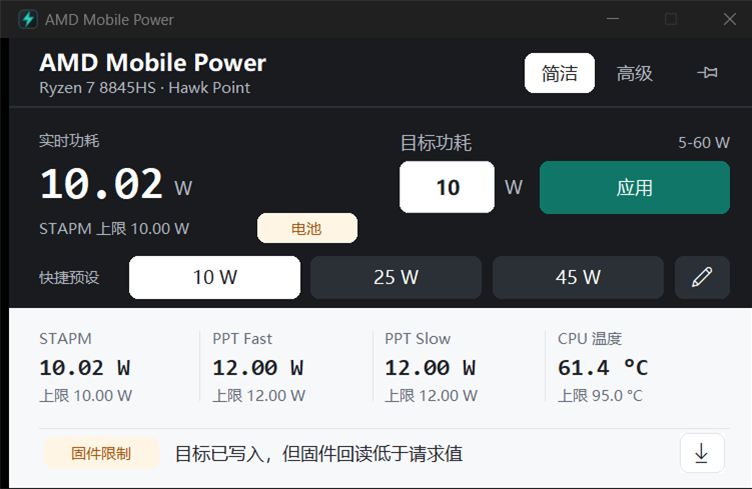

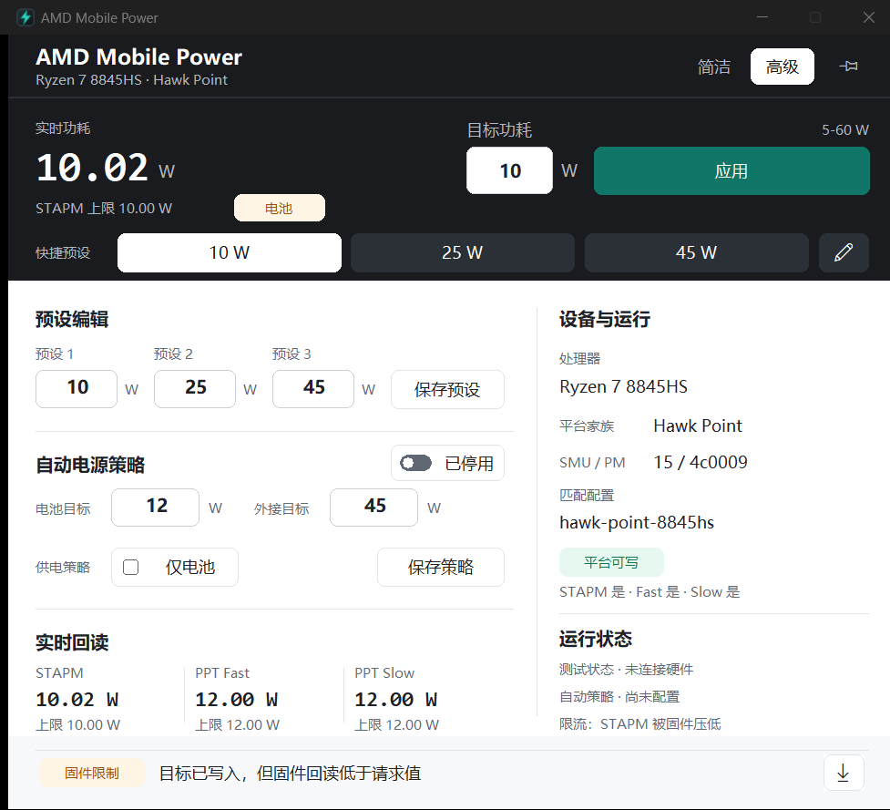

Earlier rewrite screenshots:

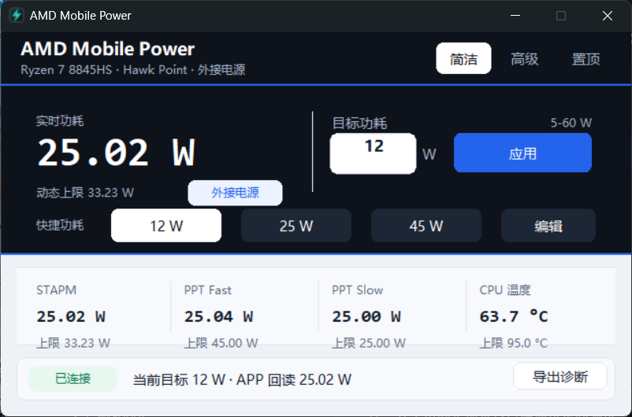

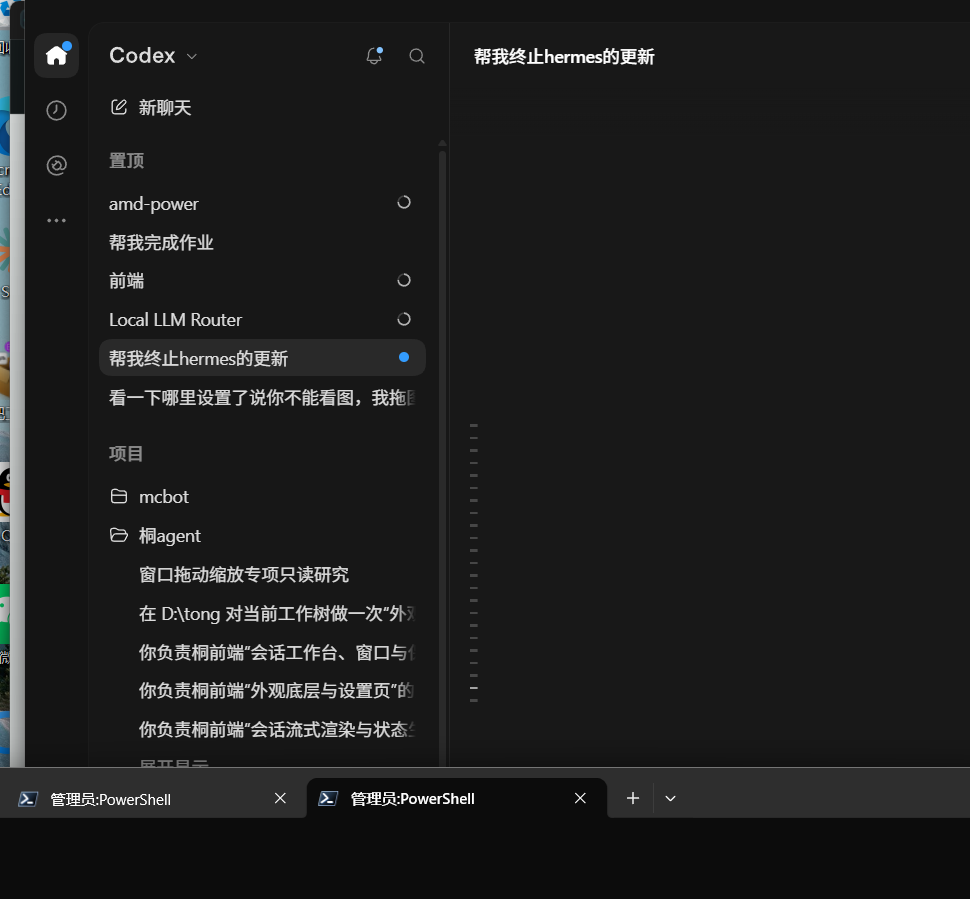

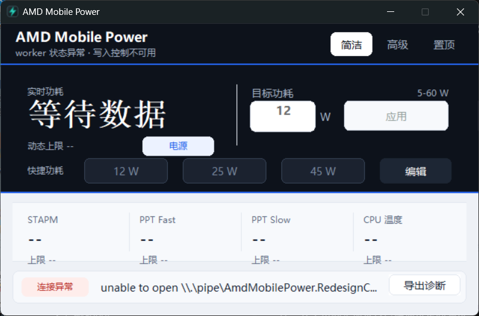

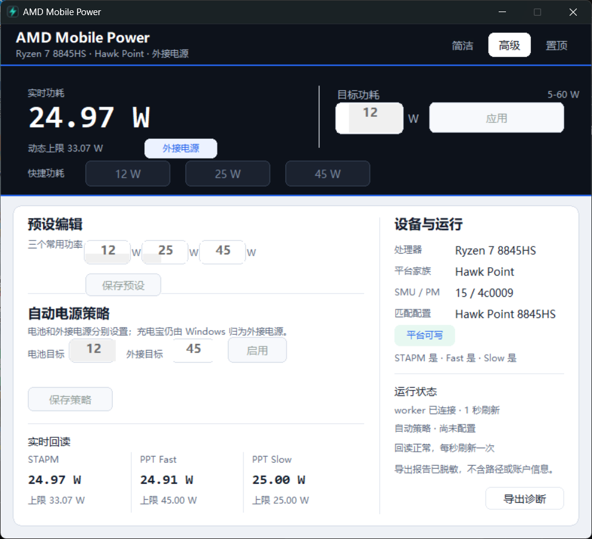

Historical development screenshots:


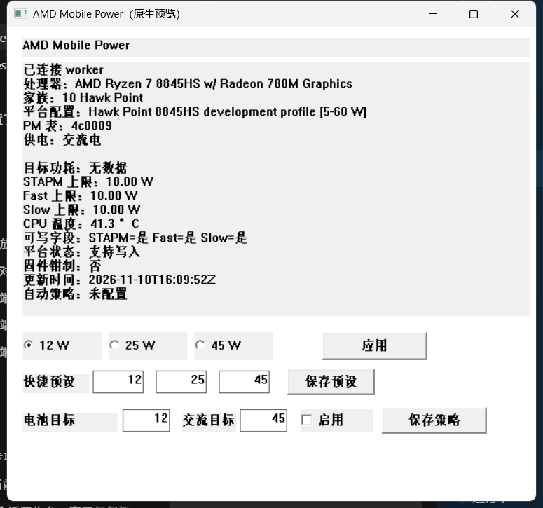

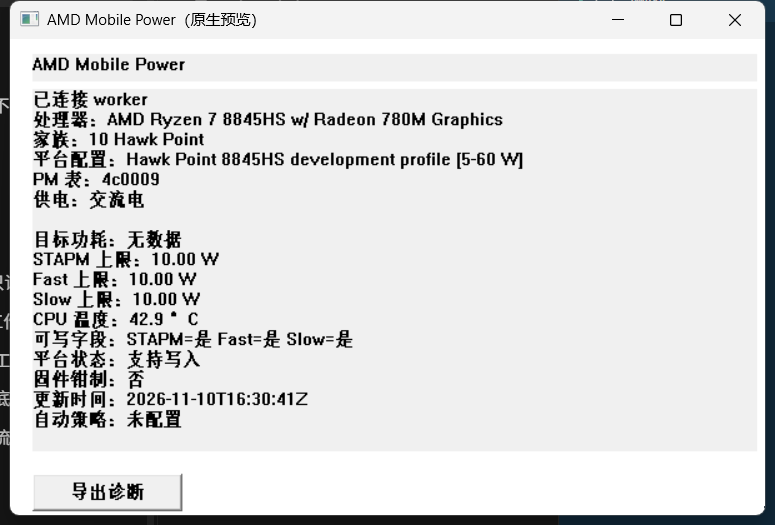

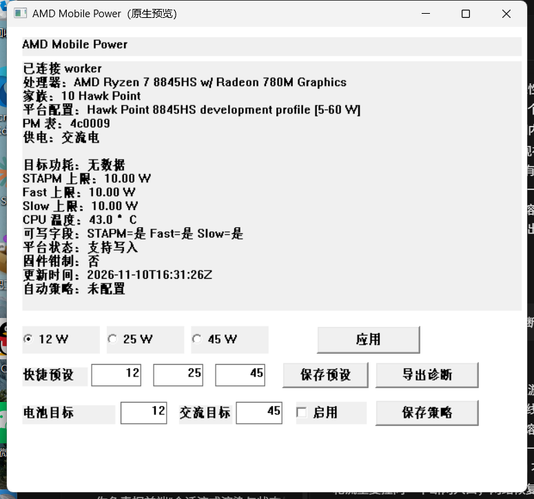

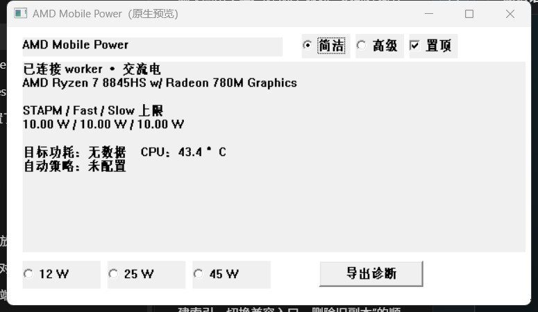

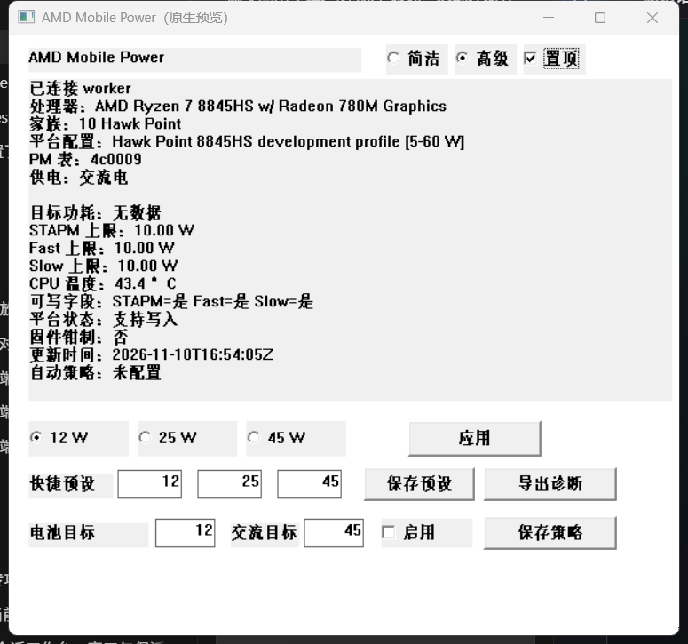

## In Progress

- Verify WinRing0 behavior under a clean Windows security baseline and document
  any driver-blocking failures.
- Add more AMD generation profiles and verify a second physical laptop when
  available.
- Obtain read-only capability evidence from a second physical AMD laptop.
- Broaden the packaged native worker's hardware matrix beyond the 8845HS and
  collect a second-device write/read-back smoke test; keep the
  `C:\RyzenAdj.before-20261111-223017` backup as the .NET stable fallback.
- The native UI now has deterministic 100%/125%/150% logical layout fixtures;
  final monitor-transition evidence in real 100% and 150% Windows sessions is
  still pending. The current display session is 125%.
- Complete human review of the v9 promotional video, cover, claims, and launch
  copy.
- Obtain explicit owner approval and an authenticated session before creating
  the public GitHub Release or uploading to Bilibili.

## Next Concrete Task

Run the real OS-level 100% and 150% DPI sessions on hardware, complete the
clean-Windows WinRing0 baseline, and collect read-only evidence from a second
AMD device when one is available. Then finish human review of the release
media and obtain explicit approval before public GitHub or Bilibili
publication. Keep the pre-promotion `C:\RyzenAdj` backup until those gates
close, and never promote a dirty or write-unverified native package.

The native GUI is now the stable-local deployment for the verified 8845HS
platform. The `.NET` `1.0.4` directory is retained as the fallback.

## Known Risks

- Windows driver security software may block WinRing0.
- Firmware and EC behavior varies by laptop vendor and BIOS profile.
- STAPM writes may report success while being clamped.
- RyzenAdj's SMU test/request polling loops have no timeout. A broken
  WinRing0/inpout/SMU state can spin one CPU core and later raise a native
  `AccessViolationException`; the GUI now fails closed but cannot safely reset
  the driver without a reboot.
- RyzenAdj, InpOut32, and WinRing0 engineering redistribution obligations are
  recorded in `LICENSING_REVIEW.md`; this is not a legal opinion. WinRing0 may
  still be blocked or unloaded by Windows security software.
- Bilibili publishing requires an authenticated session and final human review.

## Release Gates

Do not publish a stable release or promotional video until:

- GUI and worker communicate through the documented named pipe protocol.
- At least two AMD platforms or generations have manual verification evidence.
- Read-back verification is mandatory for every limit.
- Portable ZIP and installer both build reproducibly.
- Installation, upgrade, and uninstall are tested.
- Third-party notices and licenses are complete.
- A release checklist and installation documentation exist.

The controlled no-change write gate and supervised AC/battery policy transition
are complete for the development 8845HS. The `1.0.4` release and deployment
gates pass on this laptop. Broad public hardware support still requires a second
verified AMD platform or generation.

