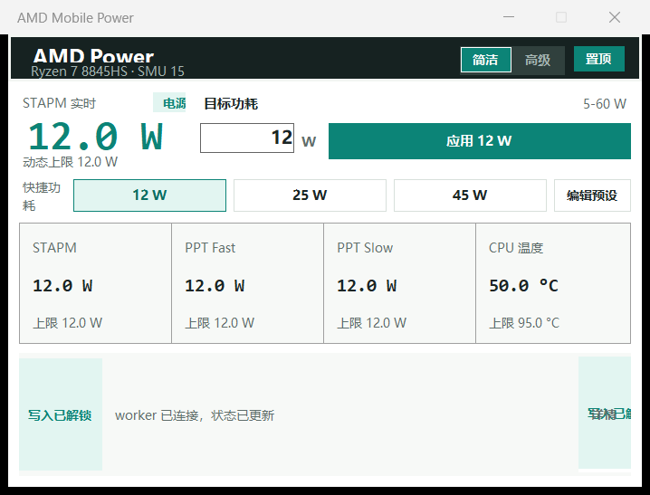

# Development Status

Last updated: 2026-11-10

## Objective

Create a broadly compatible, open-source AMD laptop power manager with:

- A native Windows GUI and notification-area workflow.
- A privileged worker that owns all hardware access.
- Capability detection instead of hardcoded assumptions.
- Read-back verification and clear firmware-limit diagnostics.
- Portable and installed distribution packages.
- Documentation, compatibility evidence, and release media.

## Source of Truth

This file is the first file every maintenance session must read. Update it
after each meaningful change. Conversation history and compacted summaries are
not authoritative.

## Current Repo State

- GitHub remote: `https://github.com/syttys123/amd-mobile-power.git`
- Local directory: `D:\amd-mobile-power`
- Stable deployment directory: `C:\RyzenAdj`
- Documentation audit starting point: commit `53e1935` (`ci: build portable
  package on Windows`). Always verify the live value with `git rev-parse HEAD`;
  this line is historical evidence, not a permanent current-head marker.
- The remote was empty when cloned.
- The repository now contains the documentation and maintenance baseline.
- The initial .NET 8 solution skeleton builds with zero warnings and errors.
- Baseline commit `f9d1be5` was pushed to `origin/main`.
- The intended project name is `amd-mobile-power`. The GitHub repository still
  uses the original `amd-mobile-power` URL because GitHub CLI is not installed locally.
- The current Release build has 71 passing tests across Core, Worker, and GUI.
- A real hardware read-only probe against the development laptop succeeded.
- The repository GUI now reads through the named pipe and updates every second.
- The GUI defaults to read-only; hardware writes require the explicit
  `--enable-write-controls` development flag.
- A self-contained Windows x64 portable ZIP now builds reproducibly.
- The current development package was rebuilt from clean commit `71be9c8`:
  593,944 bytes, SHA256
  `020d2b8d5f28955b894612020292285f821d556b22ebacd905154c933601e87b`.
- The current local stable package is `1.0.4`: 594,763 bytes, SHA256
  `f54558295515f875b655a2bdf420c719b907639999700988f0a5910deb033433`,
  built from clean commit `b2ac5f4` with .NET SDK `10.0.400`.
- `C:\RyzenAdj` now contains the verified `1.0.4` package. The previous `1.0.3`
  deployment is preserved as `C:\RyzenAdj.before-v1.0.4-20261110-190202` and
  under
  `artifacts\deployment-backups\C-RyzenAdj-before-v1.0.4-20261110-190202`.

## Development Workflow

- Develop only under `D:\amd-mobile-power`.
- Build and test from source on D:.
- Promote a build to `C:\RyzenAdj` only after automated and hardware checks.
- Keep the current C: deployment recoverable until the promoted build passes
  startup, tray, worker, and power-limit verification.
- Never edit production files in `C:\RyzenAdj` as part of normal development.

## Working Prototype

A working prototype exists outside this repository at `C:\RyzenAdj` on the
current development laptop.

Verified prototype behavior:

- CPU: AMD Ryzen 7 8845HS.
- Worker runs under PowerShell 7.6.9.
- Native `RyzenPower.exe` shell already provides GUI, taskbar icon, tray icon,
  close-to-tray, single-instance wake-up, and editable presets.
- Background supervisor launches the PowerShell 7 worker through a hidden
  scheduled task.
- Current development mode during the last verification: AC power, 25 W.
- STAPM, Fast, and Slow limits read back as 25.00 W in that state.
- At a requested 45 W, Fast and Slow read back as 45 W, but firmware clamps
  STAPM back to 25 W. Even `--max-performance` did not lift that clamp.

Prototype assets and files include:

- `RyzenPower.exe`
- `src/RyzenPowerGui.cs`
- `src/make-icon.ps1`
- `assets/ryzen-power.ico`
- `power-gui.ps1`
- `powerctl.ps1`
- `ryzen-worker.ps1`
- `readjust-service.vbs`
- RyzenAdj binaries and WinRing0 dependencies

The prototype is not yet copied into this repository. Dependency and license
review must happen before vendoring binary files.

## Target Architecture

```text
src/
  AmdMobilePower.Gui/
  AmdMobilePower.Worker/
  AmdMobilePower.Core/
  AmdMobilePower.Diagnostics/
tests/
  AmdMobilePower.Core.Tests/
  AmdMobilePower.IntegrationTests/
docs/
assets/
build/
third_party/
```

- GUI: user-level WinForms process, tray lifecycle, presets, diagnostics view.
- Worker: privileged process, RyzenAdj access, telemetry loop, command handling.
- Core: named pipe contracts, validation, profile models, telemetry parsing.
- Diagnostics: capability reports and support bundles.

## Completed

- Defined project objective and safety boundaries.
- Defined repository maintenance rules.
- Chose local project name: AMD Mobile Power.
- Defined native GUI plus privileged worker architecture.
- Recorded the existing prototype state and key hardware observations.
- Created GUI, worker, core, and xUnit projects in the .NET 8 solution.
- Verified the initial Release build with zero warnings and zero errors.
- Added immutable power target, power-line, telemetry, validation, and clamp
  detection contracts.
- Added backward-compatible parsing for prototype key/value telemetry.
- Added seven passing unit tests.
- Added GitHub Actions Windows build workflow.
- Added the initial hardware evidence matrix.
- Added the first maintenance commit and pushed it to the remote.
- Added a versioned JSON-lines named pipe protocol with request IDs and
  structured errors.
- Added a reusable named pipe client in Core.
- Added a worker server with a no-hardware `getHealth` endpoint.
- Added integration tests for health responses and unsupported commands.
- Full Release build remains at zero warnings and errors.
- Added CPU platform, power-capability, read-back, and hardware-adapter
  contracts.
- Added wildcard-based platform profiles with conservative default and 8845HS
  development profiles.
- Test suite now includes twelve passing tests across Core and Worker.
- Added RyzenAdj upstream as a Git submodule at commit
  `5775fc3e6dbb25c7030ee2d100a1bdd6e8bf2d0a`.
- Added `build-ryzenadj.ps1` and successfully built `libryzenadj.dll` from the
  pinned submodule with Visual Studio 2026 and CMake.
- Recorded RyzenAdj LGPL-3.0 and unresolved Windows-driver redistribution
  concerns in the third-party notices.
- Added an opt-in native RyzenAdj adapter that loads runtime dependencies beside
  the worker executable and exposes capability and telemetry reads.
- Added `getSnapshot` as a read-only named pipe command with profile matching.
- Added mandatory target-range and capability validation inside the adapter
  before any future power-limit write.
- Verified a clean Release build with zero warnings and 22 passing tests.
- Verified `getCapabilities` and `getSnapshot` on the Ryzen 7 8845HS:
  - SMU BIOS interface `15`.
  - PM table `4c0009`.
  - STAPM, Fast, and Slow all reported as supported.
  - Matched profile `hawk-point-8845hs`.
  - Probe ran while on AC and performed no hardware writes.
- Added the `applyTarget` named pipe contract.
- Added profile-aware and capability-aware target validation.
- Added mandatory read-back checks and automatic STAPM/Fast/Slow restore when a
  write or read-back fails.
- Added adapter tests for successful writes, firmware clamps, partial writes,
  missing read-backs, unexpected read-back increases, native exceptions, and
  restore failures.
- Added `docs/HARDWARE_TEST_PROCEDURE.md`.
- Added the native WinForms read-only GUI shell with:
  - Named pipe snapshots instead of shared text files.
  - Hidden worker startup with no console window.
  - CPU, SMU, PM table, power line, live power, limits, and temperature display.
  - One-second telemetry refresh without overlapping requests.
  - Editable 12/25/45 W presets stored under `%LocalAppData%\AmdMobilePower`.
  - Tray icon, close-to-tray behavior, single-instance wake-up, and app icon.
- Verified the GUI at 175% Windows display scaling with the two-column layout
  fully visible and no clipped labels.
- Verified that a second GUI launch exits and wakes the existing instance.
- Verified that the worker runs without a visible window.
- Added `build-package.ps1` and `docs/PACKAGING.md`.
- Verified the packaged GUI starts only one visible GUI process and launches
  `worker\AmdMobilePower.Worker.exe` with no visible console window.
- Verified the packaged worker responds to `getSnapshot` with the expected
  8845HS platform and telemetry data.
- Current local package:
  - Path: `artifacts/packages/amd-mobile-power-v0.1.0-win-x64.zip`
  - Size: 106,647,225 bytes
  - SHA256:
    `c61dcbea652c98ec0b1a80550910bc7f01c62c182b32b431f7e03aa2528dc441`
  - Source commit: `cba9c91`
  - Working tree at build time: clean
- Verified first install, overwrite upgrade, and uninstall against an isolated
  `artifacts/test-install` directory without changing shell integration.
- Re-verified isolated install and uninstall with the license-bearing package;
  all three third-party license files were present after installation.
- Re-hashed every file in the current migration package's staged
  `SHA256SUMS.txt`; all entries match, and the ZIP hash matches its adjacent
  `.sha256` file.
- Added CI-side portable package generation with uploaded ZIP and SHA256
  artifacts on pushes.
- Made `build-ryzenadj.ps1` detect Visual Studio 2019/2022/2026 automatically;
  the VS 2026 local rebuild path was reverified.
- Added `exportDiagnostics` over the named pipe.
- Diagnostics include platform capability, profile match, telemetry, worker/OS
  architecture, executable directory, and SHA256 values for four RyzenAdj
  runtime files.
- Verified a real diagnostics export on the 8845HS with all four runtime files
  present and hashed.
- Added an explicit worker-level `--enable-write-controls` gate in addition to
  the GUI flag.
- Added battery/AC power policy settings with a one-second monitor and automatic
  switching on power-line changes.
- Added a named hardware-owner mutex and legacy `RyzenPower`/`ryzenadj` process
  detection.
- Reproduced an access violation caused by running the legacy and new hardware
  owners together; the new GUI now blocks startup and reports the conflicting
  process instead of launching a second RyzenAdj owner.
- Added GUI controls for optional automatic battery/AC targets; they remain
  disabled in read-only mode.
- Persisted automatic policy settings in the existing local UI state file so
  presets and policy updates do not overwrite each other.
- Added a documentation index, installation/recovery guide, security guide,
  supported-hardware guide, and refreshed README.
- Clarified that read-only mode is a runtime write gate, not a filesystem mode
  or lack of write-capable code.
- Reconciled architecture documentation with the current child-worker process,
  named-pipe commands, package profiles, and LocalAppData storage.
- Renamed live STAPM, PPT Fast, PPT Slow, and temperature captions to
  "实际 / 上限" so requested targets cannot be mistaken for current firmware
  limits.
- Expanded hardware-owner detection to cover the legacy
  `Local\RyzenAdjPowerWorker` mutex and running `\AMD\RyzenAdj*` scheduled tasks.
- Confirmed on the development laptop that closing `RyzenPower.exe` left
  `\AMD\RyzenAdjWatch` running with an elevated hidden PowerShell worker; the
  old process-name-only check missed it and a read-only probe crashed natively.
- Added a Core regression test for legacy-worker mutex detection. The suite now
  has 37 passing tests: 14 Core and 23 Worker.
- Made portable publishing independent of the NuGet vulnerability endpoint by
  disabling NuGet Audit inside the package build.
- Rebuilt the portable package from clean commit `b48c011`.
- Completed redistribution review for the bundled InpOut32 and WinRing0 files:
  the official InpOut binary hash matches and includes MIT terms; WinRing0 uses
  the OpenLibSys two-clause BSD terms.
- Added complete license texts under `third_party/licenses/`.
- Rebuilt the portable package from clean commit `783e0e0` and verified that the
  staged ZIP license directory contains RyzenAdj, InpOut32, and WinRing0 texts.
- Runtime-verified close-to-tray on the current Release GUI: WM_CLOSE hid the
  window while PID `91956` remained responsive; a second launch woke the same
  process, left one GUI instance, and made the window visible again.
- Stopped `\AMD\RyzenAdjWatch` on 2026-11-09 and confirmed
  `Stop-ScheduledTask` left the elevated hidden `pwsh.exe` child alive. Ending
  that child removed the legacy mutex, but subsequent old and new RyzenAdj
  probes both reported `Unable to get MP1 SMU Obj`; the new worker then crashed
  natively in `init_ryzenadj`.
- Added a recovery gate: after force-terminating a RyzenAdj owner, reboot before
  attempting another probe or any hardware write.
- Added fail-closed worker handling: a hardware-read timeout now kills the
  unresponsive worker, blocks automatic restart attempts, and asks for a Windows
  reboot instead of relaunching the worker every refresh tick.
- Negative-tested the fail-closed path against the known bad driver state:
  the worker timed out once, exited, and remained at zero worker processes
  while the GUI stayed responsive with the recovery message.
- Added a Core regression test confirming that named-pipe request cancellation
  becomes an explicit `TimeoutException` for the GUI recovery path.
- Extended fail-closed handling to worker startup: if the process does not begin
  listening within the startup deadline, the GUI stops it and does not retry
  automatically.
- Rebuilt the portable package from clean commit `cba9c91` with the complete
  fail-closed worker behavior.
- Isolated-installed the current package without startup or shell integration,
  confirmed the migration script, migration guide, release checklist, and all
  three license files were present, then uninstalled it successfully.
- Re-verified every staged `SHA256SUMS.txt` entry and the outer ZIP SHA256 after
  the final package contents were staged.
- Added a framework-dependent lite package mode to `build-package.ps1`.
- Built the lite package from a detached clean worktree at commit `624d959`:
  - ZIP size: 449,612 bytes.
  - SHA256:
    `e4c58b20e2efd45f4119920c3b0d7c083b0b30cfcd6061748bd3b63e3c760318`.
  - Requires the Microsoft .NET 8 Desktop Runtime x64.
  - Working-tree state at build time: clean.
- Smoke-tested the lite GUI while the legacy hardware owner prevented worker
  startup. The GUI working set was about 56 MB, private memory about 14.6 MB,
  and startup CPU time about 0.45 seconds. This measurement covers the GUI only,
  not a connected worker or live hardware polling.
- Rebooted the development laptop for driver-state recovery. The enabled
  `\AMD\RyzenAdjWatch` logon trigger immediately restarted the legacy
  `RyzenPower` GUI and hidden worker, and `Local\RyzenAdjPowerWorker` was present
  again before the new GUI started. This confirms the task must be disabled
  before reboot for migration.
- Ran `packaging/migrate-legacy-owner.ps1 -Apply` after that reboot. The task
  state changed to `Disabled`; the old GUI and hidden worker still existed in
  the current session and require one final reboot to clear.
- Found that the legacy GUI also had `Ryzen Power.lnk` in the current user's
  Startup folder. Renamed it to `Ryzen Power.lnk.disabled` before reboot and
  updated the migration helper/documentation so future migrations disable both
  the logon task and the GUI startup shortcut.
- Confirmed after reboot that legacy processes and the legacy mutex were gone,
  but the new worker initially failed with `WinRing0 status=2 (driver not
  loaded)` because the demand-start kernel driver is not started automatically.
- Added `packaging/install-driver-bootstrap.ps1`, which installs a stable
  ProgramData driver copy and a highest-privilege logon task that starts only
  the WinRing0 service. The GUI and worker remain non-elevated.
- Installed `\AmdMobilePower\StartWinRing0`; manually running the task returned
  exit code `0`, and the driver path is now
  `C:\ProgramData\AmdMobilePower\driver\WinRing0x64.sys`.
- Verified the new GUI connects after driver startup: SMU `15`, PM table
  `4c0009`, AC telemetry present, and live STAPM/Fast/Slow/temperature values.
- Verified the balanced BIOS profile exposes a dynamic STAPM limit that moved
  between roughly 25 W and 40 W. The first implementation incorrectly treated
  a higher dynamic STAPM readback as a total write failure and restored
  Fast/Slow.
- Changed the first-write policy so only non-STAPM readback increases are
  treated as unsafe. A real 12 W test then succeeded: actual STAPM was 12.0 W,
  Fast/Slow limits were 12.0 W, and the BIOS dynamic STAPM ceiling remained
  about 25 W. Added a regression test; the suite now has 38 passing tests.
- Confirmed on the development laptop that PPT Fast and Slow are the effective
  required caps: at a 12 W target both read back as 12 W while the firmware
  reports a dynamic STAPM ceiling between roughly 16 W and 25 W.
- Changed write semantics so Fast and Slow must pass transport and read-back
  validation, while STAPM is written best-effort and excluded from success and
  rollback decisions. This keeps low-power targets effective when firmware
  rejects or dynamically rewrites STAPM.
- Found the recurring worker startup crash was caused by a client disconnect
  before a complete pipe frame, followed by `Mutex.ReleaseMutex()` running on a
  different thread during async shutdown. The mutex exception masked the pipe
  error and made the GUI enter its hardware-timeout lockout.
- Replaced the hardware-owner mutex with a named process-scoped event and made
  incomplete client connections non-fatal to the server loop. Added a
  regression test where a client connects and disconnects before sending a
  frame, then verifies a later health request still succeeds.
- Attempted an elevated restart of both `WinRing0_1_2_0` and `inpoutx64` with
  no RyzenAdj process running. Both services returned to `Running`, but the
  legacy `ryzenadj.exe --info` still hung in the SMU polling loop. Service
  restart is therefore insufficient; a Windows reboot remains required.
- Rebuilt the portable package from clean commit `0276c5b`; it contains the
  fail-closed worker recovery behavior, migration helper, migration guide, and
  release checklist.
- Added persistent simple and advanced GUI modes in the same executable.
  Simple mode is a fixed compact window with one uniform target input, editable
  presets, a live STAPM value, and one-line STAPM/Fast/Slow/temperature
  metrics. Advanced mode retains the two-column dashboard and independent
  three-limit controls. Both modes share the same worker, telemetry, presets,
  and pending target values.
- Added title-bar and tray-menu mode switching. The selected mode is stored in
  `%LocalAppData%\AmdMobilePower\ui-state.json` and restored at launch.
- Added a persistent always-on-top toggle in both the compact header and tray
  menu.
- Removed numeric spin buttons from GUI watt inputs while retaining numeric
  range validation.
- Verified both mode pages at the current 125% Windows scaling without startup
  crashes or control overlap. Long diagnostic messages remain intentionally
  ellipsized in the compact status strip. Verified that changing the simple
  target to 25 W updates STAPM, Fast, and Slow to 25 W when switching to
  advanced mode. Verified the always-on-top toggle sets the Win32 topmost style
  and survives through the UI-state file.
- Reworked simple mode against the legacy compact hierarchy and expanded it to
  `560x400`: quick-power presets are stacked vertically in a dedicated left
  rail; the main column contains a full-width target row, a large live STAPM
  value with power bar, a separate four-row telemetry panel, and the status
  strip. Removed the horizontal preset row that compressed the labels.
- Cleared default WinForms margins from fixed-height labels, disabled automatic
  ellipsis on simple-mode value labels to remove the native floating tooltip,
  and verified that the target, telemetry, and status text no longer overlap.
- Removed the simple-mode power progress graphic below the live wattage. The
  numeric value, AC/battery badge, firmware limit summary, and detailed
  telemetry remain visible.
- Verified the revised simple mode with a real window screenshot while the
  worker was online at a 10 W limit; all four telemetry values and the target
  controls were visible. The full suite remains at 41 passing tests.
- Added lightweight rolling diagnostic logs for the GUI and worker under
  `%LocalAppData%\AmdMobilePower\logs`. Logs are daily, retain seven days, and
  avoid per-second telemetry spam by recording lifecycle, connection changes,
  write outcomes, and exceptions only.
- Extended diagnostics export with the log directory and recent GUI/worker log
  excerpts so a single report is useful for field support. Added deterministic
  logger tests and an injected worker logging test. The suite now has 44
  passing tests.
- Built a new framework-dependent `0.1.1-dev` package from the current dirty
  source tree. The ZIP is 464,709 bytes with SHA256
  `44b0602ef43c45738b974ed0ee52b2e62023f2d0dda85e28c9ec40e25c4332f0`.
- Verified the candidate package in an isolated artifact directory: install,
  file layout, and uninstall passed. Read-only launch also passed; the packaged
  worker connected and reported AC telemetry with 10W STAPM/Fast/Slow limits.
  This package remains a development candidate because the source tree was
  dirty at build time.
- Audited the local UI research corpus and catalogued 24 official design-system
  repositories, Apple HIG, Atlassian guidance, and the existing SQLite UI index
  in `docs/UI_DESIGN_DATABASE.md`. The document separates local evidence,
  source-code findings, implementation recommendations, and runtime-only
  checks, then defines the `560x400` compact-layout target.
- Reworked compact mode into a four-band layout: live power and target controls,
  one horizontal preset strip, a four-column telemetry matrix, and a persistent
  status bar with a visible read-only/write-state badge.
- Fixed compact mode so the initial target comes from the first editable preset
  instead of the profile default. On the development profile it now starts at
  12 W rather than 25 W.
- Fixed the compact apply button so read-only and applying states actually
  disable it; the previous `enabled || !_applying` condition could leave the
  button active while hardware writes were locked.
- Moved DPI sizing to run after WinForms auto-scaling. At 125% scaling the
  compact window now reports a `700x500` client area, and UI Automation plus
  Windows OCR confirm that the right-side target controls and four telemetry
  columns fit inside the window.
- Applied and read back 10 W, then 12 W, through the compact GUI while the
  laptop was powered by a power bank. Both writes completed; STAPM, Fast, and
  Slow read back at the requested limit, and the GUI remained responsive.
- Renamed the two unused historical compact-layout builders and marked them
  obsolete so future maintenance edits the active `BuildSimpleWorkspace()`
  path.
- Centralized product metadata in `Directory.Build.props`: GUI and worker now
  share the product name, version, company, copyright, repository URL, embedded
  application icon, deterministic builds, and source-revision settings.
- Replaced the hardcoded GUI footer with `Application.ProductVersion` and the
  worker protocol version. Verified that one `-p:Version=0.1.2-dev` publish sets
  both executables to product version `0.1.2-dev` and file version `0.1.2.0`.
- Built `artifacts/packages/amd-mobile-power-v0.1.2-dev-win-x64-lite.zip`.
  The package is 554,191 bytes with SHA256
  `38a258e9ca47a10b98593c629715e4f4912366d3fd5ced614a0c8a2b44c592cf`.
  All 30 staged checksums match, isolated install/uninstall passed, and the
  packaged read-only GUI started its packaged worker successfully. The source
  tree was dirty at build time, so this is a development candidate rather than
  release evidence.
- Added RyzenAdj's own CPU-family identifier to platform capability data and
  profile matching. This fills a real gap because Windows CPU information did
  not provide reliable CPUID family/model values.
- Added seven conservative family profiles covering legacy Vega, Renoir/
  Cezanne/Lucienne, Rembrandt/Phoenix, Mendocino, Dragon/Fire Range,
  Krackan/Strix Point, and Strix Halo. Every profile is explicitly marked
  unverified and retains capability/read-back validation.
- Added profile-priority and worker capability tests. The suite increased from
  44 to 47 passing tests.
- Replaced the native `NumericUpDown` implementation with a pure numeric text
  entry, removing the residual gray spinner artifact. The live power value now
  renders as one `12.0 W` label. Both compact and advanced mode now label
  external power as `电源`, because Windows cannot distinguish a power bank
  from a wall adapter.
- Removed the compact-mode power-line badge beside `目标功耗`; its `--` startup
  placeholder looked like a gray dot. The current source now appends `电源` or
  `电池` to the `动态上限` line below the live STAPM value.
- Rebuilt `artifacts/packages/amd-mobile-power-v0.1.3-dev-win-x64-lite.zip`
  with the final UI and multi-generation profile changes. The package is
  564,349 bytes with SHA256
  `d6c1046a30505d76f2777018d8f572ef73fe8e85658035a7ae053c4e11f800eb`.
  All 37 staged checksums match, nine profiles are present, isolated
  install/uninstall passed, and packed read-only startup launched the packed
  worker with a connected GUI.
- Expanded diagnostics schema 1 with protocol version, pipe name, hardware-
  adapter and write-control state, worker executable SHA256, RyzenAdj family
  number/name, and every available profile with its match patterns and ranges.
- Verified a live `exportDiagnostics` response on the 8845HS: family `10`
  (`Hawk Point`), SMU `15`, PM table `4c0009`, profile
  `hawk-point-8845hs`, nine profiles, five runtime-file entries, and a worker
  executable hash were all present in one JSON response.
- Repeated the diagnostics export from the packed read-only build: version
  `0.1.3-dev`, family `Hawk Point`, matched device profile, nine profiles, five
  runtime-file entries, hardware adapter present, and write controls disabled.
- Passed the controlled no-change write gate with the packaged `0.1.3-dev`
  GUI/worker. Initial, requested, read-back, and final STAPM/Fast/Slow values
  were all 12 W; no restore, firmware clamp, or STAPM warning was reported.
  The evidence summary is
  `docs/evidence/hardware/mechrevo-wujie15-8845hs-no-change-2026-11-10.json`.
- Stopped the packaged GUI/worker after the no-change test and confirmed no
  `AmdMobilePower` or `RyzenAdj` process remained.
- Completed the engineering third-party redistribution review. Packages now
  include the pinned RyzenAdj LGPL-3.0 text, canonical GPL-3.0 text, InpOut32
  MIT notice, WinRing0 BSD notice, and instructions for replacing the separate
  `worker\libryzenadj.dll` with a compatible build.
- Verified the clean-tree Lite package with 39 staged files, 38 SHA256 entries,
  nine profiles, four license files, no logs or machine state, isolated first
  install/overwrite/uninstall, and a default read-only GUI/worker launch.
- Corrected the Lite package README so it now states that
  `-FrameworkDependent` builds require the Microsoft .NET 8 Desktop Runtime x64
  instead of claiming every package is self-contained.
- Split hardware-conflict evaluation into deterministic inputs and added tests
  for the legacy worker mutex, all three known process owners, all four running
  scheduled tasks, precedence, and the no-conflict case. The suite increased
  from 47 to 57 passing tests.
- Added an injectable worker-process boundary and GUI tests for hardware-read
  timeouts and worker-start timeouts. Both paths stop the worker once, enter
  locked fail-closed state, and refuse later refreshes without restarting it.
  The suite increased from 57 to 59 passing tests.
- Recorded the current Windows build `26300.9711`, Windows Defender real-time
  protection, WinRing0 signature/service state, binary hashes, and packaged
  read-only telemetry evidence in `WINDOWS_DRIVER_SECURITY.md`. Clean-VM and
  third-party endpoint-protection validation remain open.
- Added a visible `导出诊断` action to advanced mode while retaining the tray
  entry, and fixed compact mode to hide the advanced footer instead of leaving
  its controls in a zero-height layout row.
- Captured healthy external-power, preset-editor, legacy-conflict,
  diagnostics-save, clean-package, tray-menu, and real-battery dashboard states
  with zero visible boundary violations.
- Reconciled the hardware matrix with current 10 W, 12 W, 25 W, and 45 W
  request/read-back evidence. Firmware-clamped STAPM values are documented
  separately from Fast/Slow transport failures and restore behavior.
- Removed the compact-mode gray `--` placeholder beside `目标功耗`; the live
  summary now reads `动态上限 ... · 电源/电池`.
- Upgraded the shared test toolchain to Test SDK 18.11.0, xUnit v3 4.0.3,
  Visual Studio Runner 4.0.1, and Coverlet 10.1.0. The previous test
  dependencies pulled vulnerable `System.Net.Http` 4.3.0 and
  `System.Text.RegularExpressions` 4.3.0 transitively. xUnit v3's analyzer also
  required every asynchronous test call to use the current test cancellation
  token, which is now enforced. A test-only
  `System.Diagnostics.DiagnosticSource` 8.0.1 override removes the remaining
  deprecated transitive package.
- Added `verify-dependencies.ps1` as a machine-readable release and CI gate. It
  verifies complete project coverage, rejects every reported advisory or
  deprecated package, and runs automatically inside `verify-release.ps1` and
  the Windows build workflow. Windows PowerShell 5.1 and PowerShell 7 both
  complete the six-project audit.
- Verified the solution with an isolated .NET SDK `8.0.427`: restore, Release
  build, 71 tests, formatting, and dependency audit pass with zero warnings.
  The CI workflow now pins this tested SDK patch instead of tracking `8.0.x`.
- Fixed three installer defects found by current-user integration testing:
  scheduled-task permission failures now reset the native exit code before the
  Startup-folder fallback, task-not-found checks no longer make uninstall fail,
  and registry uninstall commands now preserve a custom install directory.
- Added `verify-shell-integration.ps1` and the optional
  `verify-release.ps1 -VerifyShellIntegration` gate. It verifies the Start menu
  shortcut, uninstall entry, custom-directory uninstall command, and either the
  logon task or the Startup-folder fallback, then cleans every created artifact.
- Hardened profile loading against duplicate IDs and added regression coverage
  that loads every shipped profile, confirms the default profile matches an
  unknown AMD CPU, and rejects case-insensitive duplicate IDs. The suite
  increased from 59 to 61 passing tests.
- Added `verify-tray-menu.ps1`, which locates the real hidden-tray icon,
  validates its live power tooltip and 11-item upward context menu, captures
  the release screenshot, and closes without invoking an action.
- Added `verify-release.ps1 -VerifyTrayMenu`; runtime screenshots are written
  under ignored `artifacts/verify` so an interactive media check does not dirty
  the release worktree.
- Extended the tray verifier with opt-in `-VerifyGracefulExit`, which invokes
  the real Exit menu item and requires both packaged processes to disappear.
- Hardened the tray verifier against transient process-exit property failures
  and false menu captures by requiring the context menu to open upward and
  remain horizontally anchored to the notification icon.
- Added `render-promo.ps1` and the JSON storyboard for a reproducible Chinese
  development-preview video. The current draft is 77.1 seconds at 1920x1080,
  includes the read-only diagnostics collector, enforces text safe-width
  bounds, passes full FFmpeg decode and audio-level checks, and remains
  `DRAFT_FOR_HUMAN_REVIEW`.
- Implemented the versioned `shutdown` worker command with a
  response-before-exit test; GUI teardown now tries graceful shutdown before
  falling back to process termination.
- Added `verify-power-policy.ps1` with a read-only preflight mode and an
  explicitly confirmed AC/battery baseline, transition, and restore workflow.
- Added `collect-diagnostics.ps1` for compatibility reports from a portable
  package without opening the GUI. It starts only the hidden read-only worker,
  uses an isolated pipe, writes a whitelisted and path-sanitized JSON report,
  and requires graceful protocol shutdown. Release verification can exercise
  this path with `-VerifyDiagnostics`.
- Rebuilt the clean Lite package after adding product analyzer hardening and
  the dependency vulnerability and deprecation gate. The package is 593,944
  bytes with SHA256
  `020d2b8d5f28955b894612020292285f821d556b22ebacd905154c933601e87b`,
  built from commit `71be9c8` with .NET SDK `8.0.427`, and contains 40 files
  with 39 checksum entries.
  The full local gate passed with 0 build warnings, 71/71 tests, shell
  integration, tray-menu placement, graceful tray exit, and read-only
  diagnostics collection. Direct and transitive dependency audit covered all
  six projects with zero advisories. PowerShell 5.1 and PowerShell 7 both
  produced a `PASS` diagnostic report with no local drive paths or forbidden
  process/log fields.
- Added `verify-dashboard.ps1` and the `-VerifyDashboard` release gate. It
  starts the packaged read-only GUI in explicit simple mode, waits for live
  worker telemetry, verifies `动态上限 ... · 电源/电池`, and requires zero
  non-background pixels immediately left of `目标功耗`. The packaged dashboard
  pass used `动态上限 25.0 W · 电源`.
- Added `prepare-release-review.ps1`, a no-upload review bundle generator. It
  validates the package sidecar and embedded commit, rejects runtime-sensitive
  drift after the package source commit, reruns the full media gate, copies
  release and Bilibili assets, and emits a JSON manifest plus complete SHA256
  list under ignored `artifacts/release-review`. Both Windows PowerShell 5.1
  and PowerShell 7 pass. The media verifier now reads UTF-8 JSON explicitly and
  captures FFmpeg stderr without treating successful diagnostics as a failure
  on PowerShell 5.1.
- Enabled selected product analyzers as errors under `src/.editorconfig`:
  null validation, culture-stable formatting, explicit string comparison, and
  safe P/Invoke search paths. Added regression tests for the new public API
  null guards.
- Replaced the GUI's raw diagnostics serialization with the shared
  `PublicDiagnosticsReport` whitelist. The GUI and portable collector now
  exclude process IDs, worker/log directories, and recent logs while redacting
  absolute Windows and UNC paths. Regression coverage parses the exported JSON
  and verifies private fields and path values are absent.
- Added compatibility-matrix tests that require every RyzenAdj family `0-15` to
  map to exactly one shipped profile and verify every known family display name.
- Captured the real battery state through the packaged read-only GUI and worker:
  `动态上限 25.0 W · 电池`, zero visible boundary violations, and screenshot
  `assets/main-dashboard-battery-2026-11-10.png`.
- Relaxed read-only `verify-power-policy.ps1 -PlanOnly` so it can run from either
  AC or battery while the full write test still requires starting on AC. The
  battery preflight recorded a `25/25/20 W` baseline, a planned `12/12/12 W`
  target, zero hardware writes, and `shutdownProtocol=PASS`.
- Fixed the supervised power-policy test to enforce Fast/Slow read-back while
  treating STAPM as firmware-managed, and to wait for live battery power to
  settle before passing. Failure cleanup now restores the active baseline before
  surfacing the exception.
- The full AC -> battery -> AC policy transition passed on the development
  8845HS with the packaged worker. AC baseline was `39/45/25 W`, battery
  baseline was `25/25/20 W`, and the `12/12/12 W` battery target settled at
  STAPM actual `12.52 W` with Fast/Slow limits at `12.00 W`. Reconnecting AC
  restored Fast/Slow to `45/25 W`; STAPM remained firmware-dynamic as designed.
  Both baselines were restored and worker shutdown used the graceful protocol.
  Evidence:
  `docs/evidence/hardware/mechrevo-wujie15-8845hs-policy-2026-11-10.json`.
- Migrated the local test entry point to the .NET 10 Microsoft.Testing.Platform
  runner through `global.json`; `dotnet test --solution AmdMobilePower.sln`
  passes all 71 tests. CI and the release gate are now pinned to SDK `10.0.400`
  while product projects continue to target .NET 8 APIs.
- Built the clean `1.0.0` Lite package and passed the full local release gate:
  zero build warnings, 71/71 tests, dependency audit, format verification,
  isolated install/overwrite/uninstall, shell integration, tray menu/exit,
  read-only diagnostics, and the packaged dashboard gate. Evidence:
  `docs/evidence/packaging/v1.0.0-clean-2026-11-10.json`.
- Passed a packaged `1.0.0` no-change hardware write on battery: the worker
  wrote `25/25/20 W` back to the same baseline, read back all three limits at
  their requested values, kept live power near 20 W, and shut down through the
  protocol. Evidence:
  `docs/evidence/hardware/mechrevo-wujie15-8845hs-no-change-1.0.0-2026-11-10.json`.
- Promoted the verified `1.0.0` package to `C:\RyzenAdj` after a full
  recoverable legacy backup. The deployed package passed file-hash comparison,
  the packaged dashboard gate, read-only diagnostics, and a write-mode launch
  where both GUI and worker logs reported writes enabled. Evidence:
  `docs/evidence/packaging/v1.0.0-deployment-2026-11-10.json`.
- Removed the redundant bottom `详情` button from simple mode after it collided
  with the write-state badge or warped the status strip. The footer now has
  only the fixed write-state badge and a single ellipsized status line; advanced
  mode remains reachable from the header.
- Hardened `verify-dashboard.ps1` against transient WinForms UI Automation
  rectangles. It waits for a stable target label anchor, rejects any bottom
  `详情` button, checks write-state/status non-overlap, and still requires zero
  non-background pixels in the target-power left region.
- Built and verified the clean `1.0.1` Lite package from commit `01fd3ae`:
  zero build warnings, 71/71 tests, dependency audit, isolated
  install/overwrite/uninstall, shell integration, tray menu and exit,
  read-only diagnostics, and the packaged dashboard gate all passed. Evidence:
  `docs/evidence/packaging/v1.0.1-clean-2026-11-10.json`.
- Passed the packaged `1.0.1` battery no-change hardware write at
  `25/25/20 W`; STAPM/Fast/Slow read back at the requested limits, settled live
  power stayed near `20 W`, and worker shutdown used the graceful protocol.
  Evidence:
  `docs/evidence/hardware/mechrevo-wujie15-8845hs-no-change-1.0.1-2026-11-10.json`.
- Promoted `1.0.1` to `C:\RyzenAdj` after a hash-verified `1.0.0` backup. The
  deployed path passed all 40 file hashes, the new dashboard overlap gate,
  read-only diagnostics reporting worker `1.0.1`, and a write-mode shortcut
  launch using both `C:\RyzenAdj` executables. Evidence:
  `docs/evidence/packaging/v1.0.1-deployment-2026-11-10.json`.
- Diagnosed the `1.0.1` tray-restore failure from Windows Error Reporting:
  repeated WinForms message re-entry caused `System.StackOverflowException`
  (`0xc00000fd`). All tray restore paths now merge requests through
  `RequestShowFromTray()` and `BeginInvoke` instead of showing the window
  synchronously from the notification-icon callback.
- Worker startup now receives `--parent-pid`; the worker watches the GUI parent
  and performs a protocol shutdown within about two seconds if the GUI exits,
  preventing orphaned hidden workers after a crash or forced termination.
- Built and verified the clean `1.0.2` Lite package from commit `9fb180a`: zero
  build warnings, 71/71 tests, dependency audit, isolated
  install/overwrite/uninstall, shell integration, tray menu and graceful exit,
  single-click/double-click/menu restore, worker parent-exit cleanup, read-only
  diagnostics, and the packaged dashboard gate all passed. Evidence:
  `docs/evidence/packaging/v1.0.2-clean-2026-11-10.json`.
- Passed the packaged `1.0.2` battery no-change hardware write at `12/12/12 W`;
  STAPM/Fast/Slow read back at the requested limits, actual power remained
  below the ceiling, and worker shutdown used the graceful protocol. Evidence:
  `docs/evidence/hardware/mechrevo-wujie15-8845hs-no-change-1.0.2-2026-11-10.json`.
- Promoted `1.0.2` to `C:\RyzenAdj` after a hash-verified 42-file backup of the
  complete `1.0.1` deployment. The deployed path passed all 40 package hashes,
  the dashboard boundary gate, read-only diagnostics reporting worker `1.0.2`,
  and a write-mode shortcut launch where both GUI and worker came from
  `C:\RyzenAdj` and logged `writes=True`. Evidence:
  `docs/evidence/packaging/v1.0.2-deployment-2026-11-10.json`.
- Fixed the compact-mode header and status layout: the top title now uses the
  complete `AMD Mobile Power` text and runtime DPI auto-sizing, while the
  write-state status cell shrank from 92 px to 78 px. The dashboard verifier now
  checks the full title text, title-to-mode-control gap, status width ratio, and
  ghost-icon retry behavior for tray recovery.
- Built and verified the clean `1.0.3` Lite package from commits `57d719c` and
  `335b420`: zero build warnings, 71/71 tests, dependency audit, format,
  isolated install/overwrite/uninstall, shell integration, tray menu, tray
  recovery, parent-exit cleanup, read-only diagnostics, and the packaged
  dashboard gate all passed. Evidence:
  `docs/evidence/packaging/v1.0.3-clean-2026-11-10.json`.
- Passed the packaged `1.0.3` battery no-change hardware write at `12/12/12 W`;
  STAPM/Fast/Slow read back at the requested limits and worker shutdown used the
  graceful protocol. Evidence:
  `docs/evidence/hardware/mechrevo-wujie15-8845hs-no-change-1.0.3-2026-11-10.json`.
- Promoted `1.0.3` to `C:\RyzenAdj` after a hash-verified 42-file backup. The
  deployed dashboard showed the complete title, a 245 px right gap, a 78 px
  write-state cell, read-only diagnostics reporting worker `1.0.3`, and a
  write-mode launch from both GUI and worker under `C:\RyzenAdj`. Evidence:
  `docs/evidence/packaging/v1.0.3-deployment-2026-11-10.json`.
- Verified the deployed tray lifecycle: single-click restore passed, the tray
  menu opened with 11 items and exited gracefully, and terminating the GUI left
  no orphaned worker process.
- Diagnosed the remaining `1.0.3` WER crash as a WinForms message-chain
  `System.StackOverflowException` caused by the `Resize` handler hiding the
  form whenever `WindowState` briefly became `Minimized`. Minimizing now keeps
  the window in the taskbar; only close/X, `--tray`, or the explicit hide action
  hides it to the notification area.
- Unified show and hide requests behind `RequestShowFromTray()` and
  `RequestHideToTray()`, made each action idempotent, and routed the
  single-instance listener through the same queued restore path.
- Added `verify-ui-lifecycle.ps1` and the `-VerifyUiLifecycle` release gate. It
  checks three Win32 minimize/restore cycles, close-to-tray, second-instance
  wake-up, and new Windows Application crash events. The development Release
  build passed in PowerShell 7 with `ApplicationCrashEvents = 0`.
- Built and passed the clean `1.0.4` Lite release gate from commit `b2ac5f4`:
  zero warnings/errors, 71/71 tests, dependency audit, format, package checks,
  isolated install/overwrite/uninstall, shell integration, tray menu and
  graceful exit, tray recovery, parent-exit cleanup, UI lifecycle, dashboard,
  and read-only diagnostics all passed. Evidence:
  `docs/evidence/packaging/v1.0.4-clean-2026-11-10.json`.
- Passed the final `1.0.4` no-change hardware gate on AC: `45/45/45 W` was
  written back and read back exactly, with graceful worker shutdown.
- Promoted `1.0.4` to `C:\RyzenAdj` after hash-verifying both 42-file backups.
  The deployed path passed file-hash verification, UI lifecycle, tray menu and
  exit, dashboard, read-only diagnostics, a write-mode GUI/worker launch, and a
  deployed no-change hardware test. Evidence:
  `docs/evidence/packaging/v1.0.4-deployment-2026-11-10.json`.
- Started branch `main` with a first native vertical slice:
  Rust named-pipe probe/client and a C++ worker skeleton. The Rust probe
  successfully reads health from both the C++ skeleton and the deployed C#
  worker `1.0.4`, and both shutdown paths pass. Evidence:
  `docs/RUST_CPP_MIGRATION.md` and `native/verify-native.ps1`.
- Added the Rust GUI migration shell on `main`: a
  dependency-free lifecycle state machine, a Win32 window and notification-area
  icon, close-to-tray behavior, a tray Show/Exit menu, and queued
  second-instance wake-up. The state machine has 10 passing unit tests and the
  live `native/verify-rust-gui.ps1` gate passes three Win32
  minimize/restore cycles, close-to-tray, tray restore, second-instance wake,
  and explicit exit with code 0. The combined native gate also passed read-only
  C++ hardware capability/snapshot reads on the 8845HS. C:\RyzenAdj remains
  unchanged at `1.0.4`.
- Connected the Rust GUI to the C++ worker's version 1 named-pipe protocol for
  read-only `getSnapshot` polling. The GUI now normalizes short pipe names,
  starts a same-directory native worker when present, and displays CPU, family,
  PM table, AC/battery state, target power, STAPM/Fast/Slow limits,
  temperature, capability flags, and firmware-clamp state once per second. The
  worker remains without a write function. `native/build.ps1` now stages
  `artifacts\native-build\gui-runtime` with the GUI, native worker, and required
  RyzenAdj/WinRing0/InpOut runtime files. The staged pair passed the full
  lifecycle gate plus `WorkerReadOnly = PASS` on the 8845HS.
- Ported the validated power-limit policy into the C++ worker without enabling
  writes by default. The new policy layer validates 5-60 W targets, requires
  Fast/Slow capability, performs mandatory read-back verification, tolerates
  independently rejected or clamped STAPM, and restores previous limits after
  required Fast/Slow write or read-back failures. Eight fake-backend policy
  tests pass. The worker accepts `applyTarget` only with both
  `--enable-hardware --enable-write-controls`; the default gate returns
  `hardware_writes_disabled`, and a 4 W target on the write-enabled worker
  returned `invalid_target` before any DLL write. The supervised no-change
  hardware gate then wrote the current AC state back as `45/45/45 W`, read back
  `45/45/45 W`, did not trigger restore, and shut the worker down cleanly.
  Evidence:
  `docs/evidence/hardware/mechrevo-wujie15-8845hs-native-no-change-2026-11-10T12-16-14Z.json`.
- Added opt-in write controls to the Rust GUI: 12 W, 25 W, and 45 W presets plus
  Apply, all hidden unless `--enable-write-controls` is passed. The GUI sends
  `applyTarget` from a background thread, keeps tray/window interaction
  responsive, and reports readback/clamp/restore status. A supervised
  `45/45/45 W` no-change preset through the full Rust GUI -> C++ worker ->
  RyzenAdj path passed with no restore attempt. Evidence:
  `docs/evidence/hardware/mechrevo-wujie15-8845hs-native-gui-no-change-2026-11-10T12-24-30Z.json`.
- Added `native/build-package.ps1` and a portable native preview README. The
  package stages the Rust GUI, C++ worker, runtime DLL/SYS files, licenses,
  notices, build metadata, SHA256 checksums, and isolated install/uninstall
  helpers, then extracts and reruns the GUI lifecycle, read-only worker,
  write-control UI, compatibility collector, and shell-integration
  fingerprints in isolation. The current internal native RC is
  `0.6.0-native-rc.4`: 453,796 bytes with SHA256
  `98858df304ad4507a842176e8237bb75ac4059926bca43ac05d9e8b4c0f05933`,
  built from clean commit `d6af6a9`. Evidence:
  `docs/evidence/packaging/v0.6.0-native-rc.4-release-gate-2026-11-10.json`.
  The prior `0.5.0-native-preview.1` package remains historical evidence.
- Added `native/verify-preview-shell-integration.ps1` and exercised the real
  current-user Start menu, Startup shortcut, and uninstall entry for the clean
  `0.6.0-native-rc.4` package without launching the GUI. The verifier
  created the expected shortcuts and version metadata, then removed the
  install directory, both shortcuts, and the uninstall key with zero residual
  artifacts. Evidence:
  `docs/evidence/packaging/v0.6.0-native-rc.4-shell-integration-2026-11-10.json`.
- Added `native/collect-native-diagnostics.ps1` to the native preview package.
  It starts the bundled worker with read-only hardware access, queries health,
  capabilities, and telemetry over the v1 named pipe, writes a sanitized local
  JSON compatibility report, and never enables write controls or network
  access. The package build gate now runs the collector against the extracted
  package and rejects reports containing local package paths or pipe names.
  The collector can also emit an issue-ready Markdown summary through
  `-MarkdownPath`, with the same read-only and sanitization boundary.
- Added a native conservative family/profile catalog for RyzenAdj families
  `2/3/5`, `7`, `8`, `9`, `10`, `11/15`, `12/13`, `14`, and legacy
  `0/1/4/6`. The `8845HS + 4c0009` development match is the only verified
  profile; every other profile is capped conservatively between 30 W and 65 W.
  Capability payloads now expose profile id, display name, range, default, and
  verification state. The Rust GUI clamps its 12/25/45 presets to the active
  profile and still passed the full 45/45/45 W no-change path.
- Added the native worker's battery/AC power-policy controller and v1
  `getPowerPolicy` / `setPowerPolicy` commands. The policy validates both
  targets against the active profile, applies the active power-line target
  once per change, retries failed targets after a five-second backoff, and
  reports last-observed power line, last applied target, timestamp, and error
  state. Fake-backend tests cover battery-to-AC switching, duplicate-write
  suppression, failure backoff, disabled policy, and unknown power-line
  handling. `verify-native.ps1` now checks the read-only policy gate; the
  supervised AC no-change path passed from clean commit `c81a4f8` by writing
  the current `45/45/45 W` state back, observing the worker's `ac` policy
  apply, disabling the policy, and shutting down cleanly. Evidence:
  `docs/evidence/hardware/mechrevo-wujie15-8845hs-native-power-policy-no-change-2026-11-10.json`.
- Exposed the native policy in the Rust preview GUI with editable battery/AC
  target fields, an enable checkbox, a save button, live policy status, and
  `%LocalAppData%\AmdMobilePower\rust-ui-state.json` persistence. The GUI
  verifier now isolates `%LocalAppData%` and covers the save path without
  touching user state.
- Extended the Windows CI workflow to build the pinned RyzenAdj runtime and a
  checksum-verified native preview ZIP, upload both the package and SHA256
  sidecar, and keep hardware runtime verification explicitly skipped on
  headless runners. `native/build-package.ps1` now validates every staged
  checksum entry before zipping and exposes `RuntimeVerification` /
  `CompatibilityCollector` evidence fields.
- Added `native/verify-release.ps1` as the aggregate native release gate:
  clean-worktree enforcement, build, hardware read-only/write-guard checks,
  policy checks, package verification, optional no-change policy write,
  optional real shell integration, and a consolidated JSON result.
- Added `docs/NATIVE_RC_STATUS.md` to track the current
  `0.6.0-native-rc.4` candidate, its passed gates, and the remaining
  second-device and publication blockers.
- Added `native/prepare-release-review.ps1` to create a local review-only
  bundle containing the current RC package, evidence, notices, documentation,
  manifest, and SHA256 list without uploading or changing the stable
  deployment.
- Made `native/verify-release.ps1` drift-aware: a verified package stays valid
  while HEAD only advances over `docs/` or root-level Markdown, and any change
  to runtime, build, CI, or packaging paths still invalidates it. Previously a
  single documentation commit invalidated an otherwise identical package and
  forced a rebuild.
- Rebuilt the native candidate as `0.6.0-native-rc.5` from clean commit
  `75c0728`. The local gate passed the offline build, C++ policy tests, 14 Rust
  GUI tests, read-only 8845HS hardware capability/telemetry
  (`43.33/45/45 W` on AC), the write-control guard, the read-only policy plan
  and write gate, package checksum verification, isolated install/uninstall,
  real Start menu/Startup/uninstall-entry integration, and a controlled AC
  no-change power-policy write. Evidence:
  `docs/evidence/packaging/v0.6.0-native-rc.5-release-gate-2026-11-10.json`.
- Ran the `rc.5` no-change policy write on AC: the worker requested the live
  `44/45/45 W` state, applied it, reported `lastAttemptSucceeded`, disabled the
  policy, and shut down through the protocol. Evidence:
  `docs/evidence/hardware/v0.6.0-native-rc.5-power-policy-no-change-2026-11-10.json`.
  The firmware reports STAPM dynamically below the Fast ceiling, so the request
  is the rounded live value rather than a fixed constant.
- Taught `native/prepare-release-review.ps1` to include the hardware
  no-change evidence only when the aggregate gate recorded
  `NoChangePolicy = PASS`, and to surface that field in its manifest. A
  candidate that intentionally skipped the hardware write no longer fails
  bundle generation with a missing-file error.
- Product decision after the native preview work: the `.NET` GUI remains the
  deployed product and daily driver at `C:\RyzenAdj` (`1.0.4`). The native
  Rust/C++ line stays an experimental preview until it reaches feature and UI
  parity; it will not replace the GUI on the strength of packaging alone.
- Fixed two GUI-line defects found while re-verifying the deployed package.
  `verify-dashboard.ps1` was not DPI aware, so at 125% scaling `GetWindowRect`
  and `CopyFromScreen` returned virtualized logical pixels and captured a
  `574x438` crop of the real `718x547` window, silently excluding the
  `简洁/高级/置顶` header controls from the automated checks. It now calls
  `SetProcessDpiAwarenessContext(PER_MONITOR_AWARE_V2)` before launching the
  GUI. The simple-mode `快捷功耗` strip label also wrapped to two lines and
  clipped in a fixed 52 px column; the column is now sized from
  `TextRenderer.MeasureText`, so it renders on one line at 125% scaling.
  Verified by rebuilding the Lite package, re-running `verify-dashboard.ps1`
  against it, and confirming the full-window capture
  (`assets/main-dashboard-simple-dpi-2026-11-10.png`) plus 71/71 tests.
- Localized the native Rust GUI preview to Chinese and reworked its
  information block into a labeled dashboard: `已连接 worker`, `处理器`, `家族`,
  `平台配置`, `PM 表`, `供电`, `目标功耗`, `STAPM/Fast/Slow 上限`, `CPU 温度`,
  `可写字段`, `平台状态`, `固件钳制`, `更新时间`, and a Chinese auto-policy
  line. Buttons, policy labels, tray menu, and apply/save result messages are
  localized too, and the window title is now `AMD Mobile Power（原生预览）`.
  Verified without touching live hardware by adding four `format_snapshot` /
  `format_policy_state` unit tests, so the rendered text is asserted even while
  the shipped `.NET` app owns RyzenAdj. Rust tests are now 18/18.

Development screenshot:



## In Progress

- GitHub Actions jobs currently fail before the first step because the
  repository account has failed recent payments or needs a higher spending
  limit. This is external account state, not a source failure. The local
  `verify-release.ps1` gate passes.
- Verify WinRing0 behavior under a clean Windows security baseline and document
  any driver-blocking failures.
- Add more AMD generation profiles and verify a second physical laptop when
  available.
- Obtain read-only capability evidence from a second physical AMD laptop.
- Resolve GitHub Actions account billing/visibility and complete final public
  release review.
- Connect the native worker's now-present validated `applyTarget` path to a
  packaged native runtime and broaden the hardware matrix beyond the 8845HS;
  keep `1.0.4` as the stable fallback.
- Bring the native Rust preview GUI to parity with the `.NET` GUI (simple and
  advanced modes, localized copy, tray/taskbar behavior, diagnostics) before
  any promotion discussion. Policy editing and persistence already exist in
  the preview.

## Next Concrete Task

Collect a read-only compatibility report from a second physical AMD laptop
while `C:\RyzenAdj` stays on the verified `1.0.4` rollback point. Keep the
existing named-pipe protocol and hardware-safety boundaries as the migration
contract, and use the recorded native-preview packaging evidence as the
baseline before promoting anything beyond the current stable deployment.

The `.NET` GUI remains the shipped product. Native parity work continues on the
side branch and does not gate `.NET` fixes or releases.

## Known Risks

- Windows driver security software may block WinRing0.
- Firmware and EC behavior varies by laptop vendor and BIOS profile.
- STAPM writes may report success while being clamped.
- RyzenAdj's SMU test/request polling loops have no timeout. A broken
  WinRing0/inpout/SMU state can spin one CPU core and later raise a native
  `AccessViolationException`; the GUI now fails closed but cannot safely reset
  the driver without a reboot.
- RyzenAdj, InpOut32, and WinRing0 engineering redistribution obligations are
  recorded in `LICENSING_REVIEW.md`; this is not a legal opinion. WinRing0 may
  still be blocked or unloaded by Windows security software.
- Bilibili publishing requires an authenticated session and final human review.

## Release Gates

Do not publish a stable release or promotional video until:

- GUI and worker communicate through the documented named pipe protocol.
- At least two AMD platforms or generations have manual verification evidence.
- Read-back verification is mandatory for every limit.
- Portable ZIP and installer both build reproducibly.
- Installation, upgrade, and uninstall are tested.
- Third-party notices and licenses are complete.
- A release checklist and installation documentation exist.

The controlled no-change write gate and supervised AC/battery policy transition
are complete for the development 8845HS. The `1.0.4` release and deployment
gates pass on this laptop. Broad public hardware support still requires a second
verified AMD platform or generation.

