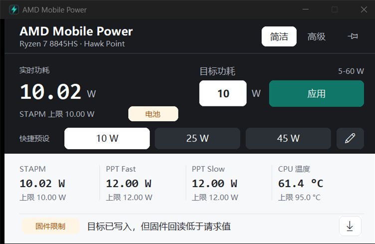
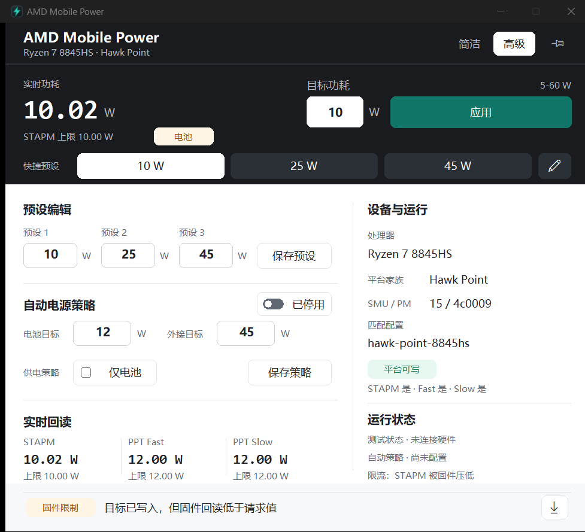
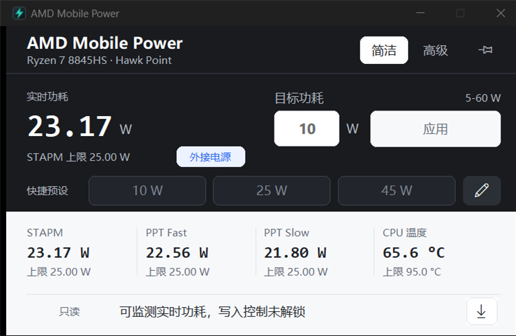

# Native UI Rewrite

Last updated: 2026-11-12

This document describes the current Rust native GUI. The card-stack layout used
by the earlier native preview has been removed.

## Design Direction

The application now uses one shell with two density levels:

- `简洁` is a compact power remote. It keeps only live power, target input,
  quick presets, four telemetry values, write state, and diagnostics export.
- `高级` is a maintenance workbench. It shares the same command deck and adds
  editable presets, battery/external power policy, device capability, runtime
  state, and STAPM/Fast/Slow read-back.

The visual source is the local read-only UI corpus at `D:\ui-database\corpus`.
The implementation takes principles from Apple HIG, Atlassian, Ant Design,
Primer, Fluent, Carbon, Spectrum, Paste, and React Aria. It does not copy
third-party brand assets or component code.

The current audit also applies
`D:\tong\docs\design\DESIGN_UI_PERCEPTION_AND_PATTERNS_2026-11-11.md`
(A2, frontend scope). The applicable contracts are:

- Read top-to-bottom and start-side first: identity, live power, target, then
  the single primary action. Mode controls stay secondary on the end side.
- Use one primary action per view. Presets use a neutral selected surface, not
  a saturated fill or a left color strip.
- Keep related labels and values within 4-8 px, fields within 16 px, and
  sections at 24 px or more. Structural rules are limited to ledgers, inputs,
  and focus boundaries.
- Keep the type ladder at five roles or fewer: 12-14 px labels/body, 18 px
  telemetry, 36 px live power, and one title role. Use normal and bold only;
  no light or thin weights.
- Status always pairs semantic color with text. Numbers use tabular figures
  and aligned units. Selected, focused, pressed, and disabled states remain
  visually distinct.
- Do not nest cards, add decorative side bars, or hide required actions behind
  hover. Keep button hit areas at 32-40 px.
- High contrast replaces the palette without changing geometry. It uses
  black/white/yellow rather than reusing normal-theme colors.

## Shell

The top of both modes is one continuous dark command deck:

- 56 px command bar with product identity, detected CPU/family/power line,
  `简洁` / `高级` segmented controls, and an icon-only topmost button.
- 160 px shared control area with measured STAPM power, power-line badge,
  target range, editable target, primary apply action, three quick presets,
  and an icon-only preset editor.
- A neutral boundary separates the command deck from the flat telemetry band.

The live power value is the only display-scale number. It never substitutes a
configured limit when the measured sample is missing. The primary teal action
is unique. Selected presets use a white surface and dark text; unselected
presets remain part of the dark deck instead of becoming separate cards. A
shared `CommandLayout` computes target, apply, preset, and edit positions from
the available client width.

## Simple Mode

Default logical client size: `600x360`; minimum: `560x360`. The minimum outer
window includes caption and frame dimensions through `AdjustWindowRectExForDpi`.

| Region | Geometry | Purpose |
| --- | --- | --- |
| Command bar | `0..56` | identity and mode controls |
| Control deck | `56..216` | live power, target, apply, presets, edit |
| Telemetry band | `230..296` | STAPM, PPT Fast, PPT Slow, CPU temperature |
| Status band | `312..352` | persistent write/read-back/error state |

The telemetry band is a flat ledger with vertical separators, not four cards.
The status band keeps diagnostics export available in read-only mode and
explains why write controls are disabled.

Simple mode is the default for a new UI state. Existing saved preferences still
restore the user's last selected mode.

## Advanced Mode

Logical client size: `780x680`.

The advanced window opens fit to the current monitor's work area instead of
always claiming the full 680 px height. When the work area is shorter (for
example 1080p at 150% scaling), the whole advanced canvas becomes scrollable:
mouse wheel, the vertical scrollbar, and keyboard focus all move through the
full content, and focusing a clipped control reveals it automatically. The
minimum advanced client is `760x420`; simple mode has no scrolling. Logical
screenshot fixtures keep the full `780x680` canvas so layout evidence stays
deterministic.

Advanced mode uses the same command deck, followed by one split workspace:

- Left column:
  - editable three-preset grid and save action,
  - battery/external power policy, a `仅电池` mode that leaves AC/external
    writes untouched, and save action,
  - live STAPM/Fast/Slow read-back ledger.
- Right column:
  - full-width processor and matched-profile rows, family, SMU, and PM table,
  - platform write support and STAPM/Fast/Slow field support,
  - worker state, saved policy, read-back health, and privacy-safe diagnostics
    export.

The workspace uses one continuous surface and structural rules. It does not
nest cards inside cards.

## Visual Tokens

### Surfaces

| Token | Value | Use |
| --- | --- | --- |
| `canvas` | `#F7F8FA` | window background |
| `surface` | `#FFFFFF` | advanced workspace |
| `surface-muted` | `#F7F8FA` | telemetry and status bands |
| `command` | `#191B1F` | command bar and control deck |
| `border` | `#CBD0D7` | workspace boundary |
| `rule` | `#E1E4E9` | internal separators |

### Semantic Color

| Token | Value | Use |
| --- | --- | --- |
| `accent` | `#107768` | apply action and focus |
| `accent-pressed` | `#0A5C50` | pressed primary action |
| `battery` | `#9C5207` | battery badge |
| `warning` | amber surface/text | firmware clamp and recovery |
| `error` | red surface/text | worker/platform failures |
| `success` | `#0D7551` | connected/read-back success text |

Neutral surfaces carry most of the window. Teal denotes actions, blue denotes
external power, and amber/red remain warning/error colors.

### High Contrast

The native shell reads the Windows high-contrast setting and switches the
entire custom canvas, owner-drawn controls, native edit backgrounds, focus
rings, semantic badges, and status bands to a black background with white text,
yellow structure, and black text on yellow primary actions. The test-only
`--ui-fixture high-contrast` path exercises the same palette without changing
the user's Windows accessibility settings.

### Type And Geometry

- `Consolas` is used for live power and telemetry numbers.
- `Microsoft YaHei UI` is used for Chinese labels and body text.
- Display power is 36 px bold at 96 DPI, with a separately aligned unit.
- Telemetry values are 18 px bold.
- Labels and status copy are 12-14 px.
- Controls and status chips use a `6 px` radius.
- Primary and secondary controls retain stable geometry in normal, selected,
  pressed, disabled, and focused states.

## State And Accessibility

- Windows dialog navigation handles Tab, Shift+Tab, Enter, and Space.
- Owner-drawn buttons paint a focus ring only for the actually focused control.
- Buttons retain native keyboard behavior and add hover feedback, hand cursors,
  and contrast-appropriate focus rings. `WM_COMMAND` ignores focus notifications
  when dispatching button actions.
- Native tooltips name the topmost, preset-edit, and diagnostics icons and expose
  the full processor, profile, and status strings.
- Text inputs and button windows paint their matching backdrop before rounded
  content so dark-shell corners never leak light default-control pixels.
- Read-only mode keeps editable geometry visible but disabled and states
  `只读 · 写入控制未解锁` in the persistent status band.
- Missing numeric data renders `--`.
- Long operation results are held for five seconds so telemetry ticks do not
  erase the user's confirmation.
- Worker-offline, unsupported-platform, firmware-clamp, and long-error states can
  be rendered through the test-only `--ui-fixture` flag without starting a
  hardware worker or requesting a power write.
- The `仅电池` policy toggle is verified through the same fixture path. The
  diagnostics JSON now includes the current UI mode, topmost state, policy
  enabled/battery-only flags, and tray/taskbar icon availability, all without
  paths or process IDs.
- Switching modes preserves worker connection, presets, policy, target,
  topmost state, and diagnostics availability.
- A modified target survives telemetry refreshes and mode switches. Preset
  fields are refreshed only when profile identity or effective bounds change,
  so the one-second telemetry loop no longer erases unsaved edits.
- The local machine keeps editable `10/25/45 W` presets and a `45 W` ceiling;
  automatic battery/AC policy is disabled. `10 W` is the manual night preset,
  not a global application restriction.

## Rendering

- The parent window paints into a compatible memory DC and blits once.
- `WS_CLIPCHILDREN` prevents parent repaint from erasing native inputs/buttons.
- Interactive text fields and owner-drawn buttons stay as native child windows
  for keyboard and accessibility support.
- The embedded application icon is used in the title bar and tray.
- Screenshot capture first attempts a foreground DWM-frame copy. When the
  foreground lock prevents activation, the script records
  `PrintWindow(normalized-fallback)` and verifies the result is nonblank; it
  does not label that result as a foreground screenshot.

## Runtime Evidence

### 2026-11-12 Compact Polish

- Rust GUI: 42 tests passed (20 library, 22 main); Rust probe: 7 tests passed.
- Clippy with `-D warnings`, the offline native Release build, both C++ policy
  test executables, and the .NET Release build passed. .NET tests: 72 passed.
- Live read-only GUI/worker verification passed at `25/25/25 W` on external
  power: target draft retention, unsaved preset retention across refresh,
  focus-notification filtering, minimum resize bounds, diagnostics, mode
  switching, topmost, three minimize/restore cycles, close-to-tray, tray
  restore, and single-instance wake.
- Follow-up review found one regression on 1080p/150% displays: the advanced
  minimum height exceeded the work area and trapped the status bar behind the
  taskbar. The advanced shell now fits the monitor work area and scrolls its
  full content; verified by the maintained harness (mouse wheel, scrollbar,
  keyboard reveal, bottom-button bounds) at native scale and the 150% fixture.
- A separate explicit `-ExecuteNoChangePreset` run applied the existing
  `25/25/25 W` through the simple-mode preset button and required fresh matching
  telemetry. The verifier now derives that isolated preset from live limits
  rather than requiring a fixed 45 W starting state.
- Logical DPI fixtures passed: simple `600x360`, `750x450`, `900x540` and
  advanced `780x680`, `975x850`, `1170x1020` at 100/125/150% respectively.
  These do not replace real Windows monitor-transition evidence.
- Screenshots were reviewed by individual header, live-power, target, preset,
  telemetry, status, editor, policy, and device regions. High-contrast and
  logical 100/150% crops were reviewed separately. The final captures use the
  recorded PrintWindow fallback; the first pass used foreground captures.
- Evidence before packaging lives under ignored `artifacts/verify/`:
  `native-ui-polish-live-interaction-2026-11-12.json`,
  `native-ui-polish-dpi-2026-11-12.json`, and `native-ui-polish-final.json`.
  These describe a development tree; clean-package evidence is recorded by the
  release gate before promotion.
- The maintained development summary is
  `docs/evidence/ui/native-ui-polish-development-2026-11-12.json`. The final
  simple/advanced screenshots and read-only footer are retained below. The
  firmware-clamp captures use isolated fixture telemetry, not a hardware test.







### Earlier Rewrite Evidence

At 125% Windows scaling:

- `cargo test --manifest-path native\rust-gui\Cargo.toml --locked --offline`:
  38/38 passed.
- `cargo clippy --manifest-path native\rust-gui\Cargo.toml --locked --offline
  -- -D warnings`: PASS.
- `native\verify-rust-gui.ps1 -NoBuild -VerifyWorker -VerifyWriteControls`:
  PASS for view modes, topmost, read-only worker status, diagnostics, preset
  editing, minimize/restore, close-to-tray, tray restore, and single-instance
  wake.
- `native\verify-rust-gui.ps1 -NoBuild -VerifyWriteControls -UiFixture
  firmware-clamp`: PASS for the battery-only policy toggle through the exported
  diagnostics JSON without hardware access.
- `native\verify-rust-gui.ps1 -NoBuild -VerifyWriteControls -UiFixture
  high-contrast`: PASS with `ui.highContrast=true` in diagnostics while the
  isolated fixture keeps Windows accessibility settings unchanged.
- The same verifier checks the diagnostics `ui` block for the active
  simple/advanced mode, topmost state, `taskbarIconAvailable=true`, and
  `trayIconId=1`.
- `native\capture-rust-gui-redesign.ps1 -Fixture firmware-clamp
  -FocusControlId 316`: PASS with the target input verified as the actual
  focused child and the focus ring visible in simple and advanced captures.
- `native\capture-rust-gui-redesign.ps1 -Fixture high-contrast`: PASS for the
  complete black/white/yellow simple and advanced states.
- `native\verify-dpi-fixtures.ps1` renders the complete simple and advanced
  shells at test-only logical 100%, 125%, and 150% scaling. Client sizes match
  the design contract exactly (`640x392` / `780x680` at 100%,
  `800x490` / `975x850` at 125%, and `960x588` / `1170x1020` at 150%), and
  region-by-region inspection found no clipped header, target, preset, metric,
  or status text.
- No power write was requested during UI verification.

Evidence and screenshots:

- `docs/evidence/ui/native-redesign-2026-11-11.json`
- `docs/evidence/ui/native-ui-failure-states-2026-11-11.json`
- `assets/native-gui-redesign-simple-2026-11-11.png` (`802x530` physical)
- `assets/native-gui-redesign-advanced-2026-11-11.png` (`977x890` physical)
- `assets/native-gui-10w-simple-2026-11-12.png` (`802x529` physical)
- `assets/native-gui-10w-advanced-2026-11-12.png` (`977x889` physical)
- `assets/native-gui-10w-1.0.10-simple-2026-11-12.png` (`802x529` physical)
- `assets/native-gui-10w-1.0.10-advanced-2026-11-12.png` (`977x889` physical)
- `assets/native-gui-redesign-readonly-simple-2026-11-11.png`
- `assets/native-gui-redesign-readonly-advanced-2026-11-11.png`
- `assets/native-ui-worker-offline-simple-2026-11-11.png`
- `assets/native-ui-firmware-clamp-simple-2026-11-11.png`
- `assets/native-ui-unsupported-platform-simple-2026-11-11.png`
- `assets/native-ui-long-error-simple-2026-11-11.png`
- `docs/evidence/ui/native-battery-only-policy-2026-11-11.json`
- `docs/evidence/ui/native-battery-only-capture-2026-11-11.json`
- `docs/evidence/ui/native-focus-2026-11-11.json`
- `assets/native-battery-only-simple-2026-11-11.png`
- `assets/native-battery-only-advanced-2026-11-11.png`
- `assets/native-focus-simple-2026-11-11.png`
- `assets/native-focus-advanced-2026-11-11.png`
- `docs/evidence/ui/native-high-contrast-2026-11-11.json`
- `assets/native-high-contrast-simple-2026-11-11.png`
- `assets/native-high-contrast-advanced-2026-11-11.png`
- `docs/evidence/ui/native-packaged-1.0.0-ui-2026-11-11.json`
- `docs/evidence/ui/native-dpi-100-125-150-2026-11-12.json`
- `docs/evidence/ui/native-10w-capture-2026-11-12.json`
- `docs/evidence/ui/native-deployed-1.0.10-capture-2026-11-12.json`

Reproduction:

```powershell
pwsh -NoProfile -ExecutionPolicy Bypass `
  -File native\capture-rust-gui-redesign.ps1 `
  -FilePrefix native-gui-redesign
```

## Remaining UI Gates

- The logical 100%/150% layout fixtures pass without changing system settings.
  A final OS-level check in real 100% and 150% Windows sessions remains open so
  monitor transitions and shell metrics are covered by physical session
  evidence rather than the test-only scale override.

The 10 W local policy captures also verify that the target editor follows the
selected preset instead of retaining the old default value. Stable-local
promotion to `C:\RyzenAdj` is accepted for the verified 8845HS platform. Public
GitHub Release and Bilibili upload remain unapproved until human review and the
remaining external gates complete.
