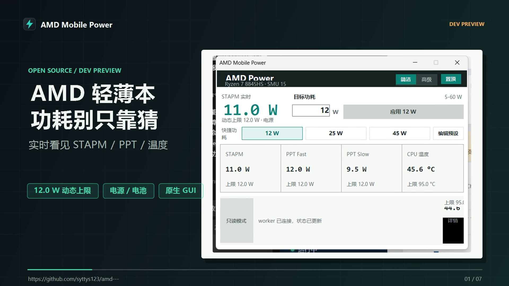
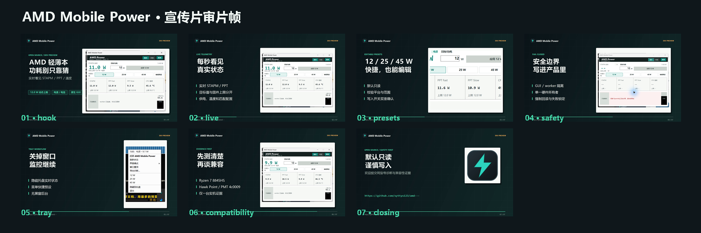

# Promotional Video Draft

The first development-preview video is generated from the reviewed screenshots,
not from live hardware during rendering. Rendering starts no application
process and performs no hardware write.

## Current Draft

The current draft is 71.9 seconds at 1920x1080, 25 fps, with H.264 video, AAC
stereo audio, Chinese narration, and simplified-Chinese captions. It is marked
`DRAFT_FOR_HUMAN_REVIEW`; it is not approved for upload.





Local render:

```text
artifacts/media/amd-mobile-power-promo-draft-2026-11-10/
  amd-mobile-power-intro-draft-2026-11-10.mp4
```

- Size: 17,923,909 bytes.
- SHA256:
  `11200e358b0fe92cac2a96c9ef1d3d3991a6896255e6cc64f2b537060a8a6ccd`.
- Full-file FFmpeg decode: PASS.
- Audio level: mean `-21.1 dB`, peak `-1.3 dB`.
- Title, caption, and bullet safe-width checks: PASS.
- Scene count: 7.

Machine-readable evidence:
`docs/evidence/media/promo-draft-2026-11-10.json`.

## Render

```powershell
.\render-promo.ps1
```

The default output is written under the ignored `artifacts/media` directory:

```text
artifacts/media/amd-mobile-power-promo-draft-2026-11-10/
  amd-mobile-power-intro-draft-2026-11-10.mp4
  captions-zh.srt
  cover-draft.png
  promo-manifest.json
  review/
    review-01-hook.png ... review-07-closing.png
    contact-sheet.png
```

Generated scene PNGs and WAV files are retained by default for review. Use
`-CleanWorkingFiles` when only the final MP4, captions, cover, manifest, and
review frames are needed.

## Review Gate

- The video is labelled as a development preview.
- It states that only one physical AMD laptop has full evidence.
- It does not claim universal AMD laptop support.
- It does not imply that development builds are ready for unsupervised writes.
- No terminal, personal path, account name, notification, or unrelated desktop
  content appears.
- The project owner reviews the final voice, pacing, claims, and cover before
  any authenticated upload.
