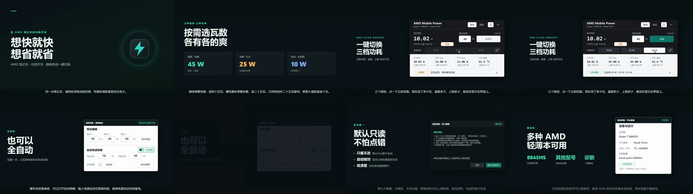
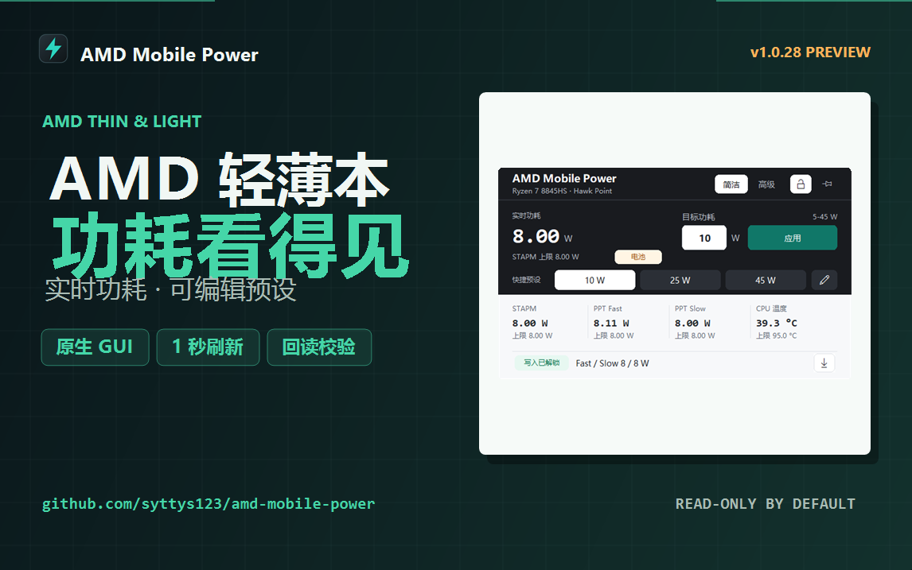

# Promotional Video Draft

The current promotional video is the 42.5-second v9 cut generated from the
HTML/Playwright pipeline in `media/promo-html`. The main interaction scene is a
screen recording of the real GUI; the consent dialog, advanced policy panel,
and device panel are real 1.0.28/1.0.29 captures. Only the pointer, captions,
transitions, and music are composited. Rendering and reviewing the video never
write power limits.

## Current Draft

- Duration: 42.5 seconds.
- Format: 1920x1080, 30 fps, H.264 video and AAC stereo audio (48 kHz).
- Size: 4,426,857 bytes.
- SHA256:
  `ca887aa5ec3b55157e91206781d15f502e3fdede7c3c7e3907621ac331863023`.
- Scenes: 7 (hook, three-preset explanation, live UI demo, auto policy, write
  unlock safety, compatibility/diagnostics, closing).
- Narration: none. Simplified-Chinese subtitles are burned into the video.
- Music: `Deliberate Thought` by Kevin MacLeod (incompetech.com), CC BY 4.0.
  The attribution must stay in any public description.
- Status: `DRAFT_FOR_HUMAN_REVIEW`; not approved for upload.

Local render:

```text
artifacts/media/promo-html-v1/amd-mobile-power-promo-2026-11-14-v9.mp4
```

Machine-readable evidence:
`docs/evidence/media/native-promo-1.0.29-draft-2026-11-14.json`
(1.0.29 reuses the identical 1.0.28 UI capture set).

## Review Assets



Bilibili 1146x717 cover:



- Contact sheet: 1920x540, 8 frames, SHA256
  `7fd4a0303ae8d2c4ad40cfcf8e18fd641196c1a869daf0c5fbb1c78221fb8997`.
- Cover: 1146x717, text-safe-width PASS, SHA256
  `89ea363925d947cc1bede51440a6dc9f7e61cf3f302494e738da1a9b62be45ad`.

## Verification

The evidence file records the video hash, codecs, dimensions, frame rate,
duration, full-decode result, scene count, and the music licence. Re-check a
local file without editing it:

```powershell
ffprobe -v error -show_entries `
  format=duration,size -show_entries `
  stream=codec_name,width,height,r_frame_rate,sample_rate,channels `
  -of json artifacts\media\promo-html-v1\amd-mobile-power-promo-2026-11-14-v9.mp4
ffmpeg -v error -i artifacts\media\promo-html-v1\amd-mobile-power-promo-2026-11-14-v9.mp4 -f null -
Get-FileHash `
  artifacts\media\promo-html-v1\amd-mobile-power-promo-2026-11-14-v9.mp4 `
  -Algorithm SHA256
```

The full decode must produce no output and exit with code 0.

## Rebuild Notes

The HTML pipeline lives in `media/promo-html`:

- `index.html` and `src/scenes.js` define scene order, durations, and subtitle
  text.
- `build/record.js` drives Chromium through Playwright and records frames.
- `build/make-audio.ps1` muxes the licensed music bed (and optional SAPI voice,
  which v9 does not use) against the scene timeline.
- Frames are encoded with FFmpeg; the historical working files stay under the
  ignored `media/promo-html/build` directory.

## Review Gate

- The video is labelled as a development preview.
- It states that only one physical AMD laptop has full evidence.
- It does not claim universal AMD laptop support.
- It does not imply that development builds are ready for unsupervised writes.
- No terminal, personal path, account name, notification, or unrelated desktop
  content appears.
- The project owner reviews pacing, subtitles, music, claims, and cover before
  any authenticated upload.
