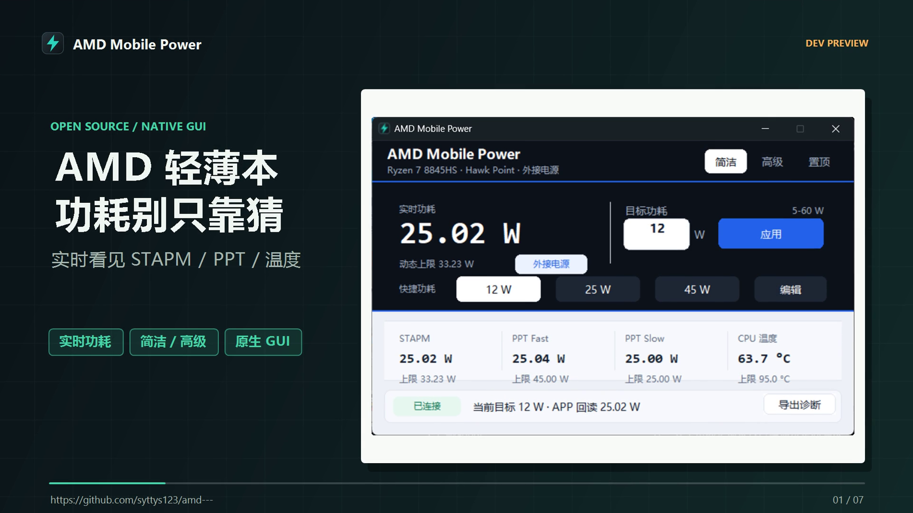
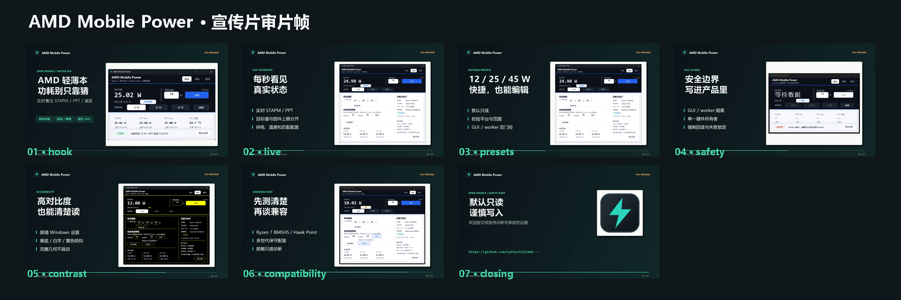
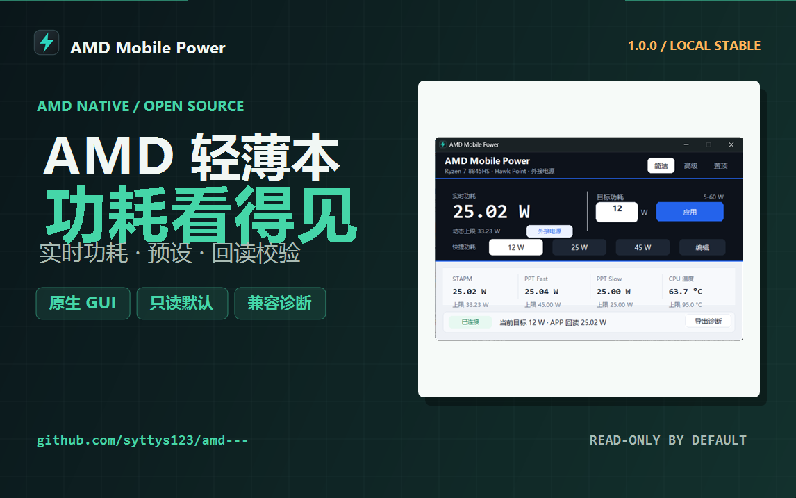

# Promotional Video Draft

The native development-preview video is generated from the reviewed screenshots,
not from live hardware during rendering. Rendering starts no application
process and performs no hardware write.

## Current Draft

The current draft is 74.2 seconds at 1920x1080, 25 fps, with H.264 video, AAC
stereo audio, Chinese narration, and simplified-Chinese captions. It is marked
`DRAFT_FOR_HUMAN_REVIEW`; it is not approved for upload.





Bilibili 1146x717 cover:



Local render:

```text
artifacts/media/amd-mobile-power-native-promo-draft-2026-11-11/
  amd-mobile-power-native-intro-draft-2026-11-11.mp4
```

- Size: 20,542,287 bytes.
- SHA256:
  `0c2045722273783038c65b2f586e8590fadf09f5a6612b5613cae62b7affb276`.
- Full-file FFmpeg decode: PASS.
- Audio level: mean `-21.3 dB`, peak `-1.1 dB`.
- Title, caption, and bullet safe-width checks: PASS.
- Scene count: 7.

Machine-readable evidence:
`docs/evidence/media/native-promo-draft-2026-11-11.json`.

Verify the local MP4 and every committed review/source hash without rerendering:

```powershell
.\verify-media.ps1 `
  -VideoPath .\artifacts\media\amd-mobile-power-native-promo-draft-2026-11-11\amd-mobile-power-native-intro-draft-2026-11-11.mp4 `
  -ManifestPath .\artifacts\media\amd-mobile-power-native-promo-draft-2026-11-11\promo-manifest.json `
  -EvidencePath .\docs\evidence\media\native-promo-draft-2026-11-11.json
```

The verifier checks the manifest, evidence, SHA256, codecs, dimensions, frame
rate, duration, full decode, mean/peak audio levels, captions, storyboard,
renderer, video cover, contact sheet, and the 1146x717 Bilibili cover.

Regenerate the Bilibili cover:

```powershell
.\render-launch-cover.ps1 `
  -OutputPath .\docs\assets\bilibili-cover-native-2026-11-11.png `
  -ScreenshotPath .\assets\native-gui-redesign-simple-2026-11-11.png `
  -Eyebrow "AMD NATIVE / OPEN SOURCE" `
  -PreviewLabel "1.0.0 / LOCAL STABLE" `
  -Subtitle "实时功耗 · 预设 · 回读校验" `
  -PillText "原生 GUI|只读默认|兼容诊断" `
  -FooterRight "READ-ONLY BY DEFAULT"
```

The cover uses the verified clean-package screenshot, application icon, and
reviewed launch copy. Rendering fails if the main text exceeds its safe width.

## Render

```powershell
.\render-promo.ps1 `
  -Storyboard .\media\promo-native\storyboard.json `
  -OutputDirectory .\artifacts\media\amd-mobile-power-native-promo-draft-2026-11-11 `
  -OutputName amd-mobile-power-native-intro-draft-2026-11-11.mp4
```

The default output is written under the ignored `artifacts/media` directory:

```text
artifacts/media/amd-mobile-power-native-promo-draft-2026-11-11/
  amd-mobile-power-native-intro-draft-2026-11-11.mp4
  captions-zh.srt
  cover-draft.png
  promo-manifest.json
  review/
    review-01-hook.png ... review-07-closing.png
    contact-sheet.png
```

Generated scene PNGs and WAV files are retained by default for review. Use
`-CleanWorkingFiles` when only the final MP4, captions, cover, manifest, and
review frames are needed.

The renderer enforces scene text bounds before encoding and runs full-decode,
mean-volume, and peak-volume checks before writing the manifest. A failed text
or audio bound stops the render instead of producing an accepted draft.

## Review Gate

- The video is labelled as a development preview.
- It states that only one physical AMD laptop has full evidence.
- It does not claim universal AMD laptop support.
- It does not imply that development builds are ready for unsupervised writes.
- No terminal, personal path, account name, notification, or unrelated desktop
  content appears.
- The project owner reviews the final voice, pacing, claims, and cover before
  any authenticated upload.
