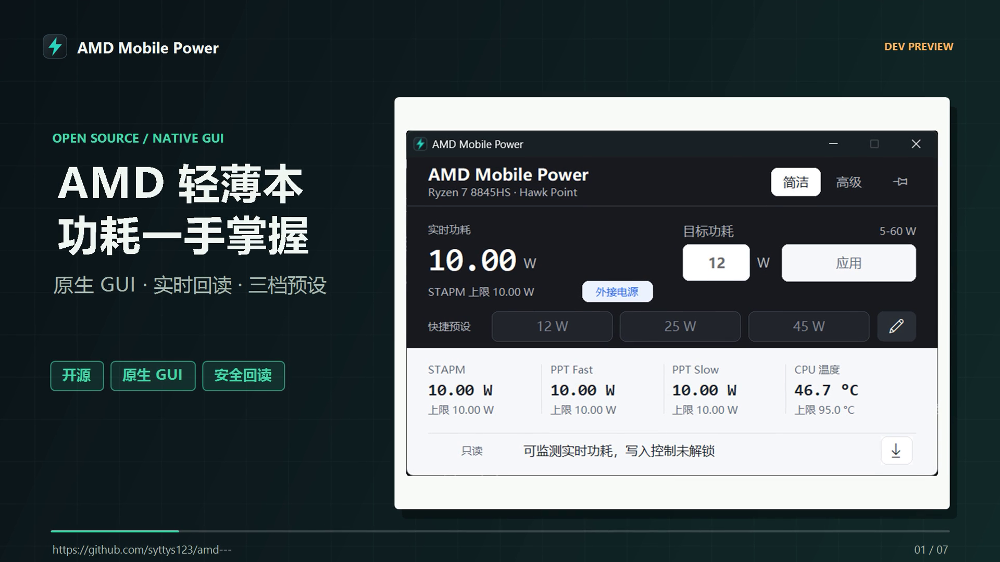
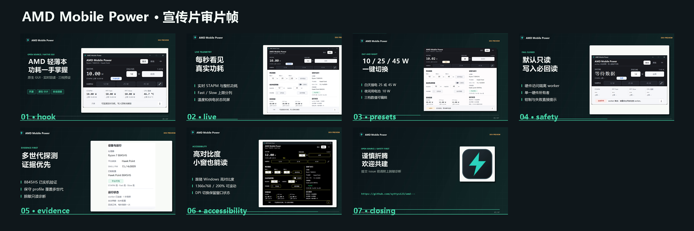
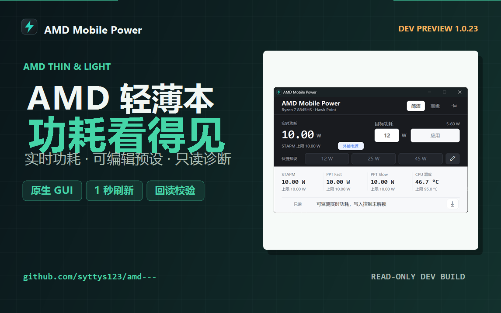

# Promotional Video Draft

The native development-preview video is generated from the reviewed screenshots,
plus one pre-recorded GUI fixture clip for the presets scene. Rendering itself
starts no application process and performs no hardware write.

## Current Draft

The current draft is 109.2 seconds at 1920x1080, 25 fps, with H.264 video, AAC
stereo audio, Chinese narration, and simplified-Chinese captions. It uses the
`1.0.22-native` capture set (layout identical to `1.0.23`) together with the
high-contrast, worker-offline, and device-panel states. Each scene uses its own
camera motion (zoom or pan) instead of a static card, and the presets scene
plays a recorded GUI clip (`25 -> 12 -> 45 W` preset clicks under the
read-only `firmware-clamp` fixture) filling its card edge to edge. A thin
accent progress bar runs along the bottom of the whole video. It is marked
`DRAFT_FOR_HUMAN_REVIEW`; it is not approved for upload.





Bilibili 1146x717 cover:



Local render:

```text
artifacts/media/amd-mobile-power-promo-1.0.23-v2-2026-11-13/
  amd-mobile-power-intro-1.0.23-v2-2026-11-13.mp4
```

- Size: 23,804,272 bytes.
- SHA256:
  `42aef6cb3d9ea11ac512e26049a269c4f2ccca87e4da71986ac42050ac26d1ce`.
- Full-file FFmpeg decode: PASS.
- Audio level: mean `-20.7 dB`, peak `-1.2 dB`.
- Title, caption, and bullet safe-width checks: PASS.
- Scene count: 7.

Machine-readable evidence:
`docs/evidence/media/native-promo-1.0.23-draft-2026-11-13.json`.

Verify the local MP4 and every committed review/source hash without rerendering:

```powershell
.\verify-media.ps1 `
  -VideoPath .\artifacts\media\amd-mobile-power-promo-1.0.23-v2-2026-11-13\amd-mobile-power-intro-1.0.23-v2-2026-11-13.mp4 `
  -ManifestPath .\artifacts\media\amd-mobile-power-promo-1.0.23-v2-2026-11-13\promo-manifest.json `
  -EvidencePath .\docs\evidence\media\native-promo-1.0.23-draft-2026-11-13.json
```

The verifier checks the manifest, evidence, SHA256, codecs, dimensions, frame
rate, duration, full decode, mean/peak audio levels, captions, storyboard,
renderer, video cover, contact sheet, and the 1146x717 Bilibili cover.

## Render

```powershell
.\render-promo.ps1 `
  -Storyboard .\media\promo-native\storyboard-1.0.23.json `
  -OutputDirectory .\artifacts\media\amd-mobile-power-promo-1.0.23-v2-2026-11-13 `
  -OutputName amd-mobile-power-intro-1.0.23-v2-2026-11-13.mp4 `
  -MusicPath .\artifacts\media\promo-music-bed-2026-11-12.wav
```

The default output is written under the ignored `artifacts/media` directory:

```text
artifacts/media/amd-mobile-power-promo-1.0.23-v2-2026-11-13/
  amd-mobile-power-intro-1.0.23-v2-2026-11-13.mp4
  captions-zh.srt
  cover-draft.png
  promo-manifest.json
  review/
    review-01-hook.png ... review-07-closing.png
    contact-sheet.png
```

Generated scene PNGs and WAV files are retained by default for review. Use
`-CleanWorkingFiles` when only the final MP4, captions, cover, manifest, and
review frames are needed.

The renderer enforces scene text bounds before encoding and runs full-decode,
mean-volume, and peak-volume checks before writing the manifest. A failed text
or audio bound stops the render instead of producing an accepted draft.

## Review Gate

- The video is labelled as a development preview.
- It states that only one physical AMD laptop has full evidence.
- It does not claim universal AMD laptop support.
- It does not imply that development builds are ready for unsupervised writes.
- No terminal, personal path, account name, notification, or unrelated desktop
  content appears.
- The project owner reviews the final voice, pacing, claims, and cover before
  any authenticated upload.
